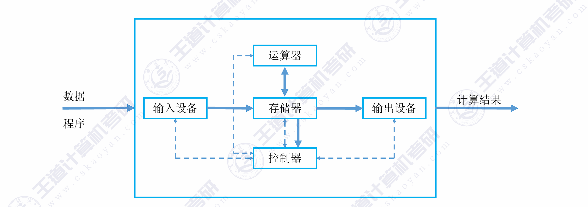
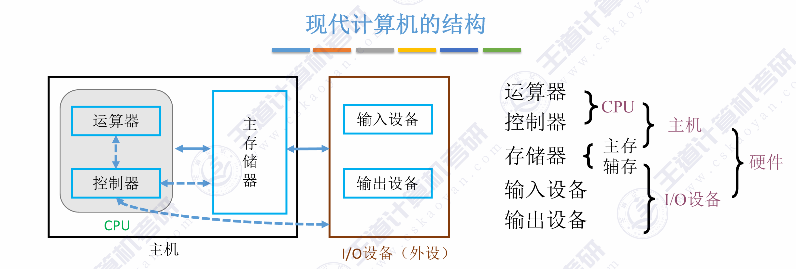
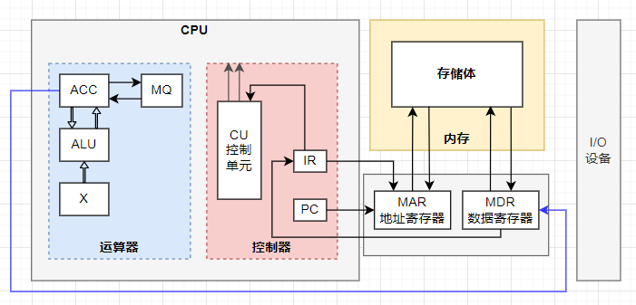
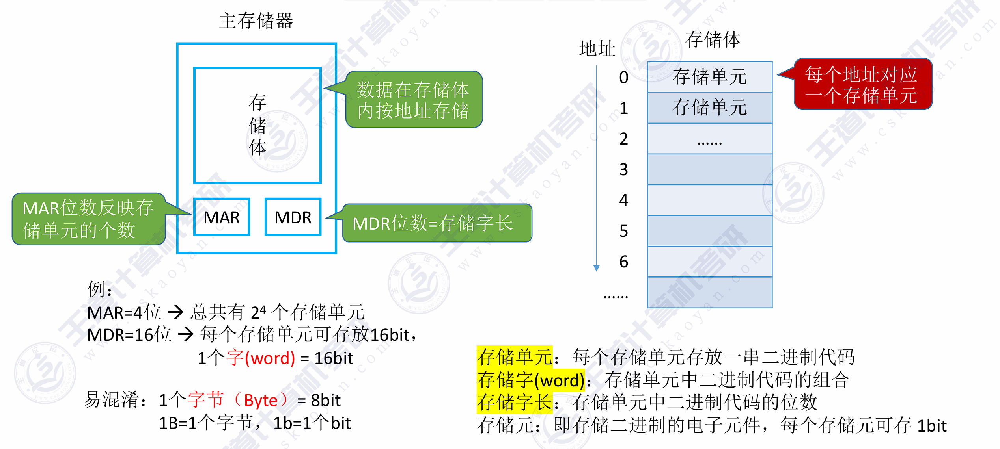
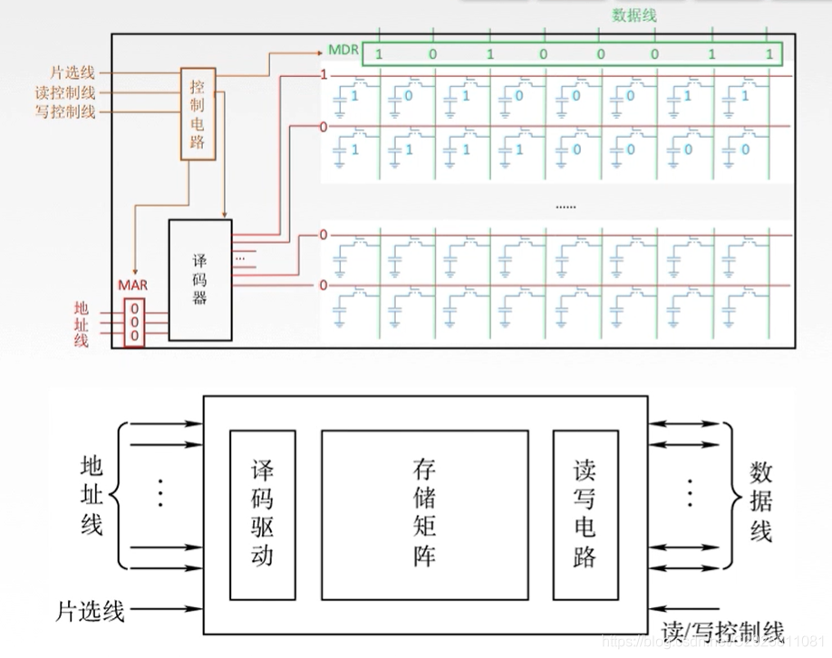
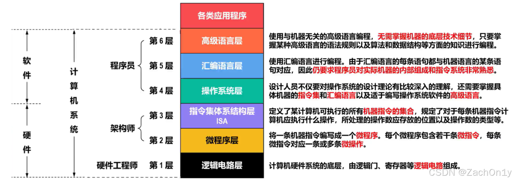
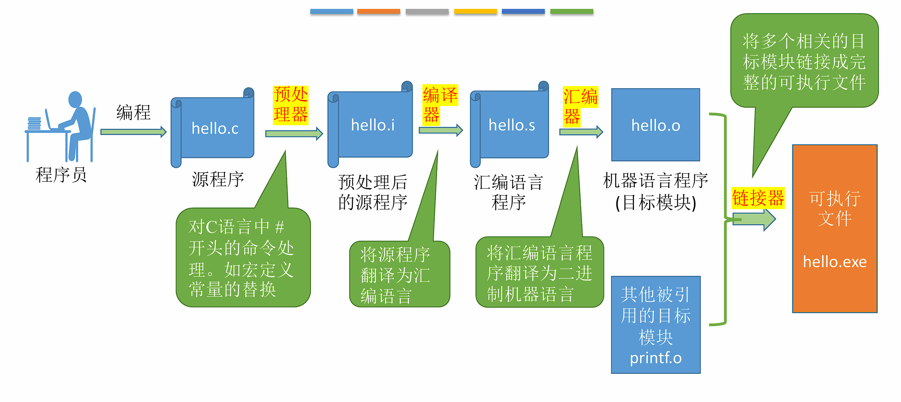

<h2 align="center">第一章 计算机系统概述</h2>


> **408 高频考点提醒**：
> - 冯·诺依曼架构核心："存储程序"——指令和数据同等地位、二进制存放、按地址顺序执行
> - 五大部件：输入设备、输出设备、存储器（MAR/MDR）、运算器（ALU/ACC）、控制器（PC/IR/CU）
> - MAR 位数决定寻址范围（$2^n$），MDR 位数 = 存储字长
> - CPU = 运算器 + 控制器；主机 = CPU + 主存；外设 = I/O 设备
> - 现代计算机以存储器为中心（DMA 不经运算器）
> - 三种语言：机器语言（二进制）→ 汇编语言（助记符）→ 高级语言（C/Java）
> - 编译（整体翻译，生成目标代码）vs 解释（逐句翻译，不生成目标代码）
> - ISA = 软件与硬件的分界面/契约（同一 ISA 可有不同微架构实现）
> - 指令 = **操作码 + 地址码**；指令和数据同存一个存储器，靠**取指周期/执行周期**区分
> - CPU 只能从**主存**取指令和操作数，外存程序须先调入主存
> - 三种时间单位：**指令周期 > 机器周期（CPU 周期）> 时钟周期**；CPI 由系统结构/指令集/组织决定，**与主频无关**
> - 性能公式：CPU 执行时间 = 指令数 × CPI × T = 指令数 × CPI / f
> - 存储器带宽计算（含 DDR 双沿）
---
### （一）计算机发展历程

> **408 大纲说明**：本节内容已从考纲中删除，简要了解即可，不作为考试重点。

计算机按原理分为**电子模拟计算机**与**电子数字计算机**：数字计算机**按位运算、不连续地跳动计算**（数值用 0/1 表示）；模拟计算机数值由**连续量**（如电压）表示、运算过程连续。数字计算机按用途又分为**专用计算机**（最有效、最经济、最快速，但适应性很差）与**通用计算机**（适应性强，但牺牲了效率、速度与经济性）。

#### 一、计算机的发展阶段

| 阶段 | 年代 | 主要器件 | 特点 |
|:---|:---|:---|:---|
| <nobr>**第一代**</nobr> | <nobr>1946–1957</nobr> | 电子管 | 体积大、功耗高、可靠性差，使用机器语言 |
| <nobr>**第二代**</nobr> | <nobr>1958–1964</nobr> | 晶体管 | 体积缩小、功耗降低，出现高级语言（FORTRAN） |
| <nobr>**第三代**</nobr> | <nobr>1965–1971</nobr> | 中小规模集成电路 | 出现操作系统、微型计算机雏形 |
| <nobr>**第四代**</nobr> | <nobr>1972–至今</nobr> | 大规模/超大规模集成电路 | 微处理器诞生、PC 普及、网络时代 |

- **1946 年**：第一台通用电子数字计算机 **ENIAC** 诞生于宾夕法尼亚大学。
- **冯·诺依曼**：1945 年提出"存储程序"概念，奠定了现代计算机体系结构的基础。

#### 二、摩尔定律

集成电路上可容纳的晶体管数目，约每隔 **18-24 个月**便会增加一倍，性能也将提升一倍。

---

### （二）计算机硬件的基本组成

#### 一、冯·诺依曼架构

##### 1. 五大部件

冯·诺依曼计算机由**五大部件**组成：

| 部件 | 功能 |
|:---|:---|
| **输入设备** | 将程序和数据转换成计算机能识别的形式（如键盘、鼠标） |
| **输出设备** | 将计算机处理结果转换成人类能识别的形式（如显示器、打印机） |
| **存储器** | 存放**指令和数据**（两者以同等地位存放） |
| **运算器** | 执行**算术运算**和**逻辑运算** |
| **控制器** | 控制各部件协调工作，按顺序从存储器取指令并执行 |

##### 2. 核心理念："存储程序"

- **指令和数据**以同等地位、用**二进制**形式事先输入主存储器
- 按**地址**寻访，从存储器中逐条取出指令**顺序执行**
- 程序执行过程就是**不断取指令、分析指令、执行指令**的循环

##### 3. 冯·诺依曼架构的特点

| 特点 | 说明 |
|:---|:---|
| **五大部件** | 输入设备、输出设备、存储器、运算器、控制器 |
| **存储程序** | 指令和数据**无区别地**以同等地位存放在**同一存储器**中 |
| **指令组成** | 指令由**操作码**（指明操作的性质）和**地址码**（指明操作数在存储器中的位置）组成（详见第 4 章） |
| **以运算器为中心** | I/O 设备与存储器之间的数据传送需经过运算器 |
| **指令顺序执行** | 按地址顺序取指执行，由程序计数器 PC 指示下条指令地址 |
| **二进制表示** | 指令和数据均用二进制编码——0/1 恰好与逻辑电路的**高、低电平**对应，实现简单且可靠，即由**物理器件的性能**决定 |

> **考点**：冯·诺依曼型计算机设计思想的两大核心——**存储程序**与**二进制表示**。
> **易错点**：指令和数据**无区别地**存放在同一存储器中，区分它们**不是靠存储位置，而是靠周期**——**取指周期**从存储单元取出的是指令，**执行周期**取出的是数据（由控制器区分）。

#### 二、现代计算机架构

现代计算机将冯·诺依曼架构进行了两方面优化：

##### 1. 以存储器为中心

传统冯·诺依曼机以**运算器**为中心，I/O 操作需要经过运算器，效率低下。现代计算机优化为以**存储器**为中心，I/O 设备可直接与存储器交换数据（**DMA 方式**）。



##### 2. CPU = 运算器 + 控制器

- **CPU（中央处理器）**：将运算器和控制器集成在一个芯片内
- **主机** = CPU + 主存储器（内存）
- **I/O 设备（外设）** = 输入设备 + 输出设备 + 辅助存储器（外存）



#### 三、各个硬件的工作原理



##### 1. 主存储器

主存储器（内存）由大量**存储单元**组成，每个存储单元有唯一的**地址**。



| 部件 | 全称 | 功能 | 位数 |
|:---|:---|:---|:---|
| **MAR** | 存储器地址寄存器 | 存放要访问的存储单元地址 | MAR 位数 = 地址线位数 → 决定最大寻址范围 |
| **MDR** | 存储器数据寄存器 | 存放从/向存储器读出/写入的数据 | MDR 位数 = 数据线位数 → 通常等于存储字长 |

> - **存储单元**：每个存储单元存放一串二进制代码，称为**存储字**，位数称为**存储字长**。
> - **寻址范围**：若 MAR 有 $n$ 位，则可寻址 $2^n$ 个存储单元。
> - **容量**：存储容量 = 存储单元个数 × 存储字长（如 $2^{16} \times 16$ 位）。

**存储器的基本结构**：



##### 2. 运算器

运算器用于进行**算术运算**和**逻辑运算**，核心部件：

<table style="width: 100%; border: none;">
  <tr style="border: none;">
    <td style="width: 20%; vertical-align: top; border: none; padding-right: 20px;">
      
    </td>
    <td style="width: 80%; vertical-align: top; border: none;">
      <table style="width: 100%; border-collapse: collapse; text-align: left;">
        <thead>
          <tr>
            <th style="border: 1px solid #dfe2e5; padding: 6px 13px; background-color: #f6f8fa;">寄存器</th>
            <th style="border: 1px solid #dfe2e5; padding: 6px 13px; background-color: #f6f8fa;">全称</th>
            <th style="border: 1px solid #dfe2e5; padding: 6px 13px; background-color: #f6f8fa;">功能</th>
          </tr>
        </thead>
        <tbody>
          <tr>
            <td style="border: 1px solid #dfe2e5; padding: 6px 13px;"><strong>ACC</strong></td>
            <td style="border: 1px solid #dfe2e5; padding: 6px 13px;">累加器 (Accumulator)</td>
            <td style="border: 1px solid #dfe2e5; padding: 6px 13px;">存放操作数或运算结果</td>
          </tr>
          <tr>
            <td style="border: 1px solid #dfe2e5; padding: 6px 13px;"><strong>MQ</strong></td>
            <td style="border: 1px solid #dfe2e5; padding: 6px 13px;">乘商寄存器 (Multiplier-Quotient)</td>
            <td style="border: 1px solid #dfe2e5; padding: 6px 13px;">乘除法时存放操作数或结果</td>
          </tr>
          <tr>
            <td style="border: 1px solid #dfe2e5; padding: 6px 13px;"><strong>X</strong></td>
            <td style="border: 1px solid #dfe2e5; padding: 6px 13px;">通用操作数寄存器</td>
            <td style="border: 1px solid #dfe2e5; padding: 6px 13px;">存放操作数</td>
          </tr>
          <tr>
            <td style="border: 1px solid #dfe2e5; padding: 6px 13px;"><strong>ALU</strong></td>
            <td style="border: 1px solid #dfe2e5; padding: 6px 13px;">算术逻辑单元 (Arithmetic Logic Unit)</td>
            <td style="border: 1px solid #dfe2e5; padding: 6px 13px;">执行算术/逻辑运算</td>
          </tr>
        </tbody>
      </table>
    </td>
  </tr>
</table>


> PSW（程序状态字寄存器）/ FR（标志寄存器）：位于**运算器内**（标志由 ALU 产生），存放**两类信息**——① 指令执行结果的**状态信息**（有无进位、有无溢出、结果正负、结果是否为零、奇偶标志位等）；② **控制信息**（如允许中断等）。有些机器将 PSW 称为标志寄存器 FR。
>
> **易错点**：**ALU 属于组合逻辑电路，没有记忆（存储）功能**，不能存放运算结果——运算结果应存入**通用寄存器**（如 ACC）；控制器负责理解、解释并执行指令，同样**不存放**运算结果。

##### 3. 控制器

控制器是计算机的**指挥中心**，负责：

- 正确的分析和指向每条指令：取指令  $ \to $ 分析指令  $ \to $ 执行指令。
- 保证指令按照规定序列自动连续的执行。
- 对各种异常情况和请求及时响应和处理。

<table style="width: 100%; border: none;">
  <tr style="border: none;">
    <td style="width: 20%; vertical-align: top; border: none; padding-right: 20px;">
      
    </td>
    <td style="width: 80%; vertical-align: top; border: none;">
      <table style="width: 100%; border-collapse: collapse; text-align: left;">
        <thead>
          <tr>
            <th style="border: 1px solid #dfe2e5; padding: 6px 13px; background-color: #f6f8fa;"><nobr>部件</nobr></th>
            <th style="border: 1px solid #dfe2e5; padding: 6px 13px; background-color: #f6f8fa;">全称</th>
            <th style="border: 1px solid #dfe2e5; padding: 6px 13px; background-color: #f6f8fa;">功能</th>
          </tr>
        </thead>
        <tbody>
          <tr>
            <td style="border: 1px solid #dfe2e5; padding: 6px 13px;"><strong>PC</strong></td>
            <td style="border: 1px solid #dfe2e5; padding: 6px 13px;">程序计数器 (Program Counter)</td>
            <td style="border: 1px solid #dfe2e5; padding: 6px 13px;">存放<strong>下一条</strong>要执行指令的地址，具有"自动 +1"功能</td>
          </tr>
          <tr>
            <td style="border: 1px solid #dfe2e5; padding: 6px 13px;"><strong>IR</strong></td>
            <td style="border: 1px solid #dfe2e5; padding: 6px 13px;">指令寄存器 (Instruction Register)</td>
            <td style="border: 1px solid #dfe2e5; padding: 6px 13px;">存放<strong>当前</strong>正在执行的指令</td>
          </tr>
          <tr>
            <td style="border: 1px solid #dfe2e5; padding: 6px 13px;"><strong>ID</strong></td>
            <td style="border: 1px solid #dfe2e5; padding: 6px 13px;">指令译码器 (Instruction Decoder)</td>
            <td style="border: 1px solid #dfe2e5; padding: 6px 13px;">对 IR 中的指令操作码进行译码</td>
          </tr>
          <tr>
            <td style="border: 1px solid #dfe2e5; padding: 6px 13px;"><strong>CU</strong></td>
            <td style="border: 1px solid #dfe2e5; padding: 6px 13px;">控制单元 (Control Unit)</td>
            <td style="border: 1px solid #dfe2e5; padding: 6px 13px;">根据译码结果产生控制信号，协调各部件工作</td>
          </tr>
        </tbody>
      </table>
    </td>
  </tr>
</table>

> **位数对应**：**IR 的位数 = 指令字长**（IR 存放当前正在执行的指令）；**PC 的位数 = 地址码长度**（与 MAR 相同，PC 存放下一条指令在主存中的地址）。
>
> **易错点（两种译码器）**：CPU 内的译码器（ID）只做**指令译码**；**地址译码**由主存中的**地址译码器**完成——地址译码器是**主存**的构成部分，**不属于 CPU**；数据和控制信号不需要译码。

##### 4. I/O 设备

I/O 设备是计算机与外界进行数据交换的桥梁。

| 部件 | 功能 |
|:---|:---|
| **输入设备** | 将外界信息转换为计算机能识别的电信号（键盘、鼠标、扫描仪等） |
| **输出设备** | 将计算机处理结果转换为外界能识别的形式（显示器、打印机、音箱等） |
| **外存/辅存** | 长期保存大量程序和数据（磁盘、固态硬盘、光盘等） |

##### 5. 五大部件工作流程总结

以一条指令 `ADD M`（将地址 M 中的数据与 ACC 相加）为例：

```
① 取指令：PC → MAR → 存储器 → MDR → IR（同时 PC+1）
② 分析指令：IR（操作码部分）→ ID → CU 产生控制信号
③ 取操作数：IR（地址码部分 M）→ MAR → 存储器 → MDR → X
④ 执行运算：CU 控制 ALU 执行 (ACC) + (X) → ACC
⑤ 取下一条指令：重复①
```

```
      PC ──▶ MAR ──▶ main memory ──▶ MDR ──▶ IR
                                               │
     ┌─────────────────────────────────────────┘
     │      opcode → ID → CU                                 │
     │      address ─────▶ MAR ──▶ main memory ──▶ MDR ──▶ X │
     │                                                       │
     └── CU control ─────────────────────────────────▶ ALU ◀─┘
                                                        │
                                                        ▼
                                                  ACC (result)
```

> 图：ADD M 指令执行的数据通路：取指（PC→MAR→主存→MDR→IR）→ 译码（操作码→ID→CU）→ 取操作数（地址码→MAR→主存→MDR→X）→ 执行（CU 控制 ALU 运算，结果送 ACC）。

---

### （三）计算机软件

**完整的计算机系统** = **硬件系统**（主机 + 外部设备）+ **配套的软件系统**——五大部件齐全但没有软件的机器（裸机）不能算完整的计算机系统，也无法方便地使用。

#### 一、软件的分类

$$
\text{计算机软件} 
\begin{cases}
  \text{系统软件}  \begin{cases}
    \text{操作系统（OS）} \\
    \text{编译程序 / 解释程序} \\
    \text{汇编程序} \\
    \text{数据库管理系统（DBMS）} \\
    \text{网络软件} \\
    \text{各种服务性程序（调试程序、诊断程序等）}
  \end{cases} \\
  \text{应用软件}  \begin{cases}
    \text{科学计算程序} \\
    \text{数据处理程序} \\
    \text{办公软件} \\
    \text{各种专用软件}
  \end{cases}
\end{cases}
$$

| 类别 | 定义 | 举例 |
|:---|:---|:---|
| **系统软件** | 管理、监控和维护计算机资源，为应用软件提供运行平台的软件 | 操作系统、编译器、DBMS |
| **应用软件** | 用户为解决特定应用领域的实际问题而编写的程序 | Word、Excel、浏览器 |

> **408 常见考点**：区分某个软件属于系统软件还是应用软件。数据库管理系统（DBMS）属于**系统软件**；编译程序属于语言处理程序（系统软件）；**连接（链接）程序**属于**服务性程序**（系统软件）。
> **易错点**：**数据库系统 ≠ 数据库管理系统**——数据库系统是引入数据库后的整个系统，由**数据库、数据库管理系统、应用系统、数据库管理员**构成，其中只有 **DBMS** 属于系统程序。

#### 二、三种级别的语言

| 语言 | 说明 | 特点 |
|:---|:---|:---|
| **机器语言** | 二进制代码，计算机唯一可直接执行的语言 | 可读性差、难以编写调试、不同机型不同 |
| **汇编语言** | 用助记符代替二进制操作码（如 `ADD`、`MOV`） | 需经**汇编程序**翻译成机器语言才能执行 |
| **高级语言** | 接近人类自然语言和数学表达式（如 C、Java、Python） | 需经**编译/解释**翻译成机器语言 |

机器语言与汇编语言统称**机器级语言**（都是**面向机器**的语言，与机器结构密切相关）；其中只有**机器语言**能被计算机硬件**直接执行**，汇编语言必须经**汇编程序**翻译成机器语言后才能执行。

**三种语言的翻译过程**：

```
高级语言 ──▶ 编译程序 ──▶ 汇编语言 ──▶ 汇编程序 ──▶ 机器语言
   │              │              │
   │              └── 解释程序（逐句翻译执行，不产生目标代码）
   │
   └── 或直接：高级语言 ──▶ 编译程序 ──▶ 机器语言
```

**编译 vs 解释**：

| 比较维度 | 编译程序 | 解释程序 |
|:---|:---|:---|
| **工作方式** | 将整个源程序一次性翻译成目标代码 | 逐句翻译、逐句执行 |
| **是否产生目标代码** | 是（可独立运行） | 否（每次执行都需要解释程序） |
| **执行速度** | 快 | 慢 |
| **典型语言** | C/C++、Fortran | Python、JavaScript、BASIC |

#### 三、指令集体系结构（ISA）

软件和硬件之间的**接口/契约**——定义了软件如何控制硬件。

- **ISA 定义的内容**：指令格式、操作类型、寻址方式、寄存器组织、存储空间、中断机制等。
- **ISA 的作用**：实现了软件和硬件的**解耦**——同一 ISA 上可运行所有兼容软件，同一 ISA 可有不同硬件实现（微架构）。

#### 四、硬件与软件的关系

（教材 1.3.2，页12-13）计算机系统是软硬件结合的整体，二者既有分工又可相互转化：

（1）**相互关联**：**硬件在最内层**，是计算机系统的基础与核心；**系统软件**（如 OS）为用户提供基本操作界面；**应用软件在最外层**，为用户提供解决具体问题的应用系统界面。

（2）**相互转换、渗透、融合**：软硬件之间**没有一条明显的分界线**——硬件软化可增强系统的功能与适应性；软件硬化可显著降低软件在时间上的开销。

（3）**固件（Firmware）**：**具有软件特性的硬件**，兼具硬件的快速性与软件的灵活性（例如固化在 ROM 中的微程序、引导程序）。

（4）**软硬件逻辑等价性**：任何操作既可以由**软件**实现，也可以由**硬件**实现；任何指令的执行既可由硬件完成，也可由软件完成。设计时应权衡价格、速度、可靠性、存储容量、变更周期等因素。二者**逻辑上等效，但实际不等价**——硬件实现**执行速度更高**，软件实现**灵活性更好**；**执行频繁、硬件实现代价不高**的功能通常由硬件实现。

（5）**兼容（Compatibility）**：指计算机**软件或硬件的通用性**，通常指**同一系列不同型号**的计算机之间可以通用——并非"任何计算机间都能通用"，也不是"只有软件能通用"。**向后兼容**指时间上向后兼容，即**新机器兼容使用以前机器的指令系统**，这是**系列机**的基本特性。

（6）**透明（Transparent）**：指在某个层次上看不到（无需了解）该事物的存在与实现。**寄存器的设置对汇编语言程序员不透明**——汇编程序员需要对寄存器进行直接操作。

> **考点**：软硬件界限已模糊——**任何操作可用软件实现，也可用硬件实现**（逻辑等价）；**固件 = 具有软件特性的硬件**（硬件快速性 + 软件灵活性）。
> **考点（兼容与透明）**：兼容 = 软/硬件的**通用性**，通常在**同一系列不同型号**计算机间；**系列机的基本特性 = 指令系统向后兼容**；寄存器对**汇编程序员不透明**。

---

### （四）计算机系统的层次结构

#### 一、层次结构图

计算机系统是一个**软硬件结合的层次化系统**，从底层硬件到上层应用分为多个层次：



#### 二、各层说明

| 层次 | 名称 | 实现方式 | 说明 |
|:---|:---|:---|:---|
| 第 1 层 | 数字逻辑层 | 硬件 | 最基本的逻辑门电路、触发器、寄存器的组合 |
| 第 2 层 | 微程序/硬布线层 | 硬件 | 用微指令/时序逻辑实现指令的执行 |
| 第 3 层 | 指令集体系结构层 (ISA) | **软硬件分界面** | 定义了机器语言指令集合，是软件与硬件的接口 |
| 第 4 层 | 操作系统层 | 软件 + 硬件 | 向上提供系统调用，向下管理硬件资源 |
| 第 5 层 | 汇编语言层 | 软件（虚拟机器） | 助记符形式的低级语言 |
| 第 6 层 | 高级语言层 | 软件（虚拟机器） | 面向用户应用的高级语言 |

> **核心理解**：除第 1-2 层由硬件实现外，其他层次均可视为**虚拟机器**——对上层屏蔽底层实现细节。第 3 层（ISA）是**软件与硬件的分界面/契约**；**操作系统**则是**硬件与应用软件之间的界面**（应用程序需要通过操作系统来使用各种硬件资源）——两个"界面"注意区分。

#### 三、层次之间的关系

- **下层为上层服务**：下层向上层提供接口，上层通过调用下层接口实现功能。
- **上层实现对下层的功能扩展，下层是实现上层的基础**：上层在下层的基础上实现更丰富的功能；仅有下层而没有上层（如只有硬件没有 OS）也可运行。
- **上层对下层透明**：上层用户/程序员无需了解下层具体实现。
- **翻译 vs 解释**：
  - **翻译**：将上层程序**整体**转换为下层程序再执行（如编译）
  - **解释**：对上层程序的每一条语句，逐条转换为下层指令并立即执行

---

### （五）计算机系统的工作原理

#### 一、计算机的工作过程



##### 1. 预处理 (Preprocessing)

- **转换过程：** 源程序 `hello.c` -> 预处理后的源程序 `hello.i`
- **核心动作：** 预处理器拦截并处理所有以 `#` 开头的命令。它会将 `#include` 指定的头文件内容直接插入到代码中，并完成所有宏定义（Macro）的文本替换。经过预处理后，文件仍然是人类可读的文本格式，但代码量通常会显著增加。

##### 2. 编译 (Compilation)

- **转换过程：** `hello.i` -> 汇编语言程序 `hello.s`
- **核心动作：** 编译器对代码进行词法分析、语法分析和语义分析，经过一定的优化后，将其翻译成汇编代码。这是高级语言逻辑向底层硬件架构转换的最关键一步。针对不同的 ISA（指令集架构，如 x86 或 ARM），这一步会生成截然不同的汇编指令集。

##### 3. 汇编 (Assembly)

- **转换过程：** `hello.s` -> 机器语言程序（目标模块）`hello.o`
- **核心动作：** 汇编器将汇编代码几乎“一对一”地翻译成 CPU 能够直接解析执行的二进制机器指令，并将其打包成可重定位的目标文件（Object File）。此时的文件已经是纯粹的 0 和 1，无法再用普通的文本编辑器直接阅读。

##### 4. 链接 (Linking)

- **转换过程：** `hello.o` + 其他被引用的目标模块（如 `printf.o`） -> 可执行文件 `hello.exe`
- **核心动作：** 链接器负责将你编写的代码与标准的系统库函数或其他独立的模块“缝合”起来。它会合并各个目标文件的段（如代码段、数据段），解析并重定位所有的外部符号（比如确定 `printf` 函数在内存中的确切地址），最终打包成操作系统可以加载运行的可执行文件。

#### 二、"存储程序"工作方式

计算机工作的本质就是**不断从内存取指令、执行指令**的循环。程序启动前，指令和数据必须先装入主存储器。**程序（连同其数据）运行时的存储位置是主存**——CPU 只能从**主存**中读取指令与操作数，**不能直接与外存交换数据**，因此外存（硬盘等）中的程序必须**先调入主存**才能运行。

#### 三、指令执行过程

每条指令的执行可分为以下阶段：

```
┌───────────┐    ┌───────────┐     ┌───────────┐    ┌────────────┐
│   Fetch   │───▶│  Decode   │───▶│  Execute  │───▶│  Interrupt │
└───────────┘    └───────────┘     └───────────┘    └────────────┘
     ▲                                                  │
     └──────────────────────────────────────────────────┘
                    fetch next instruction
```

> 图：指令执行四阶段循环：取指（Fetch）→ 译码（Decode）→ 执行（Execute）→ 中断检查（Interrupt），中断检查后返回取指，即"取下一条指令"。

| 阶段 | 操作 | 涉及部件 |
|:---|:---|:---|
| **① 取指令 (Fetch)** | PC → MAR → 存储器 → MDR → IR；PC + 1 | PC, MAR, 存储器, MDR, IR |
| **② 译码 (Decode)** | IR 的操作码 → ID → CU 产生控制信号 | IR, ID, CU |
| **③ 执行 (Execute)** | 根据操作类型执行：取操作数 → ALU 运算 → 存结果 | CU, MAR, MDR, ALU, ACC |
| **④ 中断 (Interrupt)** | 检查是否有中断请求，若有则转入中断处理程序 | CU, PC |

#### 四、C 代码为例看程序执行过程


```c
int a = 3, b = 5, c;
c = a + b;
```

**从源程序到执行的全过程**：

```
C 源程序
  │ ① 编译（compiler 翻译）
  ▼
汇编代码
  │ ② 汇编（assembler 翻译）
  ▼
机器语言（目标代码）
  │ ③ 链接（linker 链接库函数）
  ▼
可执行文件（装入内存）
  │ ④ 加载（loader 装入内存）
  ▼
CPU 逐条取指令、译码、执行
```

**对应的指令序列（伪汇编）**：

```asm
① LOAD  R1, [a]    ; 从内存地址 a 取 3，放入寄存器 R1
② LOAD  R2, [b]    ; 从内存地址 b 取 5，放入寄存器 R2
③ ADD   R3, R1, R2 ; R3 ← R1 + R2 = 8
④ STORE [c], R3    ; 将 R3 的值 8 存回内存地址 c
```

**硬件层面的执行过程**（以 `ADD R3, R1, R2` 为例）：

```
1. 取指：PC → MAR，存储器读出指令 → MDR → IR（PC+1）
2. 译码：IR 操作码 "ADD" → ID → CU 识别为加法指令
3. 执行：CU 控制 R1→ALU_A, R2→ALU_B, ALU做加法, ALU输出→R3
```

> **理解要点**：程序运行 = CPU 不断进行"取指→译码→执行→中断检查"的循环，直到程序结束或遇到停机指令。

---

### （六）计算机的性能指标

#### 一、机器字长

**CPU 一次能处理的二进制数据的位数**，与 CPU 内**通用寄存器的位数**及**内部数据总线的宽度**有关——一般情况下可通过**寄存器的位数**来判断机器字长。

| 指标 | 说明 | 示例 |
|:---|:---|:---|
| **机器字长** | CPU 内部数据通路宽度、ALU 一次运算的位数 | 32 位机 → 能同时处理 32 bit 二进制数 |
| **存储字长** | 一个存储单元存放的二进制位数 | 通常 = 机器字长，也可为机器字长的整数倍 |
| **指令字长** | 一条指令的二进制位数 | 可等于机器字长，也可为机器字长的整数倍 |

> 字长越长，计算精度越高、寻址范围越大，但硬件成本也相应提高。
>
> **注意**：一个字（机器字长）可以是 16 / 32 / 64 位等（一般是 8 的整数倍），**不一定是 32 位**；机器字长为 4 字节 ⇔ 一次能作为一个整体处理 32 位二进制代码。**操作系统的位数**指操作系统可寻址的位数，与机器字长是两个不同概念。

#### 二、存储容量

| 指标 | 含义 | 公式 |
|:---|:---|:---|
| **主存容量** | 主存储器能存放的二进制信息总量 | 存储单元个数 × 存储字长 |
| **辅存容量** | 外存储器能存放的二进制信息总量 | 以字节（Byte）为单位 |

> **容量单位**：
> - 1 KB = $2^{10}$ B = 1024 B
> - 1 MB = $2^{20}$ B
> - 1 GB = $2^{30}$ B
> - 1 TB = $2^{40}$ B

**与 MAR/MDR 的关系**：

```
若 MAR 为 16 位 → 存储单元个数 ≤ 2¹⁶ = 65536 = 64K
若 MDR 为 32 位 → 存储字长 = 32 bit = 4 B
→ 主存最大容量 = 64K × 4 B = 256 KB
```

**存储器带宽**：单位时间内存储器所能传输的数据量，反映存储器的数据传输速率。
$$
\text{存储器带宽} = \text{数据总线宽度} \times \text{存储器工作频率}
$$

若每个存储周期可传输多次数据（如 DDR），则：
$$
\text{存储器带宽} = \text{数据总线宽度} \times \text{工作频率} \times \text{每周期传输次数}
$$
| 指标 | 含义 | 单位 | 公式 |
|:---|:---|:---|:---|
| **存储器带宽** | 每秒可从存储器读/写的最大数据量 | B/s、MB/s、GB/s | 数据总线宽度 × 频率 × 每周期传输次数 |

**示例**：某 DDR4-3200 内存，数据总线宽度 64 bit（8 B），工作频率 1600 MHz，每周期传输 2 次：

$$存储器带宽 = 8\ \text{B} \times 1600 \times 10^6 \times 2 = 25.6\ \text{GB/s}$$

#### 三、运算速度

##### 1. 主频与时钟周期

| 指标 | 定义 | 关系 |
|:---|:---|:---|
| **主频 ($f$)** | CPU 内数字脉冲信号的振荡频率 | 单位：Hz（如 3.0 GHz） |
| **时钟周期 ($T$)** | 主频的倒数，即一个时钟脉冲的时间 | $T = 1/f$ |

> 例如主频 3.0 GHz → 时钟周期 $T = 1/(3 \times 10^9) \approx 0.333$ ns

**三级时间单位**（从大到小）：

| 时间单位 | 含义 | 关系 |
|:---|:---|:---|
| <b><nobr>指令周期</nobr></b> | 从一条指令**启动到下一条指令启动**所经历的时间 | 通常由多个机器周期组成 |
| <b><nobr>机器周期（CPU 周期）</nobr></b> | 完成一个**基本操作**（如取指令、存储器读、存储器写）所需的时间 | 一条指令的执行过程划分为若干阶段，每阶段完成一项基本操作；一般由若干时钟周期组成 |
| <b><nobr>时钟周期</nobr></b> | 主频的倒数，CPU 操作的**最小**时间单位（节拍） | $T = 1/f$ |

> **考点**：大小关系为**指令周期 > 机器周期（CPU 周期）> 时钟周期**——计算机操作的**最小单位时间**是**时钟周期**。

##### 2. CPI（Clock cycles Per Instruction）

**执行一条指令所需的平均时钟周期数**。

$$CPI = \frac{\text{总时钟周期数}}{\text{总指令条数}}$$

| 情况 | 说明 |
|:---|:---|
| CPI 小 | 指令执行快 |
| 不同指令 CPI 不同 | 加法 CPI 可能为 1，乘法 CPI 可能为 3-5 |

> **考点**：CPI 由**系统结构、指令集、计算机组织**决定，**与时钟频率无关**——提高主频**不会改变 CPI**，但能加快指令的执行速度（例如某指令需 10 个时钟周期，主频 1 GHz 的 CPU 比 100 MHz 的 CPU 执行它快，但 CPI 均为 10）。

##### 3. 执行时间（CPU 时间）

**CPU 执行一段程序所花费的时间**。

$$\text{CPU 执行时间} = \text{指令条数} \times CPI \times T$$

$$= \frac{\text{指令条数} \times CPI}{f}$$

> **408 常考**：三个因素——指令条数（算法/编译器决定）、CPI（指令集和微架构决定）、时钟周期 $T$（工艺决定）。

##### 4. MIPS（Million Instructions Per Second）

**每秒执行多少百万条指令**。

$$MIPS = \frac{\text{指令条数}}{\text{执行时间} \times 10^6} = \frac{f}{CPI \times 10^6}$$

**示例（主频 → 机器速度）**：主频 24 MHz 的 CPU，平均每条指令的执行时间为 2 个机器周期，每个机器周期含 2 个时钟周期——每条指令共需 $2 \times 2 = 4$ 个时钟周期，机器每秒可执行 $24\text{M}/4 = 6\text{M}$ 条指令，即 **6 MIPS**；若每条指令中有一个访存周期需插入 2 个等待时钟周期，则每条指令需 6 个时钟周期，机器速度降为 $24\text{M}/6 = $ **4 MIPS**。

> **结论**：两台**片内逻辑电路完全相同**（CPI 相同）的 CPU，平均指令执行速度之比 = **主频之比**。如 A 机主频 8 MHz、平均指令执行速度 0.4 MIPS（指令周期 $= 1/0.4\text{M} = 2.5\ \mu s$，CPI $= 2.5\ \mu s / 0.125\ \mu s = 20$），B 机主频 12 MHz 且片内逻辑与 A 完全相同 → B 机速度 $= 0.4 \times 12/8 = $ **0.6 MIPS**。

##### 5. MFLOPS / GFLOPS / TFLOPS / PFLOPS / EFLOPS / ZFLOPS

**每秒执行的浮点运算次数**（以浮点运算为单位衡量）。

| 单位 | 含义 |
|:---|:---|
| **MFLOPS** | $10^6$ 次浮点运算/秒 |
| **GFLOPS** | $10^9$ 次浮点运算/秒 |
| **TFLOPS** | $10^{12}$ 次浮点运算/秒 |
| **PFLOPS** | $10^{15}$ 次浮点运算/秒（每秒 1 千万亿次，用于超级计算机） |
| **EFLOPS** | $10^{18}$ 次浮点运算/秒 |
| **ZFLOPS** | $10^{21}$ 次浮点运算/秒 |

> **数量级递推**：M(10⁶) → G(10⁹) → T(10¹²) → P(10¹⁵) → E(10¹⁸) → Z(10²¹)，每级 ×10³，依次为百万 / 十亿 / 万亿 / 千万亿 / 百亿亿 / 十万亿亿次浮点运算每秒。
>
> **考点**：用于**科学计算**的计算机主要评估**浮点运算**性能，最有用的性能参数是 **MFLOPS**（而非 MIPS）。

#### 四、其他性能指标

| 指标 | 含义 | 单位 | 关系 |
|:---|:---|:---|:---|
| **响应时间** | 从提交请求到获得第一个结果的时间 | ms / s | = CPU 时间 + I/O 时间 + 等待时间 |
| **吞吐量（吞吐率）** | 单位时间内系统完成的作业数量（处理请求的数量） | 作业数/秒（TPS、QPS） | 从**用户观点**看，是评价计算机系统性能的**综合参数**（主频、主存容量、指令系统均非综合性能的体现） |
| **利用率** | 资源（CPU、存储器等）实际使用时间占总时间的比例 | 百分比（%） | = 实际使用时间 / 总时间 × 100% |
| **带宽** | 单位时间内传输的数据量 | bit/s（bps）、B/s | 受总线宽度、频率影响 |
| **基准测试** | 运行一组标准测试程序来衡量性能 | 无量纲（相对分数） | SPEC 是最常用的 CPU 基准测试套件 |

#### 五、性能指标总结表

| 指标 | 公式 | 单位 | 决定因素 |
|:---|:---|:---|:---|
| 时钟周期 | $T = 1/f$ | 秒 (s) | 制造工艺 |
| 主频 | $f = 1/T$ | Hz | 制造工艺 |
| CPI | $CPI = \text{总时钟数} / \text{总指令数}$ | — | ISA + 微架构 |
| CPU 执行时间 | $t = \text{指令数} \times CPI \times T$ | 秒 (s) | 指令数 × CPI × T |
| MIPS | $f / (CPI \times 10^6)$ | 百万条/秒 | f + CPI |

> **优化方向**：
> - 减少指令条数 → 改进算法、优化编译器
> - 降低 CPI → 改进微架构（流水线、超标量）
> - 缩短时钟周期 → 提升半导体工艺、降低电路延迟
>
> **注意**：当前设计**高性能计算机**的重要技术途径是**并行处理技术**（超级计算机普遍采用多处理器增强并行处理能力）——单纯提高主频、扩大主存容量对性能的提升是**有限度**的。

---

### （七）本章总结

**知识结构图**：

```
第一章 计算机系统概述
│
├── （一）计算机发展历程（了解即可）
│   ├── 计算机分类：数字（按位运算、不连续跳动）vs 模拟（连续量、运算连续）
│   ├── 按用途：专用（最快/最经济/适应差）vs 通用（适应强/牺牲效率速度）
│   ├── 电子管 → 晶体管 → 集成电路 → 大规模集成电路
│   └── 摩尔定律（18~24 月翻倍）
│
├── （二）计算机硬件的基本组成
│   ├── 一、冯·诺依曼架构
│   │   ├── 五大部件（输入/输出/存储器/运算器/控制器）
│   │   ├── 核心理念："存储程序"（指令和数据同等地位、二进制、按地址访问、顺序执行）
│   │   ├── 指令 = 操作码（操作性质）+ 地址码（操作数位置）；二进制由物理器件性能决定（高低电平）
│   │   ├── 指令/数据同存同一存储器，按取指周期/执行周期区分
│   │   └── 以运算器为中心
│   ├── 二、现代计算机架构
│   │   ├── 以存储器为中心（I/O 可直接与主存交换数据）
│   │   └── CPU = 运算器 + 控制器；主机 = CPU + 主存
│   └── 三、各个硬件的工作原理
│       ├── 主存储器：MAR（地址）/ MDR（数据）/ 存储体 / 容量公式（地址译码器属主存、不属于 CPU）
│       ├── 运算器：ACC / MQ / X / ALU（组合逻辑、无记忆，结果存通用寄存器）/ PSW（状态+控制信息）
│       ├── 控制器：PC / IR / ID / CU + 取指→译码→执行流程（IR 位数=指令字长、PC 位数=地址位数）
│       └── I/O 设备：输入/输出/辅存
│
├── （三）计算机软件（计算机系统 = 硬件 + 配套软件）
│   ├── 一、软件分类（系统软件 vs 应用软件；DBMS 属系统软件；数据库系统 ≠ DBMS；连接程序=服务性程序）
│   ├── 二、三种语言：机器语言 → 汇编语言 → 高级语言（机器语言+汇编语言=机器级语言；只有机器语言可直接执行）
│   │   └── 编译（整体翻译+生成目标代码）vs 解释（逐句翻译+不生成目标代码）对比
│   ├── 三、ISA（指令集体系结构）——软件与硬件的接口/契约
│   └── 四、硬件与软件的关系（软硬件逻辑等效；固件=具有软件特性的硬件；兼容=同系列通用、向后兼容=系列机特性；寄存器对汇编程序员不透明；频繁+代价不高→硬件实现）
│
├── （四）计算机系统的层次结构
│   ├── 六层结构：数字逻辑 → 微程序 → ISA（分界面）→ OS → 汇编 → 高级语言
│   ├── 下层为上层服务 / 上层对下层透明
│   └── 翻译 vs 解释
│
├── （五）计算机系统的工作原理
│   ├── 一、计算机的工作过程（预处理→编译→汇编→链接：hello.c→hello.i→hello.s→hello.o→hello.exe）
│   ├── 二、"存储程序"工作方式 = 不断取指→译码→执行（CPU 只能从主存取指/取数，外存程序须先调入主存）
│   ├── 三、指令执行四阶段（取指/译码/执行/中断检查）
│   └── 四、以 C 代码 c=a+b 为例的完整过程（编译→汇编→链接→加载执行 + ADD R3,R1,R2 硬件流程）
│
└── （六）计算机的性能指标
    ├── 一、机器字长（CPU 一次处理位数，看通用寄存器/内部总线宽度；字长不一定是 32 位 / 存储字长 / 指令字长）
    ├── 二、存储容量（= 存储单元个数 × 存储字长 / 与 MAR/MDR 关系）
    ├── 三、运算速度
    │   ├── 主频 $f$ / 时钟周期 $T=1/f$（最小时间单位）
    │   ├── 时间单位层级：指令周期 > 机器周期（CPU 周期，一个基本操作）> 时钟周期
    │   ├── CPI（每条指令平均时钟数，由系统结构/指令集/组织决定、与主频无关）/ CPU 执行时间 = 指令数×CPI×T
    │   ├── MIPS = f/(CPI×10⁶)（逻辑相同→MIPS 比例于主频；科学计算看 MFLOPS）/ MFLOPS~ZFLOPS（10⁶~10²¹，每级 ×10³）
    │   └── 存储器带宽 = 数据总线宽度 × 工作频率（DDR 时 × 每周期传输次数）
    ├── 四、其他性能指标（响应时间 / 吞吐量=用户观点综合参数 / 利用率 / 带宽 / 基准测试）+ 单位列
    └── 性能优化：减指令数 / 降 CPI（流水线、超标量）/ 缩时钟周期；高性能重要途径 = 并行处理技术（多处理器）
```

**高频考点速记**：

| 考点 | 一句话记忆 |
|:---|:---|
| 冯·诺依曼核心 | **存储程序**：指令和数据同等地位、二进制存放、按地址访问、顺序执行，以运算器为中心 |
| 模拟 vs 数字计算机 | 数字 = **按位运算、不连续跳动**（0/1）；模拟 = 连续量（电压）、运算连续 |
| 专用 vs 通用 | 专用 = **最快/最经济/适应差**；通用 = 适应强/牺牲效率速度经济性 |
| 五大部件 | 输入 / 输出 / **存储器** / 运算器 / 控制器；现代计算机以**存储器为中心**（I/O 经 DMA 直连主存） |
| 主机与外设 | 主机 = **CPU + 主存**；CPU = 运算器 + 控制器；外设 = I/O 设备 + 辅存 |
| MAR / MDR | MAR 位数 n → 可寻址 **2^n 个存储单元**；MDR 位数 = **存储字长** |
| 存储容量 | = 存储单元个数 × 存储字长；1 KB = 2^10 B，1 MB = 2^20 B，1 GB = 2^30 B |
| 运算器寄存器 | **ACC** 存结果 / **MQ** 乘商 / X 操作数 / **ALU** 运算；PSW 存 CF、ZF、SF、OF 标志 |
| 控制器寄存器 | **PC** 存下一条指令地址（自动 +1）/ **IR** 存当前指令 / **ID** 译码 / **CU** 产生控制信号 |
| 取指数据通路 | 取指 PC→MAR→主存→MDR→**IR**；取数地址→MAR→主存→MDR→X；ALU 运算结果送 **ACC** |
| 系统 vs 应用软件 | 系统软件管理资源（OS、编译器、**DBMS 属系统软件**）；应用软件解决具体问题（Word、浏览器） |
| 硬件与软件的关系 | 硬件在最内层、系统软件其次、**应用软件在最外层**；**任何操作可由软件实现，也可由硬件实现**（逻辑等价）；**固件 = 具有软件特性的硬件** |
| 三种语言 | 机器语言（二进制，唯一可直接执行）→ 汇编语言（助记符，需**汇编程序**）→ 高级语言（需编译/解释） |
| 编译 vs 解释 | 编译**整体翻译**并生成目标代码（C/C++，执行快）；解释**逐句翻译执行**、不生成目标代码（Python/JS） |
| ISA | 指令集体系结构 = **软硬件接口/契约**；同一 ISA 可有不同微架构，实现软硬件解耦 |
| 层次结构 | 六层中第 3 层 **ISA 是软硬件分界面**；除底层硬件外其余各层均为**虚拟机器**（对上层屏蔽细节） |
| 翻译 vs 解释 | 翻译：上层程序**整体转换**后执行；解释：**逐条**转换并立即执行 |
| 编译链接全过程 | 预处理→编译→汇编→链接：hello.c→hello.i→hello.s→hello.o→hello.exe（链接器合并段、重定位外部符号） |
| 指令执行循环 | 取指（Fetch）→ 译码（Decode）→ 执行（Execute）→ **中断检查**（Interrupt），循环直到停机 |
| 机器字长 | **CPU 一次处理的位数**；存储字长 = 存储单元位数；指令字长 = 一条指令的位数 |
| 存储器带宽 | = 数据总线宽度 × 工作频率 × 每周期传输次数（DDR 双沿 ×2，示例 25.6 GB/s） |
| 主频与时钟周期 | **T = 1/f**；主频 3.0 GHz → 时钟周期 ≈ **0.333 ns** |
| CPI | = 总时钟周期数 / 总指令数，**每条指令平均时钟数**（加法 CPI=1、乘法 3-5） |
| CPU 执行时间 | = 指令条数 × CPI × T = 指令条数 × CPI / f；三因素：指令数 / CPI / **时钟周期** |
| MIPS | = f / (CPI × 10^6)（百万条指令/秒）；MFLOPS-ZFLOPS = 10^6/10^9/10^12/10^15/10^18/10^21 次浮点运算每秒（每级 ×10³） |
| 其他性能指标 | 响应时间 = CPU + I/O + 等待；吞吐量 = 单位时间作业数；利用率 = 实际使用时间 / 总时间；SPEC 基准测试 |
| 优化方向 | 减指令数→改进算法；降 CPI→**流水线/超标量**；缩时钟周期→提升工艺 |
| 摩尔定律 | 集成电路晶体管数约 **18-24 个月**翻倍（考纲已删，了解即可） |
| ENIAC 与存储程序 | **ENIAC** 1946 年诞生；冯·诺依曼 1945 年提出"存储程序"概念 |
| 完整的计算机系统 | = **硬件**（主机 + 外部设备）+ **配套的软件系统**（五部件齐全但无软件 ≠ 完整系统） |
| 二进制的理由 | 0/1 对应逻辑电路的**高、低电平**，实现简单可靠——由**物理器件的性能**决定 |
| 指令的组成 | 指令 = **操作码**（指明操作性质）+ **地址码**（指明操作数在存储器中的位置） |
| 指令 vs 数据区分 | 同存于**同一存储器**，靠**周期**区分：**取指周期**取出的是指令，**执行周期**取出的是数据 |
| ALU 特性 | ALU 是**组合逻辑电路、无记忆**，不能存运算结果（存入通用寄存器）；控制器也不存结果 |
| IR / PC 位数与译码 | **IR 位数 = 指令字长**、PC 位数 = 地址码长度（同 MAR）；**指令译码**在 CPU（ID），**地址译码器**属主存、不属于 CPU |
| PSW 两类信息 | 存**状态信息**（进位/溢出/正负/零/奇偶）+ **控制信息**（如允许中断）；又称标志寄存器 FR |
| 兼容与透明 | 兼容 = 软/硬件**通用性**（**同一系列不同型号**间）；系列机基本特性 = **向后兼容**；寄存器对汇编程序员**不透明** |
| 数据库系统 vs DBMS | 数据库系统（库 + DBMS + 应用系统 + 管理员）**≠ DBMS**；只有 **DBMS** 属系统软件；连接程序属**服务性程序** |
| 程序的运行位置 | 程序（连同数据）运行时存于**主存**：CPU 只能从主存取指令和操作数，**不能直接访问外存**，外存程序须先调入主存 |
| 两个"界面" | **ISA = 软件与硬件的分界面**；**操作系统 = 硬件与应用软件之间的界面**（应用经 OS 用硬件） |
| 三级时间单位 | **指令周期 > 机器周期（CPU 周期）> 时钟周期**；机器周期 = 完成一个基本操作（取指、存储器读写）；时钟周期最小 |
| CPI 影响因素 | 由**系统结构、指令集、计算机组织**决定，**与主频无关**（提主频不改 CPI，只加快执行速度） |
| MIPS 换算与选型 | 片内逻辑相同（CPI 同）→ **MIPS 比例于主频**；科学计算性能看 **MFLOPS**（浮点运算） |
| 高性能途径 | **并行处理技术**（多处理器）是当前设计高性能计算机的重要途径；单靠提主频/扩主存有限度 |


