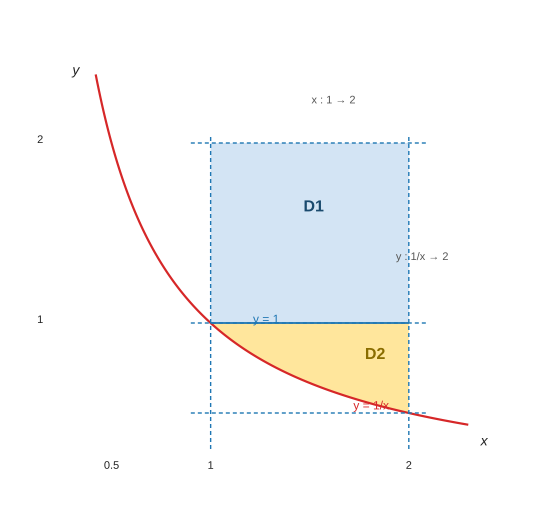
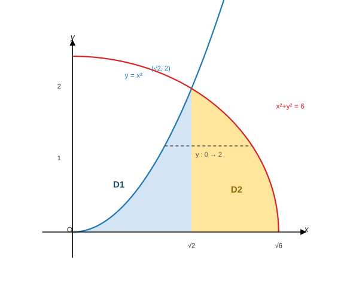
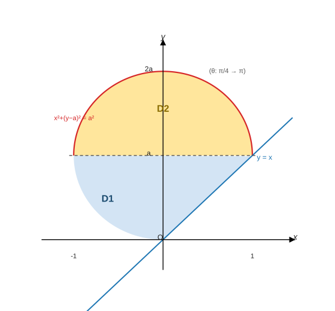

<h2 align="center">专题19 交换积分次序及坐标系</h2>

> 来源：《高等数学学习项目》讲义 · 知识模块125
> 题型：2 类 —— 交换积分次序（例1~例3）／交换坐标系（例4~例5）

------

### （一）考情分析

交换积分次序的试题主要出现在**客观题**中，可以是直角坐标中 **X 型和 Y 型**区域的转化，也可以是**直角坐标和极坐标之间**的转化，重点是**如何将累次积分转化为二重积分以及二重积分如何转化成累次积分**的方法弄明白。

三条主线（笔记整理）：

- **交换次序 = "还原区域、重新定限"**：由上下限写出 $D$ 的**不等式组** → 画草图 → 按另一方向写新的累次积分（题型一的四步法）。
- **先验证"是不是二重积分的累次积分"**：标准的累次积分要求内层**下限小于上限**；若题给的是"下限大于上限"（如例1 的 $\int_2^{1/x}$），要**先用 $\int_a^b=-\int_b^a$ 换限、把负号提到最外层**。
- **交换坐标系**：极坐标 ↔ 直角坐标（$x=r\cos\theta$、$y=r\sin\theta$、$\mathrm dx\mathrm dy=r\,\mathrm dr\,\mathrm d\theta$），要**把区域边界与被积函数同时翻译过去**（例4、例5）。

> **⚠ 命题特征**：本模块考的是"**读区域**"的能力——题目给一个（或一组）累次积分，让你写成另一种次序/另一种坐标系；**上限里带变量**、**下限大于上限**、**分块**是本模块的三大坑。

------

### （二）题型一：交换积分次序

#### 方法点拨

**(1)** 先验证累次积分是否是二重积分的累次积分。

**(2)** 由所给累次积分的上、下限写出积分区域 $D$ 的不等式组。

**(3)** 依据不等式组画出积分区域 $D$ 的草图。

**(4)** 根据图形写出另一种积分次序下的累次积分。

（笔记补充）

**(5)** 若内层**下限大于上限**（如 $\int_2^{\frac1x}$），先用定积分性质换限：$\int_2^{1/x}=-\int_{1/x}^{2}$，**负号提到最外层**，全部换序完成后再按号还原（例1）。

**(6)** 换序常常需要**分块**：某方向上一段到底、另一方向要分段时，就在**分界点**处切开（例1 在 $y=1$ 处分成两块、例2 由"两段 X 型"合并为"一段 Y 型"）。

#### 例1（内层下限大于上限：先换限、再分块换序）

**【例1】** 交换累次积分的积分次序：

$$
\int_1^2\mathrm dx\int_{2}^{\frac1x}f(x,y)\mathrm dy=\underline{\qquad}.
$$

**【分析】** 当 $1<x<2$ 时，$\dfrac1x<2$，故这个累次积分**不是二重积分的累次积分**。先利用定积分的性质，**交换积分的上、下限**，使得累次积分的下限小于上限。

**【解析】**

$$
\int_1^2\mathrm dx\int_2^{\frac1x}f(x,y)\mathrm dy
=-\int_1^2\mathrm dx\int_{\frac1x}^{2}f(x,y)\mathrm dy
=-\iint_Df(x,y)\mathrm dx\mathrm dy,
$$

其中 $D:1\le x\le2,\ \dfrac1x\le y\le2$：

> 图：例1 的积分区域 $D$（$1\le x\le2$、$\frac1x\le y\le2$）——由 $x=1$、$y=2$、$x=2$ 与双曲线 $y=\frac1x$ 围成；虚线 $y=1$ 把它分成 $D_1$（上，$1\le y\le2$）与 $D_2$（下，$\frac12\le y\le1$）。

将 $D$ 分解为如图示的两部分 $D_1$ 和 $D_2$，则有

$$
\int_1^2\mathrm dx\int_2^{\frac1x}f(x,y)\mathrm dy
=-\Bigl[\iint_{D_1}f(x,y)\mathrm dx\mathrm dy+\iint_{D_2}f(x,y)\mathrm dx\mathrm dy\Bigr]
$$

$$
=-\Bigl[\int_{\frac12}^1\mathrm dy\int_{\frac1y}^{2}f(x,y)\mathrm dx+\int_1^2\mathrm dy\int_1^2f(x,y)\mathrm dx\Bigr]
=\int_{\frac12}^1\mathrm dy\int_2^{\frac1y}f(x,y)\mathrm dx+\int_1^2\mathrm dy\int_2^1f(x,y)\mathrm dx.
$$

**【考点】**

① **"内层下限大于上限"是提示信号**：先把它改写成 $\int_{\frac1x}^{2}$ 并**在最外层添负号**——$\int_2^{1/x}=-\int_{1/x}^2$，这是本题的第一步（也是**方法提示 (1)"先验证是不是二重积分的累次积分"**的用意）；

② **还原区域**：改写后 $D:1\le x\le2,\ \frac1x\le y\le2$，边界是 $x=1$、$y=2$、$x=2$ 与双曲线 $y=\frac1x$（过 $(1,1)$ 与 $(2,\frac12)$）；

③ **Y 型必须分块**：固定 $y$ 时，左边界在 $y\le1$ 段是双曲线 $x=\frac1y$、在 $y\ge1$ 段是直线 $x=1$ ⟹ 以 $y=1$ 为界分成两块（$D_2$ 与 $D_1$），所以 $D_1:\{1\le y\le2,\ 1\le x\le2\}$（是矩形）、$D_2:\{\frac12\le y\le1,\ \frac1y\le x\le2\}$；

④ **负号要"带着走"再还原**：$-\int_{1/2}^1dy\int_{1/y}^2f\,dx=\int_{1/2}^1dy\int_2^{1/y}f\,dx$——把每个内层积分也翻过来，正好把外层负号消化掉；最终答案**两个内层积分都是"下限大于上限"**（$\int_2^{1/y}$、$\int_2^{1}$），这是本题答案的正常形态（原式本身就是这种写法）；

⑤ **易错**：忘记最外层的负号（直接写成 $\int_{1/2}^1dy\int_{1/y}^2+\int_1^2dy\int_1^2$）；只按整段 $y\in[\frac12,2]$ 用 $\frac1y$ 当左边界（**漏掉 $y>1$ 段左边界是 $x=1$**）。

#### 例2（两段 X 型 ⟹ 一段 Y 型）

**【例2】** 交换累次积分次序：

$$
I=\int_0^{\sqrt2}\mathrm dx\int_0^{x^2}f(x,y)\mathrm dy+\int_{\sqrt2}^{\sqrt6}\mathrm dx\int_0^{\sqrt{6-x^2}}f(x,y)\mathrm dy .
$$

**【分析】** 先将累次积分转化为二重积分 $\displaystyle\iint_Df(x,y)\mathrm d\sigma$。本题的积分区域 $D$ 由两部分构成：

$$
D_1:0\le x\le\sqrt2,\ 0\le y\le x^2;\qquad
D_2:\sqrt2\le x\le\sqrt6,\ 0\le y\le\sqrt{6-x^2}.
$$

**【解析】**

$$
I=\iint_{D_1}f(x,y)\mathrm dx\mathrm dy+\iint_{D_2}f(x,y)\mathrm dx\mathrm dy=\iint_{D_1+D_2}f(x,y)\mathrm dx\mathrm dy,
$$

> 图：例2 的积分区域——$D_1$（蓝，抛物线 $y=x^2$ 下方）与 $D_2$（黄，圆 $x^2+y^2=6$ 下方）在点 $(\sqrt2,2)$ **正好衔接**（$(\sqrt2)^2=2=\sqrt{6-2}$）；虚线为 Y 型取法的一条水平条。

如图示，将 $D_1+D_2$ 看成 **Y 型区域**，则

$$
I=\int_0^2\mathrm dy\int_{\sqrt y}^{\sqrt{6-y^2}}f(x,y)\mathrm dx .
$$

**【考点】**

① **"两段 X 型"的来历**：左段（$0\le x\le\sqrt2$）的上边界是抛物线 $y=x^2$，右段（$\sqrt2\le x\le\sqrt6$）的上边界是圆 $y=\sqrt{6-x^2}$——**两个上边界在 $x=\sqrt2$ 处相交于 $(\sqrt2,2)$**（$2=6-2$ ✓），这正是能合并成一个 Y 型区域的前提；

② **换序看"左右边界"**：$y$ 的范围由两块的最大值给出（$0\le y\le2$）；固定 $y$ 时，**左边界是抛物线 $x=\sqrt y$**（由 $y=x^2$ 反解，取右支）、**右边界是圆 $x=\sqrt{6-y^2}$**；

③ **衔接点要验算**：$y=2$ 时左右边界都退化为 $x=\sqrt2$ ✓（若不衔接就必须再分块），**先验证衔接、再写一段式**是本类题的关键；

④ **易错**：把左边界写成 $x=y^2$（那是把 $y=x^2$ 反解错了）；$y$ 的上限写成 $\sqrt2$ 或 $\sqrt6$（那是 $x$ 的上限）；忘记"取右支"（$x=\sqrt y$ 而非 $-\sqrt y$，区域在右半平面）；

⑤ **抽查**（笔记补充）：取 $f(x,y)=\sin(xy)+xy$，两段 X 型 = $4.1304788507$、一段 Y 型 = $4.1304788508$（差 $7\times10^{-11}$）✓。

#### 例3（不能先积 $e^{y^2}$：交换次序 or 变限积分分部）

**【例3】**

$$
\int_0^1\mathrm dx\int_x^1e^{y^2}\mathrm dy=\underline{\qquad}.
$$

**【分析】** **(1)** 本题如果先计算 $\displaystyle\int_x^1e^{y^2}\mathrm dy$，由于 $e^{y^2}$ 的原函数**不是初等函数**，其定积分算不出来，故可考虑**交换积分次序**，先对 $x$ 积分、再对 $y$ 积分（积分区域 $D:0\le x\le1,\ x\le y\le1$，即以 $(0,0)$、$(1,1)$、$(0,1)$ 为顶点的三角形）。**(2)** 该累次积分也可看成定积分，其中被积函数含有**变限积分**，故可考虑用**分部积分法**计算。

**【解析】方法一（交换积分次序）**

$$
\int_0^1\mathrm dx\int_x^1e^{y^2}\mathrm dy=\iint_De^{y^2}\mathrm dx\mathrm dy=\int_0^1\mathrm dy\int_0^{y}e^{y^2}\mathrm dx=\int_0^1e^{y^2}\cdot y\,\mathrm dy=\frac12e^{y^2}\Big|_0^1=\frac12(e-1).
$$

**【方法二（变限积分 + 分部积分）】** 令

$$
\int_x^1e^{y^2}\mathrm dy=F(x),\qquad\text{则}\qquad F'(x)=-e^{x^2},
$$

故

$$
\int_0^1\mathrm dx\int_x^1e^{y^2}\mathrm dy=\int_0^1F(x)\mathrm dx
=xF(x)\Big|_0^1-\int_0^1x\cdot F'(x)\mathrm dx
=F(1)+\int_0^1x\cdot e^{x^2}\mathrm dx
=\frac12e^{x^2}\Big|_0^1=\frac12(e-1).
$$

> **【评注】** 当被积函数中含有 $\dfrac{\sin x}{x}$、$\dfrac{\cos x}{x}$、$\dfrac{1}{\ln x}$、$e^{x^2}$、$e^{-x^2}$、$e^{\frac1x}$ 等式子时，要**先对 $y$ 积分，再对 $x$ 积分**。

**【考点】**

① **识别"积不出来"的信号**：$e^{y^2}$、$\frac{\sin x}{x}$、$\frac1{\ln x}$ 型都**没有初等原函数**，一律**换序**（把内层变量换成能积的那个）；

② **换序后的内层是"常数上下限"**：$D$ 为三角形，Y 型下 $x$ 从 $0$ 到 $y$ ⟹ 内层积出 $y$，外层变成 $\int_0^1y\,e^{y^2}\mathrm dy$（凑微分 $y\,\mathrm dy=\frac12\mathrm d(y^2)$）✓；

③ **方法二的关键**：把内层积分**整体记作 $F(x)$**，则 $F'(x)=-e^{x^2}$（**变限积分求导，上限为常数、下限为 $x$ ⟹ 负号**），再用**分部积分**：$\int F=xF-\int xF'$ ✓；

④ **两种方法结果一致**（$\frac12(e-1)$）——考试中任选其一，但**方法一更快**，方法二体现"变限积分 + 分部"的通用套路；

⑤ **抽查**（笔记补充）：数值 $\int_0^1dx\int_x^1e^{y^2}dy=0.8591409142=\frac12(e-1)$ ✓，换序后 $\int_0^1ye^{y^2}dy$ 同值 ✓。

------

### （三）题型二：交换坐标系

> **方法提示**：把极坐标下的累次积分（或被积式）翻译成直角坐标，或反向翻译，依据是
> $$x=r\cos\theta,\qquad y=r\sin\theta,\qquad \mathrm dx\mathrm dy=r\,\mathrm dr\,\mathrm d\theta,$$
> 并且**区域边界的方程要同步翻译**（$r=2a\sin\theta\Rightarrow x^2+y^2=2ay$、$r=\frac{\pi}{2}\csc\theta\Rightarrow y=\frac\pi2$ 等）。

#### 例4（极坐标 ⟹ 直角坐标，选择题）

**【例4】** 将积分

$$
I=\int_{\frac\pi4}^{\pi}\mathrm d\theta\int_{2a\sin\theta}^{0}f(r\cos\theta,r\sin\theta)r\,\mathrm dr
$$

化为先对 $x$ 积分后对 $y$ 积分为 $I=(\quad)$。

A. $\displaystyle\int_0^a\mathrm dy\int_{-\sqrt{2ay-y^2}}^{y}f(x,y)\mathrm dx+\int_a^{2a}\mathrm dy\int_{-\sqrt{2ay-y^2}}^{\sqrt{2ay-y^2}}f(x,y)\mathrm dx$

B. $\displaystyle-\int_0^a\mathrm dy\int_{-\sqrt{2ay-y^2}}^{y}f(x,y)\mathrm dx-\int_a^{2a}\mathrm dy\int_{-\sqrt{2ay-y^2}}^{\sqrt{2ay-y^2}}f(x,y)\mathrm dx$

C. $\displaystyle\int_0^a\mathrm dy\int_{\sqrt{2ay-y^2}}^{y}f(x,y)\mathrm dx+\int_a^{2a}\mathrm dy\int_{-\sqrt{2ay-y^2}}^{\sqrt{2ay-y^2}}f(x,y)\mathrm dx$

D. $\displaystyle-\int_0^a\mathrm dy\int_{\sqrt{2ay-y^2}}^{y}f(x,y)\mathrm dx-\int_a^{2a}\mathrm dy\int_{-\sqrt{2ay-y^2}}^{\sqrt{2ay-y^2}}f(x,y)\mathrm dx$

**【解析】** 注意到**内层积分的下限大于上限**，应先将积分改写成

$$
I=-\int_{\frac\pi4}^{\pi}\mathrm d\theta\int_0^{2a\sin\theta}f(r\cos\theta,r\sin\theta)r\,\mathrm dr,
$$

其中积分区域

$$
D:\ \frac\pi4\le\theta\le\pi,\qquad 0\le r\le2a\sin\theta .
$$

边界曲线 $r=2a\sin\theta$ 的直角坐标方程为 $x^2+y^2=2ay$（即 $x^2+(y-a)^2=a^2$，圆心 $(0,a)$、半径 $a$）：

> 图：例4 的积分区域 $D$（$\theta$ 从 $\frac\pi4$ 到 $\pi$，即圆盘在直线 $y=x$ **左侧**的部分）；虚线 $y=a$ 把它分成 $D_1$（下，右边界是直线 $x=y$）与 $D_2$（上，右边界是圆的右支）。

在直角坐标下积分区域 $D$ 由两部分构成：

$$
D_1:0\le y\le a,\ -\sqrt{2ay-y^2}\le x\le y;\qquad
D_2:a\le y\le2a,\ -\sqrt{2ay-y^2}\le x\le\sqrt{2ay-y^2}.
$$

故

$$
I=-\Bigl[\int_0^a\mathrm dy\int_{-\sqrt{2ay-y^2}}^{y}f(x,y)\mathrm dx+\int_a^{2a}\mathrm dy\int_{-\sqrt{2ay-y^2}}^{\sqrt{2ay-y^2}}f(x,y)\mathrm dx\Bigr],
$$

**故选 B**。

**【考点】**

① **老规矩：先看内层上下限**——题给 $\int_{2a\sin\theta}^{0}$ 是"下限 > 上限"，**先换限、添负号**，得到 $-\int_0^{2a\sin\theta}$ ✓（这一步没有就选不出 B/D 的负号）；

② **边界翻译**：$r=2a\sin\theta$ 两边乘 $r$ 得 $r^2=2ar\sin\theta$ ⟹ $x^2+y^2=2ay$ ⟹ 配方 $x^2+(y-a)^2=a^2$ ✓（**"乘 $r$"是极坐标方程转直角坐标的常用技巧**）；

③ **用 $\theta$ 的范围定区域的"哪一半"**：$\theta\ge\frac\pi4$ ⟹ $\sin\theta\ge\cos\theta$ ⟹ $y\ge x$（直线 $y=x$ 的左侧）；$\theta\le\pi$ ⟹ 圆盘的上半部分 ⟹ 合起来是**圆盘在 $y=x$ 左侧的部分**；

④ **Y 型分块点在 $y=a$**：直线 $y=x$ 与圆交于 $(a,a)$ ⟹ $y\in[0,a]$ 段右边界是**直线** $x=y$、$y\in[a,2a]$ 段右边界是**圆的右支** $x=\sqrt{2ay-y^2}$；左边界始终是圆的左支 $-\sqrt{2ay-y^2}$ ✓；

⑤ **干扰项怎么错**：A 少了负号；C 把 $D_1$ 的左边界写成 $+\sqrt{2ay-y^2}$（那是右支，区域跑到直线右侧去了）；D 把 A 的错误与负号拼在一起（左边界错 + 负号）；

⑥ **抽查**（笔记补充）：取 $a=1$、$f=1+0.3x-0.2y$，极坐标式 $=-2.2016222588$、选项 B 的直角坐标式 $=-2.2016207216$（相对差 $7\times10^{-7}$）✓，即**负号必须保留**。

#### 例5（极坐标 ⟹ 直角坐标，计算）

**【例5】** 计算

$$
I=\iint_D\frac{\sin(\cot\theta)}{\sin\theta}\mathrm dr\mathrm d\theta,
$$

其中

$$
D:\ \frac\pi4\le\theta\le\frac\pi2,\qquad 0\le r\le\frac\pi2\csc\theta .
$$

**【分析】** 题中给出的二重积分是**极坐标系下的形式**，无法直接用极坐标计算出来，故可以先将**极坐标转化为直角坐标**，再进行计算。

**【解析】**

$$
I=\iint_D\frac{\sin(\cot\theta)}{\sin\theta}\mathrm dr\mathrm d\theta
=\iint_D\frac{\sin\Bigl(\dfrac{r\cos\theta}{r\sin\theta}\Bigr)}{r\sin\theta}\,r\,\mathrm dr\,\mathrm d\theta
=\iint_D\frac{\sin\dfrac xy}{y}\mathrm dx\mathrm dy,
$$

其中 $D:0\le y\le\dfrac\pi2,\ 0\le x\le y$（即以 $(0,0)$、$(0,\frac\pi2)$、$(\frac\pi2,\frac\pi2)$ 为顶点的三角形），则有

$$
I=\int_0^{\frac\pi2}\mathrm dy\int_0^{y}\frac{\sin\dfrac xy}{y}\mathrm dx
=\int_0^{\frac\pi2}(1-\cos1)\mathrm dy
=\frac\pi2(1-\cos1).
$$

> **【评注】** 当二重积分**以极坐标的形式给出**时，在转化过程中要注意：$x=r\cos\theta$、$y=r\sin\theta$、$\mathrm dx\mathrm dy=r\,\mathrm dr\,\mathrm d\theta$。

**【考点】**

① **"凑出 $r\,\mathrm dr\,\mathrm d\theta$"是转化的关键一步**：被积式里没有 $r$，但 $\frac{1}{\sin\theta}=\frac{r}{r\sin\theta}=\frac{r}{y}$ ⟹ $\frac{1}{\sin\theta}\mathrm dr\mathrm d\theta=\frac{1}{y}\cdot r\,\mathrm dr\,\mathrm d\theta=\frac{\mathrm dx\mathrm dy}{y}$——**先补一个 $r$ 再补一个 $y$**，这是本题最巧的地方；

② **角函数翻译**：$\cot\theta=\frac{\cos\theta}{\sin\theta}=\frac{r\cos\theta}{r\sin\theta}=\frac xy$ ✓（$\theta$ 的三角式一律用"$\frac{x}{r}$、$\frac{y}{r}$"翻译）；

③ **边界翻译**：$r\le\frac\pi2\csc\theta$ ⟹ $r\sin\theta\le\frac\pi2$ ⟹ $y\le\frac\pi2$ ✓（$\csc\theta=\frac1{\sin\theta}$，**乘 $\sin\theta$ 消掉 $r$**）；$\theta\ge\frac\pi4$ ⟹ $y\ge x$；$\theta\le\frac\pi2$ ⟹ $x\ge0$ ⟹ 合起来 $D:\{0\le y\le\frac\pi2,\ 0\le x\le y\}$ ✓；

④ **内层用换元**：$\displaystyle\int_0^y\frac{\sin\frac xy}{y}\mathrm dx$ 令 $u=\frac xy$（$\mathrm dx=y\,\mathrm du$）⟹ $\displaystyle\int_0^1\sin u\,\mathrm du=1-\cos1$，**与 $y$ 无关**，于是外层只剩 $\int_0^{\pi/2}\mathrm dy=\frac\pi2$ ✓；

⑤ **易错**：把 $\sin(\cot\theta)$ 里的 $\cot\theta$ 翻译成 $\frac yx$（**是 $\frac xy$**）；忘记 $\mathrm dx\mathrm dy=r\,\mathrm dr\,\mathrm d\theta$ 里的 $r$（少了它就凑不出 $\frac1y$）；$y$ 的上限写成 $\frac\pi2\csc\theta$（那是极坐标写法，必须化成 $y\le\frac\pi2$）；

⑥ **抽查**（笔记补充）：极坐标原式 $=0.7220914494$、直角坐标式 $=0.7220914489$、$\frac\pi2(1-\cos1)=0.7220914494$ ✓。

------

### （四）小结：本模块的"三步固定动作"

| <nobr>题型</nobr> | <nobr>第一步：检查</nobr> | <nobr>第二步：还原区域</nobr> | <nobr>第三步：重写</nobr> |
|:---|:---|:---|:---|
| <nobr>X/Y 型互换</nobr> | 内层**下限 < 上限**？否则先换限加负号（例1） | 由上下限写 $D$ 的不等式组、画草图（例1、例2） | 按另一方向定限；**分段处切开**（例1 的 $y=1$、例2 的 $x=\sqrt2$） |
| <nobr>多段合并</nobr> | 各段在**衔接点是否连续**（例2 的 $(\sqrt2,2)$） | 看能否写成一段（共用左右边界） | 写"一段式"，上限用两边界的最小者思想（例2） |
| <nobr>极坐标 ⟹ 直角坐标</nobr> | 内层上下限是否反序（例4） | $r=2a\sin\theta\Rightarrow x^2+y^2=2ay$；$\theta$ 范围定"哪一半"（例4、例5） | 用 $x=r\cos\theta$、$y=r\sin\theta$ 翻译**被积式与边界**；$\frac1{\sin\theta}$ 要靠"补 $r$"（例5） |
| <nobr>被积函数"积不出来"</nobr> | 是否含 $e^{y^2}$、$\frac{\sin x}{x}$、$\frac1{\ln x}$ 等 | 还原区域（三角形等） | 换序后用**凑微分/换元**积出（例3），也可用**变限积分 + 分部**（例3 方法二） |

**六条高频提醒**

1. **第一件事永远是"验证内层下限小于上限"**：反序就换限、最外层添负号（例1、例4 都靠这一步）；**负号丢了必错**。
2. **还原区域靠"不等式组 + 草图"**，不要凭记忆套公式；草图只需画对**边界曲线**与**交点**（例2 的 $(\sqrt2,2)$、例4 的 $(a,a)$）。
3. **换序往往要分块**：分界点是"两段边界的交点"在另一方向上的投影（例1 的 $y=1$、例4 的 $y=a$）；反之，**多段也可能合并成一段**（例2）。
4. **极坐标方程转直角坐标常用"乘 $r$"**：$r=2a\sin\theta\Rightarrow r^2=2ar\sin\theta\Rightarrow x^2+y^2=2ay$（例4）；含 $\csc\theta$ 的用"乘 $\sin\theta$"：$r\le\frac\pi2\csc\theta\Rightarrow y\le\frac\pi2$（例5）。
5. **被积函数"积不出来"就换序**：$e^{y^2}$、$\frac{\sin x}{x}$、$\frac1{\ln x}$、$e^{\pm x^2}$、$e^{1/x}$ 一律**先对另一个变量积分**（例3 评注）。
6. **变限积分型累次积分可用分部积分**：记内层变限积分为 $F(x)$，则 $F'(x)=-e^{x^2}$（上下限为 $x$ 与常数时注意负号），$\int_0^1F=xF\big|_0^1-\int_0^1xF'$（例3 方法二）。

> **衔接**：二重积分的常规计算（直角/极坐标、对称性、五步法）见 `专题17 二重积分的常规计算`（知识模块123）；分段函数的二重积分见 `专题18 分段函数的二重积分`（知识模块124）；公式与性质汇总见 `数学\高数\总结\二重积分总结.md`；后续的三重积分（柱坐标/球坐标的"换坐标系"）沿用本专题"**翻译边界 + 翻译被积式**"的思路；对应刷题见 `数学\高数\题目.md` 的二重积分、三重积分等章节。
