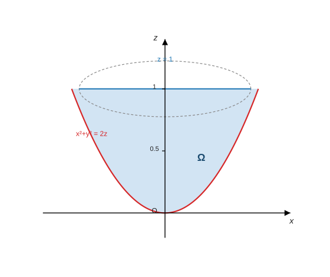
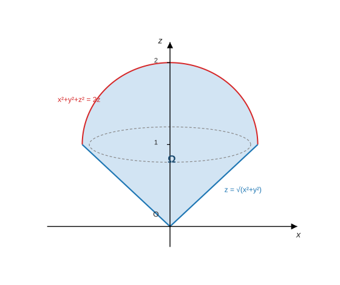
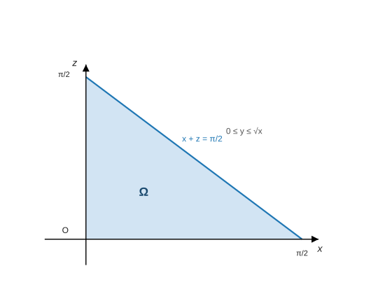
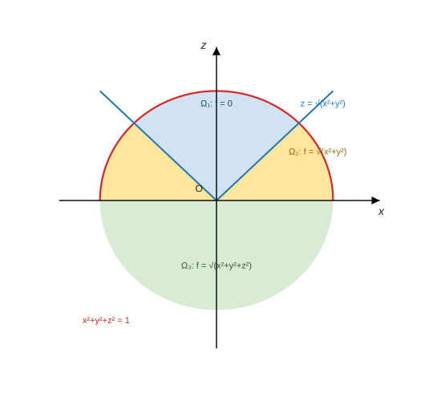

<h2 align="center">专题20 三重积分的计算</h2>

> 来源：《高等数学学习项目》讲义 · 知识模块126
> 题型：2 类 —— 三重积分的计算（例1-例4）／三重积分交换积分次序（例5）

------

### （一）考情分析

三重积分的计算掌握**四个常规方法**：**先一后二、先二后一、柱坐标、球坐标**，还有**两个简化运算的方法**。这部分**经常以客观题的形式考查**，也**经常和曲面积分结合到一起考查解答题**，所以要重点掌握。

四条主线（笔记整理）：

- **选坐标系看区域形状**：旋转体（柱面、锥面、抛物面等）⟹ **柱坐标**；球面或球面∩锥面 ⟹ **球坐标**；其他 ⟹ **直角坐标**（例1／例2／例3）。
- **先化简再算**：关于坐标面的**对称性**（奇函数项直接归零）与**轮换对称性**（$x,y,z$ 地位相同时 $\iiint f(x)dv=\iiint f(y)dv=\iiint f(z)dv$）——这是处理 $(x+y+z)^2$、$x^3+y^3+z^3$ 型被积函数的利器（例1、例2）。
- **两种"降维"办法**：**先一后二**（内层先积掉一个变量，剩下的算二重积分）；**截面法/先二后一**（被积函数只含 $z$ 时，截面面积 $S_{D_z}$ 直接乘进去）。
- **次序不当会"积不出来"**：见 $e^{z^2}$、$\dfrac{\sin z}{(1-z)^2}$ 型就要**交换积分次序**（例5）。

> **⚠ 命题特征**：本模块的解答题几乎都是"**画区域 → 选坐标（柱/球/直角）→ 用对称性化简 → 定限计算**"；客观题则专考**对称性、轮换对称性与截面法**的技巧。

------

### （二）题型一：三重积分的计算

#### 方法点拨

**1. 三重积分的性质**

**(1) 关于坐标平面的对称性**：若积分区域 $\Omega$ 关于 $xOy$ 面对称，则

$$
\iiint_\Omega f(x,y,z)\mathrm dv=
\begin{cases}
0, & f(x,y,-z)=-f(x,y,z),\\[1mm]
2\displaystyle\iiint_{\Omega_1}f(x,y,z)\mathrm dv, & f(x,y,-z)=f(x,y,z),
\end{cases}
$$

其中 $\Omega_1$ 为 $\Omega$ 在 $xOy$ 面上方的部分（关于 $yOz$ 面、$zOx$ 面对称时把 $x$、$y$ 换成相反数，结论同理）。

**(2) 轮换对称性**：对于任意点 $(x,y,z)\in\Omega$，都有 $(y,z,x)\in\Omega$、$(z,x,y)\in\Omega$，则

$$
\iiint_\Omega f(x,y,z)\mathrm dv=\iiint_\Omega f(y,z,x)\mathrm dv=\iiint_\Omega f(z,x,y)\mathrm dv
=\frac13\iiint_\Omega\bigl[f(x,y,z)+f(y,z,x)+f(z,x,y)\bigr]\mathrm dv .
$$

特别的，

$$
\iiint_\Omega f(x)\mathrm dv=\iiint_\Omega f(y)\mathrm dv=\iiint_\Omega f(z)\mathrm dv
=\frac13\iiint_\Omega\bigl[f(x)+f(y)+f(z)\bigr]\mathrm dv .
$$

**2. 三重积分的计算步骤如下**

**(1)** 画出积分区域 $\Omega$ 的图形；

**(2)** 根据 $\Omega$ 的**对称性**和被积函数的**奇偶性**进行化简；

**(3)** 选择**坐标系**：

- ① 当 $\Omega$ 由**柱面、锥面**或由柱面、锥面等**旋转曲面**与其他曲面所围成时，用**柱面坐标系**；
- ② 当 $\Omega$ 是**球面**或由**球面与锥面**所围时，用**球坐标系**；
- ③ 上述情形之外一般用**直角坐标**进行运算。

**(4)** 选择**积分次序**；

**(5)** 确定**累次积分限**，做定积分运算。

**3. 三种"写累次积分"的工具（讲义注）**

**① 截面法（先二后一）**：

$$
\iiint_\Omega f(z)\mathrm dv=\int_a^b f(z)\mathrm dz\iint_{D_z}\mathrm dx\mathrm dy=\int_a^b f(z)\cdot S_{D_z}\mathrm dz,
$$

其中 $S_{D_z}$ 为 $D_z$ 的面积。

**② 柱坐标变换**：令 $x=r\cos\theta$、$y=r\sin\theta$、$z=z$ ⟹ $\mathrm dv=r\,\mathrm dr\,\mathrm d\theta\,\mathrm dz$。

**③ 球坐标变换**：令 $x=r\sin\varphi\cos\theta$、$y=r\sin\varphi\sin\theta$、$z=r\cos\varphi$ ⟹ $\mathrm dv=r^2\sin\varphi\,\mathrm d\theta\,\mathrm d\varphi\,\mathrm dr$。

#### 例1（旋转抛物面与平面围成的区域：对称性 + 柱坐标／先二后一）

**【例1】** 计算

$$
I=\iiint_\Omega(x+y+z)^2\mathrm dv,
$$

其中 $\Omega$ 是由曲线 $\begin{cases}x=0,\\[1mm]y^2=2z\end{cases}$ 绕 $z$ 轴旋转一周而成的曲面与平面 $z=1$ 所围成的区域。

**【分析】** 积分区域关于平面 $zOx$、$zOy$ **对称**，故可以先化简。又因为积分区域是**旋转体**，故用**柱面坐标**进行计算。

**【解析】** 曲线 $\begin{cases}x=0,\\y^2=2z\end{cases}$ 绕 $z$ 轴旋转一周所成曲面方程为 $x^2+y^2=2z$（把母线中的 $y^2$ 换成 $x^2+y^2$）：

> 图：例1 的积分区域 $\Omega$（$xOz$ 平面截线示意）——旋转抛物面 $x^2+y^2=2z$（红）与平面 $z=1$（蓝）围成的"碗"；用柱坐标时 $0\le r\le\sqrt2$、$\frac{r^2}{2}\le z\le1$、$0\le\theta\le2\pi$。

**方法一（柱面坐标）** 所以

$$
I=\iiint_\Omega(x+y+z)^2\mathrm dv
=\iiint_\Omega(x^2+y^2+z^2)\mathrm dv+2\iiint_\Omega(xy+yz+zx)\mathrm dv
$$

（**展开后的交叉项在关于 $zOx$、$zOy$ 对称的区域上积分为 $0$**，故只剩平方项）

$$
=\iiint_\Omega(x^2+y^2+z^2)\mathrm dv
=\int_0^{2\pi}\mathrm d\theta\int_0^{\sqrt2}r\,\mathrm dr\int_{\frac{r^2}{2}}^{1}(r^2+z^2)\mathrm dz
$$

$$
=2\pi\int_0^{\sqrt2}r\Bigl(r^2+\frac13-\frac{r^4}{2}-\frac{r^6}{24}\Bigr)\mathrm dr=\frac{7\pi}{6}.
$$

**方法二（先二后一）** 本题也可以用"**先二后一**"法来做，这是因为 $x^2+y^2$ 和 $z^2$ 在截面 $D_z:x^2+y^2\le2z$ 上的二重积分容易计算：

$$
I=\iiint_\Omega(x^2+y^2)\mathrm dv+\iiint_\Omega z^2\mathrm dv
=\int_0^1\mathrm dz\iint_{D_z}(x^2+y^2)\mathrm dx\mathrm dy+\int_0^1\mathrm dz\iint_{D_z}z^2\mathrm dx\mathrm dy
$$

$$
=\int_0^1\mathrm dz\int_0^{2\pi}\mathrm d\theta\int_0^{\sqrt{2z}}r^2\cdot r\,\mathrm dr+\int_0^1z^2\cdot\pi\cdot2z\,\mathrm dz
=2\pi\int_0^1z^2\mathrm dz+2\pi\int_0^1z^3\mathrm dz
=2\pi\cdot\frac13+2\pi\cdot\frac14=\frac{7\pi}{6}.
$$

**【考点】**

① **旋转曲面方程**：母线 $\begin{cases}x=0,\\y^2=2z\end{cases}$（在 $yOz$ 面内）绕 $z$ 轴旋转 ⟹ 把 $y^2$ 换成 $x^2+y^2$，得 $x^2+y^2=2z$ ✓（**口诀：绕谁转，谁不动，另一个平方变两平方和**）；

② **对称性先砍掉交叉项**：$(x+y+z)^2=x^2+y^2+z^2+2(xy+yz+zx)$，其中 $xy$、$yz$、$zx$ 关于 $zOx$ 面（$y\to-y$）或 $zOy$ 面（$x\to-x$）都是**奇函数** ⟹ 三项全为 $0$ ✓——这一步不做的话计算量翻倍；

③ **柱坐标定限**：$r$ 从 $0$ 到 $\sqrt2$（$z=1$ 时 $r^2=2$）、$z$ 从 $\frac{r^2}{2}$（抛物面）到 $1$、$\theta$ 一整圈 ✓；体积元 $\mathrm dv=r\,\mathrm dr\,\mathrm d\theta\,\mathrm dz$（**别漏 $r$**）；

④ **内层积分**：$\displaystyle\int_{\frac{r^2}{2}}^{1}(r^2+z^2)\mathrm dz=r^2\Bigl(1-\frac{r^2}{2}\Bigr)+\frac13\Bigl(1-\frac{r^6}{8}\Bigr)$，末步 $\displaystyle\int_0^{\sqrt2}r^3\mathrm dr=1$、$\int_0^{\sqrt2}\frac{r^5}{2}\mathrm dr=\frac23$、$\int_0^{\sqrt2}\frac r3\mathrm dr=\frac13$、$\int_0^{\sqrt2}\frac{r^7}{24}\mathrm dr=\frac1{12}$ ⟹ 括号合计 $\frac{7}{12}$ ⟹ $I=2\pi\cdot\frac7{12}=\frac{7\pi}6$；

⑤ **截面法的价值**：被积函数只依赖 $z$（或只依赖 $x$、$y$）时，$\iiint f(z)\mathrm dv=\int f(z)S_{D_z}\mathrm dz$ **一步降成定积分**——本题 $S_{D_z}=\pi\cdot2z$（半径 $\sqrt{2z}$ 的圆面积），故 $\iiint z^2\mathrm dv=\int_0^1z^2\cdot2\pi z\,\mathrm dz=\frac{\pi}2$ ✓；

⑥ **抽查**（笔记补充）：蒙特卡洛 $3.667181\approx\frac{7\pi}{6}=3.665191$ ✓。

#### 例2（球面与锥面围成：对称性 + 球坐标）

**【例2】** 设 $\Omega$ 是由曲面 $x^2+y^2+z^2\le2z$ 与曲面 $z\ge\sqrt{x^2+y^2}$ 所围成的区域，求

$$
I=\iiint_\Omega(x^3+y^3+z^3)\mathrm dv .
$$

**【分析】** 由于 $\Omega$ 是由**球面与锥面**围成，故用**球坐标**进行计算。

**【解析】** $\Omega$ 的图形如下（球面 $x^2+y^2+z^2=2z$ 与锥面 $z=\sqrt{x^2+y^2}$ 围成的"锥顶 + 球冠"区域）：

> 图：例2 的积分区域 $\Omega$（$xOz$ 平面截线示意）——红线为球面 $x^2+y^2+z^2=2z$（即 $x^2+(z-1)^2=1$），蓝线为锥面 $z=\sqrt{x^2+y^2}$ 的截线 $z=|x|$；虚线是两者的交线（$z=1$ 处的圆）。

$\Omega$ 关于 $zOx$、$zOy$ **对称**，则 $x^3$、$y^3$ 项为奇函数积分为 $0$，故

$$
I=\iiint_\Omega z^3\mathrm dv=\int_0^{2\pi}\mathrm d\theta\int_0^{\frac\pi4}\mathrm d\varphi\int_0^{2\cos\varphi}(r\cos\varphi)^3\cdot r^2\sin\varphi\,\mathrm dr
$$

$$
=2\pi\int_0^{\frac\pi4}\cos^3\varphi\sin\varphi\,\mathrm d\varphi\int_0^{2\cos\varphi}r^5\mathrm dr
=\frac{64}{3}\pi\int_0^{\frac\pi4}\cos^9\varphi\sin\varphi\,\mathrm d\varphi=\frac{31}{15}\pi .
$$

**【考点】**

① **"球面 ∩ 锥面"是球坐标的标志**：球坐标下**锥面给出 $\varphi$ 的上限**（$\cos\varphi\ge\sin\varphi$ ⟹ $\varphi\le\frac\pi4$）、**球面给出 $r$ 的上限** ✓；

② **偏心球要仔细**：$x^2+y^2+z^2\le2z$ 配方得 $x^2+y^2+(z-1)^2\le1$（球心 $(0,0,1)$、半径 1，**过原点**）；球坐标下 $\rho^2\le2\rho\cos\varphi$ ⟹ $r\le2\cos\varphi$ ✓（**不是常数**，这是本题最容易写错的地方）；

③ **先砍掉 $x^3$、$y^3$**：$x^3$ 关于 $zOy$ 面（$x\to-x$）为奇函数 ⟹ 积分为 $0$ ✓；$y^3$ 同理 ⟹ 只剩 $\iiint z^3\mathrm dv$；

④ **球坐标体积元与积分次序**：$\mathrm dv=r^2\sin\varphi\,\mathrm d\theta\,\mathrm d\varphi\,\mathrm dr$，故被积式 $(r\cos\varphi)^3\cdot r^2\sin\varphi=r^5\cos^3\varphi\sin\varphi$ ✓（$r$ 的幂次是 $3+2=5$）；

⑤ **两次一元积分**：$\displaystyle\int_0^{2\cos\varphi}r^5\mathrm dr=\frac{(2\cos\varphi)^6}{6}=\frac{32}{3}\cos^6\varphi$ ⟹ 与 $\cos^3\varphi$ 合成 $\frac{64\pi}{3}\cos^9\varphi\sin\varphi$；再凑微分 $\displaystyle\int_0^{\frac\pi4}\cos^9\varphi\sin\varphi\,\mathrm d\varphi=\frac1{10}\Bigl(1-\cos^{10}\frac\pi4\Bigr)=\frac1{10}\Bigl(1-\frac1{32}\Bigr)=\frac{31}{320}$ ⟹ $I=\frac{64\pi}{3}\cdot\frac{31}{320}=\frac{31\pi}{15}$；

⑥ **抽查**（笔记补充）：蒙特卡洛 $6.496330\approx\frac{31\pi}{15}=6.492625$ ✓，且只取 $z^3$ 项时 $6.496791$——印证 $x^3$、$y^3$ 项确实为 $0$ ✓。

#### 例3（直角坐标 + 先一后二）

**【例3】** 求

$$
I=\iiint_\Omega y\sin(x+z)\mathrm dv,
$$

其中

$$
\Omega=\Bigl\{(x,y,z)\ \Big|\ 0\le y\le\sqrt x,\ x+z\le\frac\pi2,\ z\ge0\Bigr\}.
$$

**【解析】** 积分区域 $\Omega$（$xOz$ 截线是 $x+z\le\frac\pi2$、$z\ge0$ 的三角形，且对每个 $x$ 有 $0\le y\le\sqrt x$）如下，采用**直角坐标**，则

> 图：例3 的积分区域 $\Omega$（$xOz$ 平面截线示意）——三角形区域 $0\le x\le\frac\pi2$、$0\le z\le\frac\pi2-x$，再配以 $0\le y\le\sqrt x$ 的"厚度"。

$$
I=\iiint_\Omega y\sin(x+z)\mathrm dv
=\int_0^{\frac\pi2}\mathrm dx\int_0^{\sqrt x}y\,\mathrm dy\int_0^{\frac\pi2-x}\sin(x+z)\mathrm dz
$$

$$
=\int_0^{\frac\pi2}\mathrm dx\int_0^{\sqrt x}y\cos x\,\mathrm dy
=\int_0^{\frac\pi2}\frac x2\cos x\,\mathrm dx=\frac14(\pi-2).
$$

**【考点】**

① **"先一后二"的定限顺序**：本题三个变量的上下限互不耦合（$x$ 定住后 $y$、$z$ 各自独立），故按 $x\to y\to z$ 依次积分最省事；

② **内层对 $z$ 积分给出 $\cos x$**：$\displaystyle\int_0^{\frac\pi2-x}\sin(x+z)\mathrm dz=-\cos(x+z)\Big|_0^{\frac\pi2-x}=-\cos\frac\pi2+\cos x=\cos x$ ✓（**上限代入后 $\cos$ 的角是 $\frac\pi2$，恰好为 0**）；

③ **再对 $y$ 积分**：$\displaystyle\int_0^{\sqrt x}y\cos x\,\mathrm dy=\cos x\cdot\frac{(\sqrt x)^2}{2}=\frac x2\cos x$ ✓（$\cos x$ 对 $y$ 是常数）；

④ **末步用分部积分**：$\displaystyle\int_0^{\frac\pi2}\frac x2\cos x\,\mathrm dx=\frac12\bigl[x\sin x+\cos x\bigr]_0^{\frac\pi2}=\frac12\Bigl(\frac\pi2-1\Bigr)=\frac14(\pi-2)$ ✓（$\int x\cos x\,\mathrm dx=x\sin x+\cos x$）；

⑤ **易错**：把 $y$ 的上限写成 $x$（**是 $\sqrt x$**）；把 $z$ 的上限写成 $\frac\pi2$（**要减去 $x$**）；忘记 $\int_0^{\sqrt x}y\,\mathrm dy=\frac x2$（当心写成 $\frac{\sqrt x}{2}$）；

⑥ **抽查**（笔记补充）：蒙特卡洛 $0.285333\approx\frac{\pi-2}{4}=0.285398$ ✓。

#### 例4（分段函数的三重积分：球坐标分块）

**【例4】** 计算

$$
I=\iiint_\Omega f(x,y,z)\mathrm dv,
$$

其中 $\Omega$ 为球域 $x^2+y^2+z^2\le1$，被积函数

$$
f(x,y,z)=
\begin{cases}
0, & z\ge\sqrt{x^2+y^2},\\[1mm]
\sqrt{x^2+y^2}, & 0\le z\le\sqrt{x^2+y^2},\\[1mm]
\sqrt{x^2+y^2+z^2}, & z\le0.
\end{cases}
$$

**【分析】** **分段函数的三重积分**，**分区域积分**。

**【解析】** 球面 $x^2+y^2+z^2=1$ 与锥面 $z=\sqrt{x^2+y^2}$ 把球域分成三部分：

> 图：例4 的分块（$xOz$ 平面截线示意）——$\Omega_1$（蓝，锥面之上，$f=0$）、$\Omega_2$（黄，$xOy$ 面与锥面之间，$f=\sqrt{x^2+y^2}$）、$\Omega_3$（绿，下半球，$f=\sqrt{x^2+y^2+z^2}$）；平面截线 $\varphi$ 的范围依次是 $[0,\frac\pi4]$、$[\frac\pi4,\frac\pi2]$、$[\frac\pi2,\pi]$。

在球坐标下三块依次对应 $\varphi\in\bigl[0,\frac\pi4\bigr]$、$\bigl[\frac\pi4,\frac\pi2\bigr]$、$\bigl[\frac\pi2,\pi\bigr]$（都有 $0\le r\le1$、$0\le\theta\le2\pi$），则

$$
I=\iiint_{\Omega_1}0\,\mathrm dv+\iiint_{\Omega_2}\sqrt{x^2+y^2}\,\mathrm dv+\iiint_{\Omega_3}\sqrt{x^2+y^2+z^2}\,\mathrm dv
$$

$$
=\int_0^{2\pi}\mathrm d\theta\int_{\frac\pi4}^{\frac\pi2}\mathrm d\varphi\int_0^1\sqrt{r^2\sin^2\varphi}\cdot r^2\sin\varphi\,\mathrm dr
+\int_0^{2\pi}\mathrm d\theta\int_{\frac\pi2}^{\pi}\mathrm d\varphi\int_0^1 r\cdot r^2\sin\varphi\,\mathrm dr
$$

$$
=\frac58\pi+\frac1{16}\pi^2 .
$$

**【考点】**

① **分界线是锥面 $z=\sqrt{x^2+y^2}$ ⟹ 球坐标下 $\varphi=\frac\pi4$**：$\varphi<\frac\pi4$ 在锥内（$z$ 大、$\rho$ 小）、$\varphi>\frac\pi4$ 在锥外；再加上 $z=0$ 对应 $\varphi=\frac\pi2$ ⟹ 三块分别是 $\bigl[0,\frac\pi4\bigr]$、$\bigl[\frac\pi4,\frac\pi2\bigr]$、$\bigl[\frac\pi2,\pi\bigr]$ ✓（**分段函数的三重积分第一件事就是"把分段面翻译成 $\varphi$ 或 $r$ 的分段点"**）；

② **被积函数也要翻译**：$\sqrt{x^2+y^2}=r\sin\varphi$（在与 $z$ 无关的柱半径上）；$\sqrt{x^2+y^2+z^2}=r$（到原点的距离）——**两者在球坐标下恰好都只剩 $r$ 的幂与 $\varphi$ 的三角式**，这是用球坐标的关键；

③ **两块的具体计算**：
$\displaystyle\iiint_{\Omega_2}:\int_0^{2\pi}\mathrm d\theta\int_{\frac\pi4}^{\frac\pi2}\sin^2\varphi\,\mathrm d\varphi\int_0^1r^3\mathrm dr=2\pi\cdot\frac14\cdot\int_{\frac\pi4}^{\frac\pi2}\frac{1-\cos2\varphi}{2}\mathrm d\varphi=\frac{\pi^2}{16}+\frac\pi8$；
$\displaystyle\iiint_{\Omega_3}:\int_0^{2\pi}\mathrm d\theta\int_{\frac\pi2}^{\pi}\sin\varphi\,\mathrm d\varphi\int_0^1r^3\mathrm dr=2\pi\cdot\frac14\cdot\Bigl[-\cos\varphi\Bigr]_{\frac\pi2}^{\pi}=\frac\pi2$；

④ **合计**：$\dfrac{\pi^2}{16}+\dfrac\pi8+\dfrac\pi2=\dfrac{5\pi}{8}+\dfrac{\pi^2}{16}$（**答案里同时含 $\pi$ 与 $\pi^2$ 是正常的**，因为两块分别给出 $\pi$ 与 $\pi^2$ 量级）；

⑤ **易错**：把 $\Omega_1$ 也算进去（$f=0$ ⟹ 白算）；$r$ 的上限写成 $\cos\varphi$ 或 $2\cos\varphi$（**本题是单位球，$r\le1$**）；$\Omega_3$ 的 $\varphi$ 范围写成 $\bigl[\frac\pi2,\frac{3\pi}2\bigr]$（$\varphi\in[0,\pi]$ 即可）；

⑥ **抽查**（笔记补充）：蒙特卡洛 $\Omega_2=1.009655$（解析 $\frac{\pi^2}{16}+\frac\pi8=1.009549$）、$\Omega_3=1.570676$（解析 $\frac\pi2=1.570796$）、合计 $2.580331\approx\frac{5\pi}{8}+\frac{\pi^2}{16}=2.580346$ ✓。

------

### （三）题型二：三重积分交换积分次序

#### 例5（被积函数"积不出来"：两次换序）

**【例5】** 计算

$$
I=\int_0^1\mathrm dx\int_0^x\mathrm dy\int_0^y\frac{\sin z}{(1-z)^2}\mathrm dz .
$$

**【分析】** 由于本题被积函数 $\dfrac{\sin z}{(1-z)^2}$ 对 $z$ 的积分**算不出来**，故要**交换积分次序**。三重积分交换积分次序可以像二重积分一样，先把累次积分转换成三重积分再交换；但**有的时候图形不太容易画出来**。另外一个方法是**采用二重积分交换积分次序**——先把两个积分结合，看成二重积分的累次积分，再交换积分次序。

**【解析】** 先交换 $y$ 和 $z$ 的次序（区域由 $0\le z\le y\le x\le1$ 给出，固定 $x$ 时 $z$ 从 $0$ 到 $x$、$y$ 从 $z$ 到 $x$），则

$$
I=\int_0^1\mathrm dx\int_0^x\mathrm dz\int_z^x\frac{\sin z}{(1-z)^2}\mathrm dy
=\int_0^1\mathrm dx\int_0^x\frac{(x-z)\sin z}{(1-z)^2}\mathrm dz
$$

再交换 $x$ 和 $z$ 的次序（固定 $z$ 时 $x$ 从 $z$ 到 $1$），则

$$
I=\int_0^1\mathrm dz\int_z^1\frac{(x-z)\sin z}{(1-z)^2}\mathrm dx
=\int_0^1\frac{\sin z}{(1-z)^2}\cdot\frac{(1-z)^2}{2}\mathrm dz
=\frac12\int_0^1\sin z\,\mathrm dz=\frac12(1-\cos1).
$$

**【考点】**

① **"对 $z$ 的积分算不出来"就要换序**：$\dfrac{\sin z}{(1-z)^2}$ 没有初等原函数；更狠的是**原次序的内层在 $y\to1^-$ 时发散**（$\int_0^y\frac{\sin z}{(1-z)^2}\mathrm dz\sim\frac{\sin1}{1-y}$），所以**直接按原次序数值计算也不可行**——必须换序；

② **换序的"代数"做法**：本题区域 $0\le z\le y\le x\le1$ 就是一个**四面体**，不必画图——**先把内层两个变量交换**（$y$ 与 $z$，区域写成 $0\le z\le y\le x\le1$），把 $\int_z^x\mathrm dy$ 积成 $(x-z)$；**再把 $x$ 与 $z$ 交换**（$z$ 固定时 $x$ 从 $z$ 到 $1$）✓；

③ **关键的一步消去**：$\displaystyle\int_z^1(x-z)\mathrm dx=\frac{(1-z)^2}{2}$ **恰好与分母 $(1-z)^2$ 相消**，奇点被彻底消掉——这就是命题人设计这道题的目的（**换序能"消奇点"**）；

④ **次序与限的对应**：$x$ 从 $z$ 到 $1$（**不是 $0$ 到 $1$**，因为区域要求 $x\ge z$）；$z$ 从 $0$ 到 $1$ ✓；

⑤ **易错**：交换 $y$、$z$ 时把 $\int_z^x\mathrm dy$ 写成 $(z-x)$（**符号错**，必须是 $x-z$）；第二次换序把 $x$ 的下限写成 $0$；忘记分母与 $(1-z)^2$ 的相消而去做换元；

⑥ **抽查**（笔记补充）：换序后 $\displaystyle\frac12\int_0^1\sin z\,\mathrm dz=\frac{1-\cos1}{2}=0.2298488471$ ✓（原次序因瑕点无法直接数值积分，这正说明"必须换序"）。

------

### （四）小结：三重积分的方法选择

| <nobr>区域特征</nobr> | <nobr>坐标系 / 方法</nobr> | 关键动作 |
|:---|:---|:---|
| <nobr>旋转体（柱面、锥面、抛物面等）</nobr> | **柱坐标** | $\mathrm dv=r\,\mathrm dr\,\mathrm d\theta\,\mathrm dz$；旋转曲面方程由母线"绕谁转谁不动"得到（例1） |
| <nobr>球面，或球面 ∩ 锥面</nobr> | **球坐标** | $\mathrm dv=r^2\sin\varphi\,\mathrm d\theta\,\mathrm d\varphi\,\mathrm dr$；**锥面定 $\varphi$、球面定 $r$**（例2、例4） |
| <nobr>其他（平面、柱面围成的"斜"区域）</nobr> | **直角坐标 + 先一后二** | 三变量上下限互不耦合时最省事（例3） |
| <nobr>被积函数只含 $z$（或只含 $x$、$y$）</nobr> | **截面法（先二后一）** | $\iiint f(z)\mathrm dv=\int f(z)S_{D_z}\mathrm dz$（例1 方法二） |
| <nobr>分段函数</nobr> | 按**分界面**（锥面等）分块 | 先把分界面翻译成 $\varphi$（或 $r$）的分段点，再逐块选坐标（例4） |
| <nobr>次序导致"积不出来"</nobr> | **交换积分次序** | 像二重积分一样还原/换限；内层在端点常是**瑕点**，换序常能把奇点消掉（例5） |

**六条高频提醒**

1. **选坐标系"先看区域、再看被积函数"**：柱面/锥面/抛物面 ⟹ 柱坐标；球面（含球面∩锥面）⟹ 球坐标；其余 ⟹ 直角坐标（方法提示 2 的三档）。
2. **对称性是最省时间的一步**：关于坐标面的奇偶性（奇 ⟹ 0）与**轮换对称性**（$\iiint f(x)=\iiint f(y)=\iiint f(z)$）能把 $(x+y+z)^2$、$x^3+y^3+z^3$ 型被积函数**砍到只剩一项**（例1、例2）。
3. **两个体积元别写错**：柱坐标 $\mathrm dv=r\,\mathrm dr\,\mathrm d\theta\,\mathrm dz$、球坐标 $\mathrm dv=r^2\sin\varphi\,\mathrm d\theta\,\mathrm d\varphi\,\mathrm dr$；球坐标里 $r$ 的幂次是"被积式的幂 + 2"（例2 的 $r^5$）。
4. **偏心球要配方**：$x^2+y^2+z^2\le2z\Rightarrow x^2+y^2+(z-1)^2\le1$，球坐标下 $r\le2\cos\varphi$（**不是常数**，例2）；单位球则是 $r\le1$（例4）。
5. **"先二后一"是单变量被积函数的捷径**：$\iiint f(z)\mathrm dv=\int f(z)S_{D_z}\mathrm dz$，其中 $S_{D_z}$ 是截面面积（例1 方法二，$S_{D_z}=2\pi z$）。
6. **被积函数"积不出来"就换序**：$\dfrac{\sin z}{(1-z)^2}$、$e^{z^2}$ 型一律换序（例5）；换序时可用"**四面体不必画图**"的代数写法——把内层两个变量先换、再把外层与之换，注意别把 $(x-z)$ 的符号写反。

> **衔接**：二重积分的常规计算、分段函数与交换次序分别见 `专题17`（知识模块123）、`专题18`（124）、`专题19`（125）；公式与坐标系汇总见 `数学\高数\总结\三重积分总结.md`；本模块的"选坐标 + 对称性 + 截面法"是后续**曲面积分**（常与三重积分结合考解答题）的直接基础；对应刷题见 `数学\高数\题目.md` 的三重积分章节。
