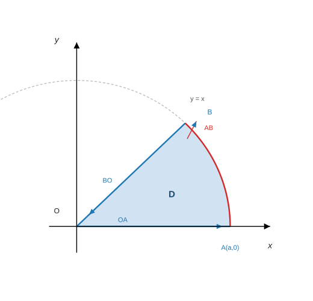
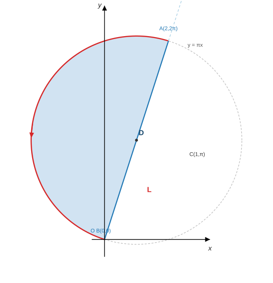

<h2 align="center">专题21 曲线积分</h2>

> 来源：《高等数学学习项目》讲义 · 知识模块127
> 题型：2 类 —— 对弧长的曲线积分（例1-例2）／对坐标的曲线积分（例3-例5）

------

### （一）考情分析

曲线积分通常以**计算题**的形式考查，**第二型曲线积分**（对坐标的曲线积分）的计算考查的频率较高，且题型相对比较固定，所以要加强训练。

三条主线（笔记整理）：

- **对弧长（第一型）**：**参数法 + $ds$**；下限**一定小于上限**；对称性、轮换对称性与二重积分相同；**曲线方程可直接代入被积函数**（例1、例2）。
- **对坐标（第二型）**：**参数法**（下限=起点、上限=终点）、**格林公式**（不满足条件时**补线**或**挖洞**）、**路径无关**（改换路径／原函数）、**斯托克斯公式**（空间曲线）、**两类曲线积分的关系**（例3-例5）。
- **三问定工具**：① 是不是闭曲线？② 区域内**有没有奇点**（$P,Q$ 是否处处有连续一阶偏导）？③ $\dfrac{\partial Q}{\partial x}$ 与 $\dfrac{\partial P}{\partial y}$ 是否相等？——**答案决定用参数法、格林、挖洞还是路径无关**。

> **⚠ 命题特征**：本模块以**计算题**为主，最常见的三套是"**补线 + 格林**""**挖洞 + 格林**""**斯托克斯**"，且常把**抽象函数**塞进被积式（例3），靠公式把 $f$ 项消掉。

------

### （二）题型一：对弧长的曲线积分的计算

#### 方法点拨

**1.** 利用**参数法**将对弧长的曲线积分转化为定积分，其中 $\mathrm ds=\sqrt{(\mathrm dx)^{2}+(\mathrm dy)^{2}}$ 且**定积分的下限一定小于上限**；

**2.** 关于坐标轴的**对称性、轮换对称性**与二重积分的相同；

**3.** 将曲线 $L$ 的方程**直接代入被积函数**，然后再计算。

#### 例1（先代入化简、再用对称性与极坐标参数化）

**【例1】** 计算曲线积分

$$
I=\oint_{L}\frac{xy+\sqrt{x^{2}+y^{2}}}{x^{2}+(y+1)^{2}}\mathrm ds,
$$

其中

$$
L:x^{2}+y^{2}=-2y .
$$

**【分析】** 因为 $L$ 关于坐标轴对称，所以可以考虑先化简；由于 $L$ 是圆，所以 $L$ 方程可以考虑用**极坐标**来表示。

**【解析】** 在 $L$ 上 $x^{2}+y^{2}=-2y$，故

$$
x^{2}+(y+1)^{2}=x^{2}+y^{2}+2y+1=(-2y)+2y+1=1,
$$

所以分母恒为 $1$，且 $xy$ 关于 $y$ 轴为奇函数（$L$ 关于 $y$ 轴对称）⟹ $\displaystyle\oint_L xy\,\mathrm ds=0$，于是

$$
I=\oint_{L}\bigl[xy+\sqrt{x^{2}+y^{2}}\bigr]\mathrm ds=\oint_{L}\sqrt{x^{2}+y^{2}}\,\mathrm ds .
$$

$L$ 的极坐标方程为

$$
L:\ r=-2\sin\theta\qquad(\pi\le\theta\le2\pi),
$$

且 $\mathrm ds=\sqrt{r^{2}+r'^{2}}\,\mathrm d\theta=\sqrt{4\sin^{2}\theta+4\cos^{2}\theta}\,\mathrm d\theta=2\,\mathrm d\theta$、$\sqrt{x^{2}+y^{2}}=|r|=-2\sin\theta$，所以

$$
I=\int_{\pi}^{2\pi}-2\sin\theta\cdot\sqrt{4\sin^{2}\theta+4\cos^{2}\theta}\,\mathrm d\theta
=\int_{\pi}^{2\pi}-4\sin\theta\,\mathrm d\theta=8 .
$$

**【考点】**

① **第一步永远是"把曲线方程代入"**：$L$ 上 $x^{2}+y^{2}=-2y$ ⟹ 分母 $x^{2}+(y+1)^{2}\equiv1$——**代入后分母消失**，这是本题能算的前提（方法提示 3 的直接体现）；

② **圆上的极坐标写法**：$x^{2}+y^{2}=-2y$ 即 $x^{2}+(y+1)^{2}=1$（圆心 $(0,-1)$、半径 $1$、**过原点**）；代入 $x=r\cos\theta$、$y=r\sin\theta$ 得 $r^{2}=-2r\sin\theta$ ⟹ $r=-2\sin\theta$（**$r$ 可为负**，对应 $\theta\in[\pi,2\pi]$ 这一支）✓；

③ **弧长元与"下限小于上限"**：$\mathrm ds=\sqrt{r^{2}+r'^{2}}\mathrm d\theta$，本例 $=2\mathrm d\theta$ ✓；积分从 $\pi$ 到 $2\pi$（**下限小、上限大**，对弧长有方向无关性）✓；

④ **$|r|$ 的符号要看清**：$\sqrt{x^{2}+y^{2}}=|r|=-2\sin\theta$（该区间上 $\sin\theta\le0$）——**不能直接写成 $r$**；若误写成 $r=-2\sin\theta$ 恰好同号，但换区间就会错；

⑤ **对称性省一半力气**：$L$ 关于 $y$ 轴对称 + $xy$ 对 $x$ 为奇 ⟹ $\oint_Lxy\,\mathrm ds=0$ ✓（第一型的对称性判定与二重积分完全一致）；

⑥ **抽查**（笔记补充）：数值 $\oint_L\sqrt{x^{2}+y^{2}}\,\mathrm ds=8.00000000$ ✓。

#### 例2（分段闭合曲线：逐段算再相加）

**【例2】** 计算

$$
\int_{L}e^{\sqrt{x^{2}+y^{2}}}\,\mathrm ds,
$$

$L$ 由圆周 $x^{2}+y^{2}=a^{2}$、直线 $y=x$ 及 $x$ 轴在**第一象限**中所围图形的边界。

**【分析】** 因为 $L$ 是个**分段闭合曲线**，所以**分段求积分**。

**【解析】** 记 $\overline{OA}$（$x$ 轴，$O\to A(a,0)$）、$\overline{AB}$（圆弧，$A\to B\bigl(\frac{\sqrt2}{2}a,\frac{\sqrt2}{2}a\bigr)$）、$\overline{BO}$（直线 $y=x$），则

> 图：例2 的分段闭合曲线 $L=\overline{OA}+\overline{AB}+\overline{BO}$——三条边界依次是 $x$ 轴（$\overline{OA}$）、圆周 $x^2+y^2=a^2$ 上的弧（$\overline{AB}$）与直线 $y=x$（$\overline{BO}$），围成的正是第一象限的扇形 $D$；箭头示出积分路径的方向 $O\to A\to B\to O$（对弧长积分与方向无关，这里只为看清分段）。

$$
\int_{L}e^{\sqrt{x^{2}+y^{2}}}\mathrm ds
=\int_{\overline{OA}}e^{\sqrt{x^{2}+y^{2}}}\mathrm ds+\int_{\overline{AB}}e^{\sqrt{x^{2}+y^{2}}}\mathrm ds+\int_{\overline{BO}}e^{\sqrt{x^{2}+y^{2}}}\mathrm ds,
$$

其中 $\overline{OA}:y=0,\ 0\le x\le a$，$\mathrm ds=\mathrm dx$，故 $\displaystyle\int_{\overline{OA}}e^{\sqrt{x^{2}+y^{2}}}\mathrm ds=\int_0^{a}e^{x}\mathrm dx=e^{a}-1$；

$\overline{AB}:x=a\cos t,\ y=a\sin t,\ 0\le t\le\frac\pi4$，$\mathrm ds=a\,\mathrm dt$，$\sqrt{x^{2}+y^{2}}=a$，故 $\displaystyle\int_{\overline{AB}}=\int_0^{\frac\pi4}e^{a}\cdot a\,\mathrm dt=\frac\pi4ae^{a}$；

$\overline{BO}:y=x,\ 0\le x\le\frac{\sqrt2}{2}a$，$\mathrm ds=\sqrt2\,\mathrm dx$，$\sqrt{x^{2}+y^{2}}=\sqrt2x$，故 $\displaystyle\int_{\overline{BO}}=\int_0^{\frac{\sqrt2}{2}a}e^{\sqrt2x}\sqrt2\,\mathrm dx=e^{a}-1$。

故

$$
\int_{L}e^{\sqrt{x^{2}+y^{2}}}\,\mathrm ds=2(e^{a}-1)+\frac\pi4ae^{a}.
$$

**【考点】**

① **分段闭合曲线 = 分段参数化**：第一型曲线积分对**闭合曲线**没有"格林公式"可用（那是第二型的工具），只能**逐段算再相加**（方法提示 1）；

② **每段都要把该段的曲线方程代入**：$\overline{OA}$ 上 $y=0$ ⟹ 被积函数 $e^{x}$；$\overline{AB}$ 上 $x^{2}+y^{2}=a^{2}$ ⟹ $e^{a}$（**常数**，直接把 $e^a$ 提出）；$\overline{BO}$ 上 $y=x$ ⟹ $e^{\sqrt2x}$ ✓——**"代入"能大幅简化**；

③ **三段各自算 $\mathrm ds$**：$y=0$ ⟹ $\mathrm ds=\mathrm dx$；圆弧参数方程 ⟹ $\mathrm ds=a\,\mathrm dt$（半径乘角度）；$y=x$ ⟹ $\mathrm ds=\sqrt2\mathrm dx$ ✓（**三条路径的 $\mathrm ds$ 都不同**，别混用）；

④ **下限一律小于上限**：三段分别是 $0\to a$、$0\to\frac\pi4$、$0\to\frac{\sqrt2}2a$ ✓（对弧长**与方向无关**，所以起点终点反着写不影响结果，但**必须下限<上限**）；

⑤ **结果核对**：两段直线给出相同的 $e^{a}-1$（因为两段上 $x$ 的取值范围恰好使 $\sqrt{x^2+y^2}$ 的积分同值），圆弧给出 $\frac\pi4ae^{a}$ ⟹ 合计 $2(e^{a}-1)+\frac\pi4ae^{a}$ ✓；

⑥ **抽查**（笔记补充）：取 $a=1$，数值 $5.57149721=2(e-1)+\frac\pi4e$ ✓。

------

### （三）题型二：对坐标的曲线积分的计算

#### 方法点拨

**1.** 利用**参数法**将对坐标的曲线积分转化为定积分，其中定积分的**下限对应曲线的起点，上限对应曲线的终点**；

**2.** 利用**格林公式**：

$$
\oint_{L}P\mathrm dx+Q\mathrm dy=\iint_{D}\Bigl(\frac{\partial Q}{\partial x}-\frac{\partial P}{\partial y}\Bigr)\mathrm dx\mathrm dy .
$$

**注**：不满足格林公式条件时，两种处理办法：**① 添加辅助曲线；② 挖洞法**。

**3.** 利用**曲线积分与路径无关**：若 $\dfrac{\partial Q}{\partial x}=\dfrac{\partial P}{\partial y}$，则

**方法一：改换路径**（一般选择沿着平行于坐标轴的折线进行积分）。设 $L$ 的起点为 $(x_1,y_1)$、终点为 $(x_2,y_2)$，则

$$
\int_{L}P\mathrm dx+Q\mathrm dy=\int_{(x_1,y_1)}^{(x_2,y_2)}P\mathrm dx+Q\mathrm dy
=\int_{x_1}^{x_2}P(x,y_1)\mathrm dx+\int_{y_1}^{y_2}Q(x_2,y)\mathrm dy .
$$

**方法二：利用原函数**。若 $\mathrm du(x,y)=P\mathrm dx+Q\mathrm dy$，则

$$
\int_{(x_1,y_1)}^{(x_2,y_2)}P\mathrm dx+Q\mathrm dy=u(x,y)\Big|_{(x_1,y_1)}^{(x_2,y_2)} .
$$

**4.** 利用**斯托克斯公式**计算空间对坐标的曲线积分

$$
\oint_{L}P\mathrm dx+Q\mathrm dy+R\mathrm dz
=\iint_{\Sigma}
\begin{vmatrix}
\mathrm dy\mathrm dz & \mathrm dz\mathrm dx & \mathrm dx\mathrm dy\\[1mm]
\dfrac{\partial}{\partial x} & \dfrac{\partial}{\partial y} & \dfrac{\partial}{\partial z}\\[2mm]
P & Q & R
\end{vmatrix}
=\iint_{\Sigma}
\begin{vmatrix}
\cos\alpha & \cos\beta & \cos\gamma\\[1mm]
\dfrac{\partial}{\partial x} & \dfrac{\partial}{\partial y} & \dfrac{\partial}{\partial z}\\[2mm]
P & Q & R
\end{vmatrix}\mathrm dS,
$$

其中 $\vec n=(\cos\alpha,\cos\beta,\cos\gamma)$ 为 $\Sigma$ 的**单位法向量**。

**5.** 利用**两类曲线积分之间的关系**计算：

$$
\int_{L}P\mathrm dx+Q\mathrm dy=\int_{L}(P\cos\alpha+Q\cos\beta)\mathrm ds,
$$

其中 $\alpha$、$\beta$ 为有向曲线弧 $L$ 上点 $(x,y)$ 处的**正向切线向量的方向角**。

#### 例3（非闭曲线：补线法 + 格林公式，抽象函数自动消去）

**【例3】** 设 $f(x)$ 具有**一阶连续导数**，计算曲线积分

$$
\int_{L}f'(x)\sin y\,\mathrm dx+\bigl[f(x)\cos y-\pi x\bigr]\mathrm dy,
$$

其中曲线 $L$ 是从点 $A(2,2\pi)$ 沿圆周 $(x-1)^{2}+(y-\pi)^{2}=1+\pi^{2}$ 的**上半圆周**到点 $B(0,0)$。

**【分析】** 因为 $\dfrac{\partial Q}{\partial x}-\dfrac{\partial P}{\partial y}$ **比较简单**，故考虑用**格林公式**；由于**不是闭曲线**，故用**补线法**。

**【解析】** 因为 $\overline{AB}:y=\pi x$（$x$ 从 $2$ 到 $0$），与 $L$ 正好合成闭曲线 $L+\overline{BA}$，如图：

> 图：例3 的补线法——$L$ 是以 $C(1,\pi)$ 为心、半径 $\sqrt{1+\pi^2}$ 的圆上从 $A(2,2\pi)$ 到 $B(0,0)$ 的**上半圆弧**（红，箭头示方向）；补上弦 $\overline{BA}$（即直线 $y=\pi x$）后构成闭曲线，围成的半圆域记作 $D$。

$$
\int_{L}f'(x)\sin y\,\mathrm dx+\bigl[f(x)\cos y-\pi x\bigr]\mathrm dy
=\int_{L+\overline{BA}}+\int_{\overline{AB}}
$$

$$
=\iint_{D}(-\pi)\mathrm dx\mathrm dy+\int_{\overline{AB}}f'(x)\sin y\,\mathrm dx+\bigl[f(x)\cos y-\pi x\bigr]\mathrm dy
$$

（这里 $P=f'(x)\sin y$、$Q=f(x)\cos y-\pi x$，故 $\dfrac{\partial Q}{\partial x}-\dfrac{\partial P}{\partial y}=f'(x)\cos y-\pi-f'(x)\cos y=-\pi$；而 $\iint_D\mathrm dx\mathrm dy=\dfrac12\pi(1+\pi^2)$ 是**半圆域**的面积）即

$$
=-\pi\cdot\frac12\pi(1+\pi^2)+\int_{2}^{0}\Bigl[f'(x)\sin\pi x+\bigl(f(x)\cos\pi x-\pi x\bigr)\cdot\pi\Bigr]\mathrm dx
$$

因为

$$
\int_{2}^{0}\bigl[f'(x)\sin\pi x+\pi f(x)\cos\pi x\bigr]\mathrm dx
=\int_{2}^{0}f'(x)\sin\pi x\,\mathrm dx+\int_{2}^{0}f(x)\,\mathrm d(\sin\pi x)
$$

$$
=\int_{2}^{0}f'(x)\sin\pi x\,\mathrm dx+f(x)\sin\pi x\Big|_{2}^{0}-\int_{2}^{0}f'(x)\sin\pi x\,\mathrm dx=0
$$

（**两项恰好相消**，且 $f(x)\sin\pi x\big|_2^0=f(0)\sin0-f(2)\sin2\pi=0$），故原式

$$
=-\frac{\pi^{2}}{2}(1+\pi^{2})+\int_{2}^{0}\pi^{2}x\,\mathrm dx
=-\frac{\pi^{2}}{2}(1+\pi^{2})+2\pi^{2}
=\frac{3}{2}\pi^{2}-\frac{\pi^{4}}{2}.
$$

**【考点】**

① **判断顺序**：先看**闭不闭**（非闭 ⟹ 补线）、再看 $\dfrac{\partial Q}{\partial x}-\dfrac{\partial P}{\partial y}$ **简不简单**（是常数最好 ⟹ 格林公式）（例3）；

② **补什么线**：补的线要**简单**（这里是直线 $y=\pi x$，两端点就是 $B(0,0)$、$A(2,2\pi)$），且**方向**要与 $L$ 合成**正向闭曲线**（$L$ 从 $A$ 到 $B$，故补 $\overline{BA}$ 从 $B$ 到 $A$）✓；

③ **圆的关键几何量**：$(x-1)^2+(y-\pi)^2=1+\pi^2$（圆心 $C(1,\pi)$、半径 $\sqrt{1+\pi^2}$）**过原点**，且 $A(2,2\pi)$ 与 $B(0,0)$ 是**一条直径的两个端点**（都到 $C$ 的距离为半径）⟹ $L$ 与弦 $AB$ 围成的是**半圆域**，面积 $=\frac12\pi(1+\pi^2)$ ✓（这一步定错面积，后面全错）；

④ **抽象函数在补线上自动消去**：$\overline{AB}$ 上 $y=\pi x$、$\mathrm dy=\pi\mathrm dx$，于是 $f'$ 项与 $f$ 项**凑成导数** $\mathrm d[f(x)\sin\pi x]=f'\sin\pi x+\pi f\cos\pi x$ ⟹ 两项相消、只剩 $-\int_2^0\pi^2x\mathrm dx$（**这正是命题人设计补线为 $y=\pi x$ 的原因**：把 $\cos y$ 变成 $\cos\pi x$，凑出全微分）；

⑤ **最后注意积分上下限**：$\overline{AB}$ 的方向是 $x:2\to0$，故 $\int_2^0\pi^2x\mathrm dx=-2\pi^2$，代入时**别把符号弄反**；结果 $-\frac{\pi^2}2(1+\pi^2)+2\pi^2=\frac32\pi^2-\frac{\pi^4}2$ ✓；

⑥ **抽查**（笔记补充）：取 $f=x^2$、$f=\sin x$、$f=3x+1$ 分别数值积分，结果**完全相同**：$-33.90013892=\frac32\pi^2-\frac{\pi^4}2$ ✓（印证"答案与 $f$ 无关"）。

#### 例4（闭曲线：条件满足直接格林 vs 含奇点挖洞）

**【例4】** 计算

$$
I=\oint_{C}\frac{y\,\mathrm dx-x\,\mathrm dy}{x^{2}+y^{2}},
$$

其中 **(1)** $C$ 为 $x^{2}+y^{2}-2y=-\dfrac12$ 的正向；**(2)** $C$ 为 $4x^{2}+y^{2}-8x=4$ 的正向。

**【分析】** 由于 $\dfrac{\partial Q}{\partial x}-\dfrac{\partial P}{\partial y}=0$，所以考虑用**格林公式**，重点是**验证条件**：第一问满足条件，直接用；第二问不满足条件（**有奇点**），故用**挖洞法**。

**【解析】** **(1)** $C:x^{2}+(y-1)^{2}=\dfrac12$，由格林公式得

$$
I=\iint_{D}\Bigl(\frac{\partial Q}{\partial x}-\frac{\partial P}{\partial y}\Bigr)\mathrm d\sigma
=\iint_{D}\Bigl[\frac{x^{2}-y^{2}}{(x^{2}+y^{2})^{2}}-\frac{x^{2}-y^{2}}{(x^{2}+y^{2})^{2}}\Bigr]\mathrm d\sigma=0 .
$$

**(2)** $C:\dfrac{(x-1)^{2}}{2}+\dfrac{y^{2}}{8}=1$，此时**不能直接用**格林公式，因为在 $(0,0)$ 点条件不满足。因此，作以 $(0,0)$ 为中心的圆

$$
L:x^{2}+y^{2}=\varepsilon^{2}\quad(\varepsilon>0)
$$

且取**顺时针**方向，在 $L$ 和 $C$ 围成的**环形域**上用格林公式得

$$
\oint_{C+L}\frac{y\mathrm dx-x\mathrm dy}{x^{2}+y^{2}}=\iint\Bigl[\frac{x^{2}-y^{2}}{(x^{2}+y^{2})^{2}}-\frac{x^{2}-y^{2}}{(x^{2}+y^{2})^{2}}\Bigr]\mathrm d\sigma=0,
$$

即

$$
\oint_{C}\frac{y\mathrm dx-x\mathrm dy}{x^{2}+y^{2}}+\oint_{L}\frac{y\mathrm dx-x\mathrm dy}{x^{2}+y^{2}}=0 .
$$

则

$$
I=\oint_{C}\frac{y\mathrm dx-x\mathrm dy}{x^{2}+y^{2}}
=\oint_{-L}\frac{y\mathrm dx-x\mathrm dy}{x^{2}+y^{2}}
=\frac{1}{\varepsilon^{2}}\oint_{-L}y\mathrm dx-x\mathrm dy
=\frac{1}{\varepsilon^{2}}\iint_{D_L}(-1-1)\mathrm d\sigma
=\frac{1}{\varepsilon^{2}}(-2\pi\varepsilon^{2})=-2\pi .
$$

> **【评注】** 由本题可看出，对线积分 $\displaystyle\int\frac{y\mathrm dx-x\mathrm dy}{x^{2}+y^{2}}$，$P=\dfrac{y}{x^{2}+y^{2}}$、$Q=\dfrac{-x}{x^{2}+y^{2}}$，除原点 $(0,0)$ 外 $P$、$Q$ 有连续一阶偏导数，且 $\dfrac{\partial P}{\partial y}=\dfrac{\partial Q}{\partial x}\ (x,y)\ne(0,0)$。此时有以下结论：
> **(1)** 沿任何一条**不包含原点在内**的分段光滑闭曲线的积分为**零**；
> **(2)** 沿任何一条**包含原点在内**的分段光滑闭曲线的积分**均相等**（都等于 $-2\pi$）。

**【考点】**

① **格林公式的"条件"就是要查三件事**：$P,Q$ 在**闭区域 $D$ 上处处**有一阶连续偏导（**奇点！**）、$D$ 是单连通/复连通的处理、曲线的**正向**（逆时针）；

② **(1) 的判定**：$x^{2}+(y-1)^{2}=\frac12$ 的圆心 $(0,1)$ 到原点的距离为 $1>\frac{1}{\sqrt2}$ ⟹ **原点在圆外** ⟹ 条件满足 ⟹ 积分 $=0$（与上面算出的被积函数恒为 0 一致）✓；

③ **(2) 的判定**：$4x^{2}+y^{2}-8x=4\Rightarrow\frac{(x-1)^2}{2}+\frac{y^2}{8}=1$，把原点代入左边得 $0<8$ ⟹ **原点在椭圆内** ⟹ **不能用**格林公式（否则会用到奇点处的偏导）⟹ **挖洞法**；

④ **挖洞的关键细节——内圆取顺时针**：外边界 $C$ 取正向（逆时针）时，环形域的边界是 $C$（逆时针）+ $L$（**顺时针**），这样左右手规则才一致 ⟹ $\oint_{C}+\oint_{L}=0$ ⟹ $I=\oint_{-L}$ ✓（**内圆方向弄反会差一个负号**，这是本题最大的坑）；

⑤ **$y\mathrm dx-x\mathrm dy$ 的积分是小圆的"面积公式"**：$\oint_{-L}y\mathrm dx-x\mathrm dy=\iint_{D_L}(-1-1)\mathrm d\sigma=-2\pi\varepsilon^2$（这里又用了一次格林公式，把线积分化成圆面积）；再乘 $\frac1{\varepsilon^2}$ 得 $-2\pi$——**$\varepsilon$ 被约掉**，所以结果与洞的大小无关 ✓；

⑥ **【评注】的两条结论要背**（本题型的高频考点）：不含原点的闭曲线 ⟹ 积分 $=0$；含原点的闭曲线 ⟹ 积分恒为 $-2\pi$（**与曲线形状、大小无关**）；

⑦ **抽查**（笔记补充）：(1) 数值 $-0.00000000$ ✓；(2) 沿椭圆正向数值 $-6.28318531=-2\pi$ ✓；另取包住原点的圆 $x^2+(y-1)^2=4$ 数值也是 $-6.283185$（$=-2\pi$）✓，印证结论 (2)。

#### 例5（空间闭曲线：斯托克斯公式）

**【例5】** 计算空间曲线积分

$$
I=\oint_{L}(y-z)\mathrm dx+(z-x)\mathrm dy+(x-y)\mathrm dz,
$$

其中曲线 $L$ 为圆柱面 $x^{2}+y^{2}=a^{2}$ 与平面 $\dfrac xa+\dfrac zh=1\ (a>0,h>0)$ 的交线，从 $x$ 轴正向看去，曲线是**逆时针方向**。

**【分析】** 计算空间对坐标的曲线积分，考虑**斯托克斯公式**。

**【解析】**

$$
I=\oint_{L}(y-z)\mathrm dx+(z-x)\mathrm dy+(x-y)\mathrm dz
=\iint_{\Sigma}
\begin{vmatrix}
\mathrm dy\mathrm dz & \mathrm dz\mathrm dx & \mathrm dx\mathrm dy\\[1mm]
\dfrac{\partial}{\partial x} & \dfrac{\partial}{\partial y} & \dfrac{\partial}{\partial z}\\[2mm]
y-z & z-x & x-y
\end{vmatrix}
$$

（转子的三个分量都是 $-2$）

$$
=-2\iint_{\Sigma}\mathrm dy\mathrm dz+\mathrm dz\mathrm dx+\mathrm dx\mathrm dy
=-2\iint_{D_{xy}}(1,1,1)\cdot\Bigl(-\frac ha,\ 0,\ 1\Bigr)\mathrm dx\mathrm dy
$$

$$
=-2\iint_{D_{xy}}\Bigl(\frac ha+1\Bigr)\mathrm dx\mathrm dy=-2\pi a(h+a).
$$

**【考点】**

① **空间闭曲线 ⟹ 斯托克斯**：把 $\oint_L$ 化为 $\iint_\Sigma$，**$\Sigma$ 任选**（以 $L$ 为边界即可）——本题选**平面的一块**（最简单），$D_{xy}$ 是它在 $xOy$ 面上的投影（**圆盘 $x^2+y^2\le a^2$**）✓；

② **"$P\mathrm dx+Q\mathrm dy+R\mathrm dz$"型的面元**：$\iint_\Sigma P\mathrm dy\mathrm dz+Q\mathrm dz\mathrm dx+R\mathrm dx\mathrm dy=\iint_{D_{xy}}(-Pz_x-Qz_y+R)\mathrm dx\mathrm dy$（**曲面写成 $z=z(x,y)$ 时**）——本题 $z=h\bigl(1-\frac xa\bigr)$ ⟹ $z_x=-\frac ha$、$z_y=0$ ⟹ $-1\cdot(-\frac ha)-0+1=\frac ha+1$ ✓（讲义写作 $(1,1,1)\cdot(-\frac ha,0,1)$ 就是这一步的内积形式）；

③ **转子的算法**：$\nabla\times\vec F=\Bigl(\frac{\partial R}{\partial y}-\frac{\partial Q}{\partial z},\ \frac{\partial P}{\partial z}-\frac{\partial R}{\partial x},\ \frac{\partial Q}{\partial x}-\frac{\partial P}{\partial y}\Bigr)$，对 $\vec F=(y-z,\ z-x,\ x-y)$ 三个分量**都等于 $-2$** ✓（**每一项都是"一个变量的系数 $-1$ 减另一个 $-1$"**，先算出来再往行列式里代更稳）；

④ **法向量方向与曲线方向配套（右手法则）**：题给"从 $x$ 轴正向看是逆时针" ⟹ 诱导法向量的 **$x$ 分量为正** ⟹ 与 $(-z_x,-z_y,1)=(\frac ha,0,1)$ 一致（$h>0$）✓；若把 $L$ 的方向理解反了，答案会差一个负号；

⑤ **面积因子**：$\iint_{D_{xy}}\mathrm dx\mathrm dy=\pi a^{2}$ ⟹ $I=-2(\frac ha+1)\pi a^2=-2\pi a(h+a)$ ✓（**答案含 $a+h$ 两个参数**，量纲上是"长度×面积"）；

⑥ **抽查**（笔记补充）：取 $a=1$、$h=2$，按题给方向的参数化 $(a\cos t,\ a\sin t,\ h(1-\cos t))$（$t:0\to2\pi$）数值得 $-18.849556=-6\pi=-2\pi a(h+a)$ ✓（反向后为 $+6\pi$）。

------

### （四）小结：曲线积分的工具选择

| <nobr>情形</nobr> | <nobr>工具</nobr> | 关键动作 |
|:---|:---|:---|
| <nobr>对弧长（第一型），任意曲线</nobr> | **参数法 + $\mathrm ds$** | **下限一定小于上限**；**把曲线方程代入被积函数**化简（例1）；分段闭合曲线**逐段算**（例2） |
| <nobr>对坐标（第二型），闭曲线且条件满足</nobr> | **格林公式** | 查 $P,Q$ 在 $D$ 上**处处**有一阶连续偏导、曲线取**正向**（逆时针）（例4(1)） |
| <nobr>对坐标，**非闭**曲线</nobr> | **补线法 + 格林** | 补简单曲线成闭路（方向要凑成正向），再**减去**补线上的积分（例3） |
| <nobr>对坐标，闭曲线但**含奇点**</nobr> | **挖洞法 + 格林** | 作小圆（取**顺时针**）与 $C$ 组成环形域；结果**与洞的大小无关**（例4(2)） |
| <nobr>路径无关（$\frac{\partial Q}{\partial x}=\frac{\partial P}{\partial y}$）</nobr> | **改换路径 / 原函数** | 折线：$\int_{x_1}^{x_2}P(x,y_1)\mathrm dx+\int_{y_1}^{y_2}Q(x_2,y)\mathrm dy$；或找 $\mathrm du=P\mathrm dx+Q\mathrm dy$ |
| <nobr>空间闭曲线</nobr> | **斯托克斯公式** | 化到 $\iint_\Sigma$（**选平面**最简单）；法向与曲线方向**右手法则**（例5） |

**七条高频提醒**

1. **第一型与第二型的"上下限"规则相反**：第一型（对弧长）**下限一定小于上限**（$\mathrm ds>0$，与方向无关）；第二型（对坐标）**下限=起点、上限=终点**（反向差一个负号）——这是最易混的一处。
2. **第一型先"代入曲线方程"**：积分在曲线上进行，$L$ 的方程可以**直接代进被积函数**（例1 的分母 $x^{2}+(y+1)^{2}\equiv1$；例2 圆弧上 $e^{\sqrt{x^2+y^2}}=e^a$）——常常一步就把积分变简单。
3. **第一型看对称性**：关于坐标轴对称时奇函数项直接为 0（例1 的 $xy$），轮换对称性与二重积分类同。
4. **闭曲线先问"格林条件满足吗"**：$P,Q$ 在**所围区域内**是否处处有连续一阶偏导——满足就用（例4(1)）；不满足就**挖洞**（例4(2)），**内圆取顺时针**。
5. **非闭曲线用补线法**：补的线要简单（常是直线），**方向要与原曲线合成正向闭路**；被积函数含抽象函数时，往往在补线上凑成全微分而**自动消去**（例3）。
6. **"$\frac{y\mathrm dx-x\mathrm dy}{x^{2}+y^{2}}$"要背结论**：不含原点的闭曲线积分为 $0$、含原点的闭曲线积分恒为 $-2\pi$（例4 评注）——这是本模块出现频率最高的"套路题"。
7. **空间闭曲线用斯托克斯**：$\iint_\Sigma P\mathrm dy\mathrm dz+Q\mathrm dz\mathrm dx+R\mathrm dx\mathrm dy=\iint_{D_{xy}}(-Pz_x-Qz_y+R)\mathrm dx\mathrm dy$（$\Sigma:z=z(x,y)$）；法向量由"**右手法则**"与曲线方向配套（例5）。

> **衔接**：二重积分与三重积分见 `专题17`（知识模块123）、`专题18`（124）、`专题19`（125）、`专题20`（126）——本模块的格林公式是二重积分的"边界版"，斯托克斯是曲面积分的"边界版"；公式汇总见 `数学\高数\总结\曲线积分总结.md`；后续**曲面积分**（高斯公式）沿用同一套"验证条件 → 选公式 → 化重积分"的思路；对应刷题见 `数学\高数\题目.md` 的（七）曲线积分（题 45-52）：题 45 对弧长（轮换对称性）、题 46 空间曲线第一类、题 47 两类积分符号判断、题 48 变力做功（保守场）、题 49 分段折线＋格林、题 51 挖洞法、题 52 斯托克斯。
