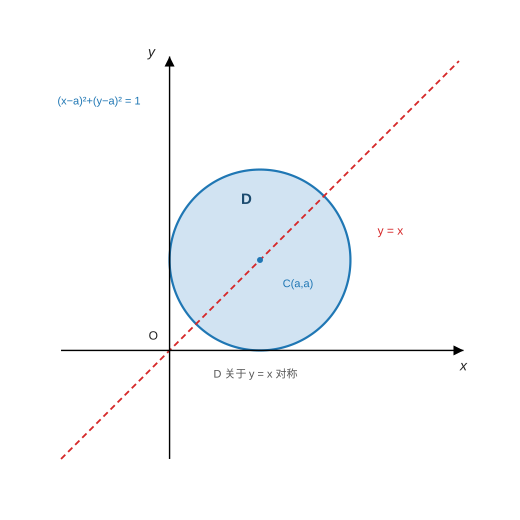

<h2 align="center">专题22 平面曲线积分与路径无关的相关问题</h2>

> 来源：《高等数学学习项目》讲义 · 知识模块128
> 题型：1 类 —— 平面曲线积分与路径无关的相关问题（方法提示 2 条 + 例1-例4）

------

### （一）考情分析

积分与路径无关主要考查**五个等价条件**，考查方式主要有以下两种：**已知曲线积分与路径无关，求未知函数表达式**；**由曲线积分与路径无关，求起点和终点确定的任意曲线的积分值**。

两条主线（笔记整理）：

- **"求未知函数"型**：把"与路径无关"翻译成**等价条件 (5)** $\dfrac{\partial P}{\partial y}=\dfrac{\partial Q}{\partial x}$，得到一个**微分方程**（例1 是二阶线性、例2 是解出 $Q$、例4 是全微分方程），再用初值/恒等式定常数。
- **"求积分值"型**：既然与路径无关，就用**折线路径**（平行于坐标轴）或**原函数** $u$ 求值——`专题21` 方法提示 3 的两种办法在这里是主力。

> **⚠ 前提别丢**：等价条件 (5) 成立要有两个前提——**$G$ 是单连通区域**、**$P,Q$ 在 $G$ 内有一阶连续偏导**；多连通区域或有奇点时 (5) 不再与"路径无关"等价（对比 `专题21` 例4：$\frac{y\mathrm dx-x\mathrm dy}{x^2+y^2}$ 满足 (5) 但在含原点的闭曲线上积分不为 0）。

------

### （二）题型一：平面曲线积分与路径无关的相关问题

#### 方法点拨

**1. 定义**：设 $G$ 是**单连通区域**，$P(x,y)$、$Q(x,y)$ 在区域 $G$ 内具有一阶连续偏导数，如果对于 $G$ 内任意指定的两个点 $A$、$B$ 以及 $G$ 内从点 $A$ 到点 $B$ 的任意两条曲线 $L_1$、$L_2$，恒有

$$
\int_{L_1}P\mathrm dx+Q\mathrm dy=\int_{L_2}P\mathrm dx+Q\mathrm dy,
$$

则称曲线积分 $\displaystyle\int_{L}P\mathrm dx+Q\mathrm dy$ 在 $G$ 内**与路径无关**。

**2. 几个等价条件**：设区域 $G$ 是一个**单连通区域**，函数 $P(x,y)$、$Q(x,y)$ 在区域 $G$ 内具有一阶连续偏导数，则下列几个条件等价：

**(1)** 曲线积分 $\displaystyle\int_{L}P(x,y)\mathrm dx+Q(x,y)\mathrm dy$ **与路径无关**；

**(2)** $\displaystyle\oint_{L}P\mathrm dx+Q\mathrm dy=0$，其中 $L$ 是 $G$ 内**任意封闭曲线**；

**(3)** $P(x,y)\mathrm dx+Q(x,y)\mathrm dy$ 是某二元函数 $u(x,y)$ 的**全微分**，即存在 $u(x,y)$ 使得

$$
\mathrm du(x,y)=P(x,y)\mathrm dx+Q(x,y)\mathrm dy;
$$

**(4)** $P(x,y)\boldsymbol i+Q(x,y)\boldsymbol j$ 是某二元函数 $u(x,y)$ 的**梯度**；

**(5)** $\dfrac{\partial P}{\partial y}=\dfrac{\partial Q}{\partial x}$。

（笔记补充）**两个"用法提示"**：**"求未知函数"** ⟹ 用条件 (5) 列微分方程（例1、例2、例4）；**"求积分值"** ⟹ 用条件 (3)/(4) 找原函数 $u$，或把路径改换成**折线**。

#### 例1（求 $f(x)$：条件 (5) ⟹ 二阶线性方程）

**【例1】** 设 $f(x)$ 有**二阶连续导数**，$f(1)=f'(1)=1$，且

$$
\oint_{C}\Bigl[\frac{y^{2}}{x}+xf\Bigl(\frac yx\Bigr)\Bigr]\mathrm dx+\Bigl[y-xf'\Bigl(\frac yx\Bigr)\Bigr]\mathrm dy=0,
$$

其中 $C$ 是**右半平面 $x>0$ 内任一**分段光滑简单闭曲线，求 $f(x)$。

**【分析】** **已知条件是积分与路径无关的等价条件之一**（"任意闭曲线上的积分为 0" ⟹ 条件 (2)），利用**条件 (5)** 转化成微分方程。

**【解析】** 由题设条件知，在 $x>0$ 处

$$
\frac{\partial}{\partial y}\Bigl[\frac{y^{2}}{x}+xf\Bigl(\frac yx\Bigr)\Bigr]
=\frac{\partial}{\partial x}\Bigl[y-xf'\Bigl(\frac yx\Bigr)\Bigr],
$$

即

$$
2\frac yx+f'\Bigl(\frac yx\Bigr)=-f'\Bigl(\frac yx\Bigr)+\frac yx f''\Bigl(\frac yx\Bigr).
$$

令 $\dfrac yx=t$，则

$$
2t+2f'(t)=t f''(t)\quad\Longrightarrow\quad f''(t)-\frac{2}{t}f'(t)=2 .
$$

这是关于 $f'(t)$ 的**一阶线性方程**，由通解公式知

$$
f'(t)=t^{2}\Bigl[-\frac2t+C_1\Bigr]=-2t+C_1t^{2}.
$$

由 $f'(1)=1$ 知 $C_1=3$。于是

$$
f'(t)=3t^{2}-2t\quad\Longrightarrow\quad f(t)=t^{3}-t^{2}+C_2 .
$$

由 $f(1)=1$ 知 $C_2=1$，则

$$
f(x)=x^{3}-x^{2}+1 .
$$

**【考点】**

① **"任意闭曲线上积分为 0"就是条件 (2)**：它等价于"与路径无关"，从而可以用**条件 (5)** 列方程——这是本模块"**求未知函数**"型的标准起手式（例1、例2、例4 都是这一招）；

② **复合函数的偏导要一层层算**：$xf\bigl(\frac yx\bigr)$ 对 $y$ 求导 $=x\cdot f'\bigl(\frac yx\bigr)\cdot\frac1x=f'\bigl(\frac yx\bigr)$；$xf'\bigl(\frac yx\bigr)$ 对 $x$ 求导 $=f'\bigl(\frac yx\bigr)+x\cdot f''\bigl(\frac yx\bigr)\cdot\bigl(-\frac y{x^2}\bigr)=f'\bigl(\frac yx\bigr)-\frac yx f''\bigl(\frac yx\bigr)$——**$f''$ 项全靠这一步出现**；

③ **换元把"二元等式"变成"一元方程"**：$t=\frac yx$ 后 $2t+2f'(t)=tf''(t)$，即 $f''-\frac2tf'=2$——**注意 $t\neq0$**（由 $x>0$、$y$ 与 $x$ 同号使 $t>0$ 或"任一闭曲线"要求在右半平面内），这是本题"右半平面"条件的用处（避开 $x=0$ 使 $\frac yx$ 无意义）；

④ **降阶解一阶线性方程**：记 $u=f'$，则 $u'-\frac2tu=2$，积分因子 $\mu=e^{\int-\frac2t\mathrm dt}=t^{-2}$ ⟹ $(ut^{-2})'=2t^{-2}$ ⟹ $u=t^{2}\bigl(-\frac2t+C_1\bigr)=-2t+C_1t^{2}$ ✓（**也可以直接用一阶线性通解公式**）；

⑤ **两个初值定两个常数**：$f'(1)=1\Rightarrow C_1=3$（先定 $f'$ 里的常数）、$f(1)=1\Rightarrow C_2=1$ ✓——**顺序不能颠倒**（若先用 $f(1)$ 会多一个未知的 $C_1$）；

⑥ **抽查**（笔记补充）：把 $f=x^{3}-x^{2}+1$、$f'=3x^{2}-2x$、$f''=6x-2$ 代回，逐点验证 $\dfrac{\partial P}{\partial y}=\dfrac{\partial Q}{\partial x}=\dfrac{3y^{2}}{x^{2}}$：$(1,1)$ 得 $3$、$(2,1)$ 得 $0.75$、$(0.5,3)$ 得 $108$、$(3,2.5)$ 得 $2.0833$ ✓ 全部一致。

#### 例2（求 $Q(x,y)$：条件 (5) 定出 $Q$ 的形式 + 积分恒等式定函数）

**【例2】** 设函数 $Q(x,y)$ 具有一阶连续偏导数，曲线积分 $\displaystyle\int_{L}2xy\,\mathrm dx+Q(x,y)\mathrm dy$ 与路径无关，并且对任意 $t$ 恒有

$$
\int_{(0,0)}^{(t,1)}2xy\,\mathrm dx+Q(x,y)\mathrm dy=\int_{(0,0)}^{(1,t)}2xy\,\mathrm dx+Q(x,y)\mathrm dy,
$$

求 $Q(x,y)$。

**【分析】** 本题考查积分与路径无关，通过**等价条件 (5)** 推出微分方程（进而是 $Q$ 的形式），再用**积分恒等式**定其中的待定函数。

**【解析】** 由曲线积分与路径无关的条件得

$$
\frac{\partial Q}{\partial x}=\frac{\partial(2xy)}{\partial y}=2x
\quad\Longrightarrow\quad
Q(x,y)=x^{2}+c(y),
$$

其中 $c(y)$ 为**待定函数**。又（沿折线 $(0,0)\to(t,0)\to(t,1)$）

$$
\int_{(0,0)}^{(t,1)}2xy\,\mathrm dx+Q(x,y)\mathrm dy=\int_{0}^{1}\bigl[t^{2}+c(y)\bigr]\mathrm dy=t^{2}+\int_{0}^{1}c(y)\mathrm dy,
$$

又（沿折线 $(0,0)\to(1,0)\to(1,t)$）

$$
\int_{(0,0)}^{(1,t)}2xy\,\mathrm dx+Q(x,y)\mathrm dy=\int_{0}^{t}\bigl[1^{2}+c(y)\bigr]\mathrm dy=t+\int_{0}^{t}c(y)\mathrm dy .
$$

由已知

$$
t^{2}+\int_{0}^{1}c(y)\mathrm dy=t+\int_{0}^{t}c(y)\mathrm dy,
$$

两端对 $t$ **求导**得

$$
2t=1+c(t)\quad\Longrightarrow\quad c(t)=2t-1,
$$

所以

$$
Q(x,y)=x^{2}+2y-1 .
$$

**【考点】**

① **第一步用条件 (5) 只定出"$Q$ 的形状"**：$\dfrac{\partial Q}{\partial x}=2x$ ⟹ $Q=x^{2}+c(y)$——**待定函数 $c(y)$ 必须由别的条件再定**（这里就是那个积分恒等式），这是本题与例1 的区别；

② **算积分要挑折线**：沿水平段 $y=0$（$dy=0$、$2xy=0$）积分自动为 0，故只剩竖直段 $\int_0^1Q(t,y)\mathrm dy$ ✓；两条路径分别得 $t^{2}+\int_0^1c$ 与 $t+\int_0^tc$（**积分限一个是 $0\to1$、一个是 $0\to t$**，别写混）；

③ **"对任意 $t$ 恒等" ⟹ 求导**：把积分恒等式对 $t$ 求导，$\int_0^tc(y)\mathrm dy$ 的导数是 $c(t)$（**变限积分求导**）⟹ $2t=1+c(t)$ ✓；求导后得到代数式，比直接比较积分容易得多；

④ **注意上下限的（隐式）一致性**：$t=0$ 时原恒等式给出 $\int_0^1c(y)\mathrm dy=0$；把 $c=2t-1$ 代回：$\int_0^1(2y-1)\mathrm dy=0$ ✓ **自洽**（可作为答案的验算）；

⑤ **易错**：把 $\dfrac{\partial Q}{\partial x}=2x$ 写成 $Q=2x^2+c(y)$（**漏了 $\frac12$**，应为 $x^2$）；把恒等式两端的 $\int_0^1$ 与 $\int_0^t$ 混为一个；忘记 $Q$ 中的 $c(y)$；

⑥ **抽查**（笔记补充）：代入 $Q=x^{2}+2y-1$，恒等式两端在 $t=0.4$／$1$／$2$ 处分别得 $0.16$／$1$／$4$，**逐点相等** ✓。

#### 例3（证明不等式：格林公式 + 关于 $y=x$ 的对称性 + 均值不等式）

**【例3】** 设曲线 $L$ 是**正向**圆周

$$
(x-a)^{2}+(y-a)^{2}=1,
$$

$\varphi(x)$ 是连续的**正函数**，证明：

$$
\oint_{L}\frac{x}{\varphi(y)}\mathrm dy-y\varphi(x)\mathrm dx\ge2\pi .
$$

**【分析】** 本题可以从两个角度来思考：**1.** 由于**第二类曲线积分没有比较性**，所以要转换成**定积分或者二重积分**；**2.** 由于本题积分曲线是**闭曲线**，所以考虑先用**格林公式**处理一下，再根据处理结果来分析。

**【解析】** 由格林公式知（$P=-y\varphi(x)$、$Q=\dfrac{x}{\varphi(y)}$）

$$
\oint_{C}\frac{x}{\varphi(y)}\mathrm dy-y\varphi(x)\mathrm dx=\iint_{D}\Bigl[\frac{1}{\varphi(y)}+\varphi(x)\Bigr]\mathrm dx\mathrm dy,
$$

其中 $D$ 为曲线 $C$ 所围区域。由于区域 $D$ **关于 $y=x$ 对称**（圆心 $(a,a)$ 在直线 $y=x$ 上）：

> 图：例3 的区域 $D:(x-a)^2+(y-a)^2\le 1$——圆心 $C(a,a)$ 恰在直线 $y=x$ 上，故 $D$ **关于 $y=x$ 对称**，于是 $\iint_D\varphi(x)\mathrm dx\mathrm dy=\iint_D\varphi(y)\mathrm dx\mathrm dy$（把 $x$、$y$ 互换，区域不变）。

$$
\iint_{D}\varphi(x)\mathrm dx\mathrm dy=\iint_{D}\varphi(y)\mathrm dx\mathrm dy,
$$

于是

$$
\oint_{C}\frac{x}{\varphi(y)}\mathrm dy-y\varphi(x)\mathrm dx
=\iint_{D}\Bigl[\varphi(x)+\frac{1}{\varphi(x)}\Bigr]\mathrm dx\mathrm dy
\ge2\iint_{D}\sqrt{\varphi(x)\cdot\frac{1}{\varphi(x)}}\,\mathrm dx\mathrm dy
=2\iint_{D}\mathrm dx\mathrm dy=2\pi .
$$

**原题得证。**

**【考点】**

① **"第二类曲线积分没有比较性" ⟹ 先化成重积分**：不等式的目标（$\ge2\pi$）提示要用**面积**或**均值不等式**，而线积分本身无法比较 ⟹ 必须先用**格林公式**（或参数化）把它变成二重积分 ✓（这是本题的分析要点）；

② **格林公式的符号与配项**：$P=-y\varphi(x)$、$Q=\dfrac x{\varphi(y)}$，故 $\dfrac{\partial Q}{\partial x}=\dfrac1{\varphi(y)}$、$\dfrac{\partial P}{\partial y}=-\varphi(x)$ ⟹ 被积函数 $=\dfrac{1}{\varphi(y)}+\varphi(x)$ ✓（**两个偏导都是"一项"**，这是本题被设计成能算的原因）；

③ **对称性把两个变量"统一"**：$D$ 关于 $y=x$ 对称 ⟹ $\iint_D\varphi(x)=\iint_D\varphi(y)$，于是 $\varphi(y)$ 可以换成 $\varphi(x)$，**两项同变量才能用均值不等式**；这一步等价于把 $x$、$y$ 互换（**轮换对称性的二维版本**）；

④ **均值不等式**（$\varphi>0$ 是关键，题给的"正函数"）：
$$
\varphi(x)+\frac1{\varphi(x)}\ge2\sqrt{\varphi(x)\cdot\frac1{\varphi(x)}}=2,
$$
等号成立当且仅当 $\varphi\equiv1$（**取等号的情形**就是 $\varphi\equiv1$，此时被积函数恒为 2、积分 $=2\pi\cdot\text{面积}/1$ ✓）；

⑤ **面积要算对**：$D$ 是**半径 1** 的圆 ⟹ $\iint_D\mathrm dx\mathrm dy=\pi$ ⟹ 下界 $2\pi$ ✓（若把半径看成 $a$ 就错了）；

⑥ **抽查**（笔记补充）：取 $\varphi\equiv1$ 时数值 $=6.283185=2\pi$（**恰好取等**）；$\varphi\equiv2$ 时 $=7.853982=\frac52\pi\ge2\pi$ ✓；$\varphi=1+x^{2}$ 时 $=6.529863\ge2\pi$ ✓。

#### 例4（全微分方程：求 $f(x)$ 与方程的通解）

**【例4】** 设 $f(x)$ 具有**二阶连续导数**，$f(0)=0$、$f'(0)=1$，且

$$
\bigl[xy(x+y)-f(x)y\bigr]\mathrm dx+\bigl[f'(x)+x^{2}y\bigr]\mathrm dy=0
$$

为**一全微分方程**，求 $f(x)$ 及此全微分方程的通解。

**【分析】** 本题考查**全微分方程**求解，利用**积分与路径无关**。

**【解析】** 由全微分方程的充要条件 $\dfrac{\partial Q}{\partial x}=\dfrac{\partial P}{\partial y}$ 知（$P=xy(x+y)-f(x)y=x^{2}y+xy^{2}-f(x)y$、$Q=f'(x)+x^{2}y$）

$$
f''(x)+2xy=x^{2}+2xy-f(x),
$$

即

$$
f''(x)+f(x)=x^{2}.\qquad(1)
$$

此方程的**齐次方程** $f''(x)+f(x)=0$ 的通解为 $F=C_1\cos x+C_2\sin x$。非齐次方程 (1) 的**特解形式**为 $y^{*}=ax^{2}+bx+c$，代入方程 (1) 中可知 $a=1$、$b=0$、$c=-2$，于是 $y^{*}=x^{2}-2$。

故方程 (1) 的通解为

$$
f(x)=C_1\cos x+C_2\sin x+x^{2}-2 .
$$

由 $f(0)=0$、$f'(0)=1$，求得 $C_1=2$、$C_2=1$，从而得

$$
f(x)=2\cos x+\sin x+x^{2}-2 .
$$

将 $f(x)$ 表达式代入原方程中，得

$$
\bigl[xy^{2}-(2\cos x+\sin x)y+2y\bigr]\mathrm dx+\bigl(-2\sin x+\cos x+2x+x^{2}y\bigr)\mathrm dy=0 .
$$

因为

$$
u(x,y)=\int_{(0,0)}^{(x,y)}\bigl[xy^{2}-(2\cos x+\sin x)y+2y\bigr]\mathrm dx+\bigl(-2\sin x+\cos x+2x+x^{2}y\bigr)\mathrm dy
$$

（取折线 $(0,0)\to(x,0)\to(x,y)$：**水平段上 $y=0$、$P(x,0)\equiv0$，整段积分为 0**）

$$
=\int_{0}^{y}\bigl(-2\sin x+\cos x+2x+x^{2}y\bigr)\mathrm dy
=-2y\sin x+y\cos x+2xy+\frac{x^{2}y^{2}}{2}.
$$

所以原方程的通解为

$$
-2y\sin x+y\cos x+\frac{x^{2}y^{2}}{2}+2xy=C .
$$

**【考点】**

① **"全微分方程"就是等价条件 (3)**：$\mathrm du=P\mathrm dx+Q\mathrm dy$，其**充要条件**就是 (5) $\dfrac{\partial Q}{\partial x}=\dfrac{\partial P}{\partial y}$ ⟹ 立刻得到关于 $f$ 的**二阶常系数线性方程** $f''+f=x^{2}$；

② **偏导别算错**：$\dfrac{\partial P}{\partial y}=2xy+x^{2}-f(x)$（$xy(x+y)=x^2y+xy^2$ 对 $y$ 求导得 $x^{2}+2xy$）、$\dfrac{\partial Q}{\partial x}=f''(x)+2xy$ ⟹ 相减时 **$2xy$ 项自动消去**，只剩 $f''+f=x^{2}$ ✓（命题人这样设计是为了让方程简单）；

③ **二阶常系数非齐次方程的三步**：齐次通解（$C_1\cos x+C_2\sin x$）＋特解（$x^2$ 是多项式 ⟹ 设 $y^*=ax^{2}+bx+c$，代回比较系数得 $a=1,b=0,c=-2$）＋由**初值**定 $C_1=2,C_2=1$ ✓；

④ **回代求通解时选"折线路径"**：$u(x,y)=\int_{(0,0)}^{(x,y)}P\mathrm dx+Q\mathrm dy$，取 $(0,0)\to(x,0)\to(x,y)$：**水平段 $y=0$ 使 $P(x,0)=0$**（这是 $P$ 中含 $y$ 的因子造成的，不是巧合）⟹ 只剩竖直段 $\int_0^yQ(x,y)\mathrm dy$ ✓；

⑤ **竖直段的积分**：$Q(x,y)=-2\sin x+\cos x+2x+x^{2}y$ 对 $y$ 积分（**$x$ 视为常数**）得 $-2y\sin x+y\cos x+2xy+\frac{x^{2}y^{2}}{2}$ ✓；通解写成 $u(x,y)=C$ ✓；

⑥ **抽查**（笔记补充）：$f(0)=0$、$f'(0)=1$ ✓，$f''+f-x^{2}$ 在 $x=1$ 处 $=2.2\times10^{-16}$ ✓；$u_x=P$、$u_y=Q$ 在 $(0.6,0.9)$、$(1.3,0.4)$ 两点数值一致（差 $<10^{-6}$）✓。

------

### （三）小结：与路径无关题型的"两条路线"

| <nobr>题目特征</nobr> | <nobr>用哪个等价条件</nobr> | 关键动作 |
|:---|:---|:---|
| <nobr>"任意闭曲线上积分为 0" ⟹ 求 $f(x)$</nobr> | 条件 (2) ⟹ **(5)** | 列 $\dfrac{\partial P}{\partial y}=\dfrac{\partial Q}{\partial x}$；**复合函数偏导逐层算**（$f''$ 项由此而来）；换元 $t=\frac yx$ 化成一元方程；两个初值定两个常数（例1） |
| <nobr>给出积分恒等式 ⟹ 求 $Q(x,y)$</nobr> | **(5)** 定形式 + 恒等式 | 先得 $Q=x^{2}+c(y)$（**待定函数**），再用折线算两个积分、**对 $t$ 求导**得 $c$（例2） |
| <nobr>证明积分不等式</nobr> | **格林公式** + 对称性 | 线积分无比较性 ⟹ 先化二重积分；区域**关于 $y=x$ 对称** ⟹ $\iint\varphi(x)=\iint\varphi(y)$；再用均值不等式（例3） |
| <nobr>全微分方程 ⟹ 求 $f$ 与通解</nobr> | **(3)** ⟹ **(5)** | 充要条件得 $f$ 的微分方程；解出 $f$ 后**回代**；求 $u$ 用折线（水平段常自动为 0）（例4） |
| <nobr>已知与路径无关 ⟹ 求积分值</nobr> | **(3)/(4)** | 找原函数 $u$（$\int$ 折线）或**改换路径**为平行坐标轴的折线（`专题21` 方法提示 3） |

**六条高频提醒**

1. **五个等价条件要成串记住**：与路径无关 ⟺ 任意闭曲线积分为 0 ⟺ 是某函数的全微分 ⟺ 是某函数的梯度 ⟺ $\frac{\partial P}{\partial y}=\frac{\partial Q}{\partial x}$；**用哪一条取决于题目给的是"闭曲线条件""恒等式"还是"全微分方程"**。
2. **前提是"单连通 + 一阶连续偏导"**：(5) 与路径无关的等价性只在这两个前提下成立（`专题21` 例4 的 $\frac{y\mathrm dx-x\mathrm dy}{x^2+y^2}$ 就是"满足 (5) 但闭曲线积分不为 0"的经典反例）。
3. **复合函数的偏导是这类题的"计算主战场"**：$xf\bigl(\frac yx\bigr)$、$xf'\bigl(\frac yx\bigr)$ 求偏导时要**同时用到 $\frac1x$、$-\frac y{x^2}$ 与链式**（例1），$f''$ 项就是从这里冒出来的。
4. **换元把二元等式化成一元方程**：出现 $f\bigl(\frac yx\bigr)$ 就令 $t=\frac yx$（例1）；**分母不能为零**（故题设限定右半平面 $x>0$）。
5. **待定函数靠"附加条件"定**：条件 (5) 只能定出 $Q$ 的形状（$x^{2}+c(y)$）；再用**积分恒等式求导**（例2）或**初值**（例1、例4）把常数/函数定死。
6. **求 $u$ 一定选折线路径**：$\int_{(0,0)}^{(x,y)}P\mathrm dx+Q\mathrm dy$ 取 $(0,0)\to(x,0)\to(x,y)$，往往有一段**自动为 0**（例4 的水平段），能省一半计算；通解写成 $u(x,y)=C$。

> **衔接**：曲线积分的三大工具（格林公式、路径无关、斯托克斯）见 `专题21 曲线积分`（知识模块127）——本模块是其中"路径无关"一条的**专题化展开**（判据、求未知函数、求积分值）；公式汇总见 `数学\高数\总结\曲线积分总结.md`；后续**曲面积分与高斯公式**沿用"验证条件 → 选公式 → 化重积分"的同一套路；对应刷题见 `数学\高数\题目.md` 的（七）曲线积分（题 43-50）：题 46 变力做功（保守场）、题 48 判定全微分并反求参数与势函数、题 49 挖洞法（格林公式）。
