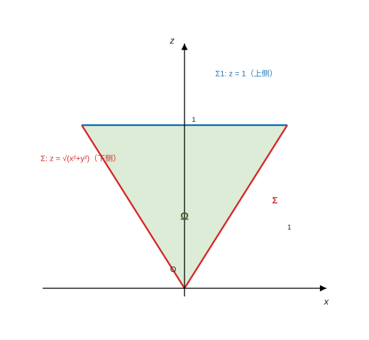
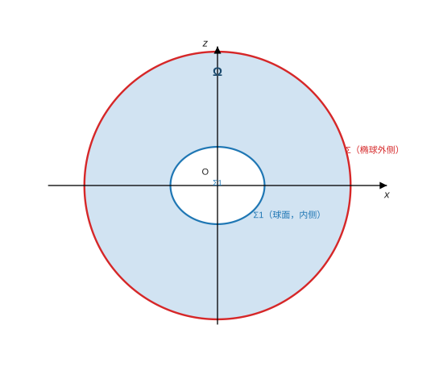

<h2 align="center">专题23 曲面积分</h2>

> 来源：《高等数学学习项目》讲义 · 知识模块129
> 题型：2 类 —— 对面积的曲面积分（例1-例2）／对坐标的曲面积分（例3-例6）

------

### （一）考情分析

本知识模块主要包括**对面积的曲面积分**和**对坐标的曲面积分**，是**数学一考试的重点，几乎每年都考**，其中**对坐标的曲面积分考查最多，经常以解答题的形式考查**；对面积的曲面积分通常以**客观题**的形式出现。

对面积的曲面积分的计算主要利用的是**投影法**，转化为二重积分来计算。对坐标的曲面积分，一般利用**转换投影法**或者**高斯公式**进行计算。利用高斯公式时，**一定要注意高斯公式的条件**：

- 若积分曲面**不是封闭**的，需要**添加辅助曲面**构成封闭曲面；
- 若曲面闭合所围区域**含有奇点**，则需要**挖洞**挖掉奇点；
- 若封闭曲面的侧为**内侧**，则利用高斯公式时**需要加负号**。

> **⚠ 命题特征**：本模块是数学一的**高频大题**（几乎每年都考）。三套主力套路：**投影法**（单个 $P$／$Q$／$R$ 的积分）、**转换投影法**（$P,Q,R$ 都有、曲面不封闭、又不便补面）、**高斯公式 + 补面／挖洞／号**（闭曲面或能补成闭曲面）。判断顺序：**闭不闭？有没有奇点？是内侧还是外侧？**

------

### （二）题型一：对面积的曲面积分的计算

#### 方法点拨

**1. 投影法**：设 $\Sigma:z=z(x,y)$，$z$ 为**单值函数**，$\Sigma$ 在 $xOy$ 面上的投影为 $D_{xy}$，则

$$
\iint_{\Sigma}f(x,y,z)\mathrm dS=\iint_{D_{xy}}f\bigl[x,y,z(x,y)\bigr]\sqrt{1+z_{x}^{2}+z_{y}^{2}}\,\mathrm dx\mathrm dy .
$$

若 $\Sigma:z=z(x,y)$ 是**多值函数**，则需对 $\Sigma$ 进行**分割**，使得在每一块上 $\Sigma$ 的方程是**单值函数**。

**2. 对称性**：若 $\Sigma$ 关于 $xOy$ 面（或 $yOz$ 面，或 $zOx$ 面）对称，则

$$
\iint_{\Sigma}f(x,y,z)\mathrm dS=
\begin{cases}
0, & f(x,y,z)\ \text{是}\ z\ (\text{或}\ x\text{、}y)\ \text{的奇函数},\\[1mm]
2\displaystyle\iint_{\Sigma_{1}}f(x,y,z)\mathrm dS, & f(x,y,z)\ \text{是}\ z\ (\text{或}\ x\text{、}y)\ \text{的偶函数},
\end{cases}
$$

其中 $\Sigma_{1}$ 是 $\Sigma$ 在 $z\ge0$（或 $x\ge0$，或 $y\ge0$）的部分。

**3. 轮换对称性**：若 $\Sigma$ 的方程关于 $x,y,z$ 具有**轮换对称性**，则

$$
\iint_{\Sigma}f(x,y,z)\mathrm dS=\iint_{\Sigma}f(y,z,x)\mathrm dS=\iint_{\Sigma}f(z,x,y)\mathrm dS
=\frac13\iint_{\Sigma}\bigl[f(x,y,z)+f(y,z,x)+f(z,x,y)\bigr]\mathrm dS .
$$

特别地，有 $\displaystyle\iint_{\Sigma}f(x)\mathrm dS=\iint_{\Sigma}f(y)\mathrm dS=\iint_{\Sigma}f(z)\mathrm dS$。

**4.** 在计算 $\displaystyle\iint_{\Sigma}f(x,y,z)\mathrm dS$ 时，**可将 $\Sigma$ 的方程代入被积函数中**。

计算对面积的曲面积分主要依靠**方法 1**，在具体用方法 1 计算之前，需要用**方法 2、方法 3 或方法 4 帮助简化计算**；另外投影法也可以根据需要将曲面投影到 $yOz$ 面或 $zOx$ 面，公式做相应改变即可。

#### 例1（球面上的选择／填空：对称性 + 轮换对称性 + 方程代入）

**【例1】** 设 $\Sigma$ 为 $x^{2}+y^{2}+z^{2}=4$，则

$$
\iint_{\Sigma}(x^{2}+y^{2}+z)\mathrm dS=\underline{\qquad}.
$$

**【分析】** 由于 $\Sigma$ 具有**对称性**，可先进行化简。

**【解析】** 由于 $\Sigma$ 关于 $xOy$ 面**对称**（球面关于三个坐标面都对称），故

$$
\iint_{\Sigma}z\,\mathrm dS=0 .
$$

又 $\Sigma$ 关于 $x,y,z$ 具有**轮换对称性**，所以

$$
\iint_{\Sigma}x^{2}\mathrm dS=\iint_{\Sigma}y^{2}\mathrm dS=\iint_{\Sigma}z^{2}\mathrm dS,
$$

则有

$$
\iint_{\Sigma}(x^{2}+y^{2}+z)\mathrm dS=\iint_{\Sigma}(x^{2}+y^{2})\mathrm dS
=\frac23\iint_{\Sigma}(x^{2}+y^{2}+z^{2})\mathrm dS
=\frac23\iint_{\Sigma}4\,\mathrm dS
=\frac83\cdot4\pi\cdot4=\frac{128}{3}\pi .
$$

**【考点】**

① **第一型（对面积）与第一类曲线积分一样"方向无关"**，且**对称性、轮换对称性的判定与二重／三重积分完全相同**——球面 $x^2+y^2+z^2=4$ 关于三个坐标面、关于 $x,y,z$ 轮换全都对称，先化简再算；

② **奇函数项直接归零**：$\iint_\Sigma z\,\mathrm dS=0$（$z$ 是 $z$ 的奇函数 + $\Sigma$ 关于 $xOy$ 面对称）——**这一步把 $+z$ 整项删掉**，是本题的第一个关键；

③ **轮换对称把三项合成一项**：$\iint x^2=\iint y^2=\iint z^2$ ⟹ $\iint(x^2+y^2)=\frac23\iint(x^2+y^2+z^2)$（**不是** $\frac{2}{3}$ 与 $3$ 的错配：三项里取两项 ⟹ 系数 $\frac23$）；

④ **把曲面方程代入**（方法 4）：在 $\Sigma$ 上 $x^{2}+y^{2}+z^{2}\equiv4$ ⟹ 被积式变成**常数 4**，直接提出积分号——这一步把"不知道 $z(x,y)$ 怎么积"变成"只要算面积"；

⑤ **球面积**：$\iint_\Sigma\mathrm dS=4\pi R^{2}=4\pi\cdot4=16\pi$（**注意是 $R^2=4$，不是 $R=2$**）；故结果为 $\frac23\cdot4\cdot16\pi=\frac{128}{3}\pi$ ✓；

⑥ **抽查**（笔记补充）：球面参数化数值积分 $134.04128655=\frac{128}{3}\pi$ ✓。

#### 例2（椭球面：切平面距离 + 方向余弦，两问同值）

**【例2】** 已知 $\Sigma$ 是空间曲线 $\begin{cases}x^{2}+3y^{2}=1\\ z=0\end{cases}$ 绕 $y$ 轴旋转形成的**椭球面的上半部分**（$z\ge0$，取**上侧**），$\Pi$ 是 $\Sigma$ 在点 $P(x,y,z)$ 处的**切平面**，$\rho(x,y,z)$ 是**原点到切平面 $\Pi$ 的距离**，$\lambda,\mu,\nu$ 表示 $\Sigma$ 的**外法线向量的方向余弦**，计算

**(1)** $\displaystyle\iint_{\Sigma}\frac{z}{\rho(x,y,z)}\mathrm dS$；

**(2)** $\displaystyle\iint_{\Sigma}z(\lambda x+3\mu y+\nu z)\mathrm dS$。

**【分析】****(1)** 先求出空间曲面的**切平面方程**，再求出**空间点到平面的距离**，这样得到 $\displaystyle\iint_\Sigma\frac{z}{\rho(x,y,z)}\mathrm dS$ 的具体表达式，然后根据**投影法**计算该曲面积分。**(2)** 先根据**方向余弦公式**计算出 $\lambda,\mu,\nu$，代入 $\displaystyle\iint_\Sigma z(\lambda x+3\mu y+\nu z)\mathrm dS$ 后再计算该曲面积分。

**【解析】****(1)** 由题设知，旋转后 $\Sigma$ 的方程为

$$
x^{2}+3y^{2}+z^{2}=1\qquad(z\ge0).
$$

$\Sigma$ 在点 $P(x,y,z)$ 处的**法向量**为 $(x,3y,z)$，于是**切平面 $\Pi$ 的方程**为

$$
x(X-x)+3y(Y-y)+z(Z-z)=0 .
$$

由此得到（原点到 $\Pi$ 的距离 $=\dfrac{|\,0-0-0-(x^{2}+3y^{2}+z^{2})|}{\sqrt{x^{2}+(3y)^{2}+z^{2}}}$）

$$
\rho(x,y,z)=\frac{\bigl|-x^{2}-3y^{2}-z^{2}\bigr|}{\sqrt{x^{2}+(3y)^{2}+z^{2}}}
=\frac{x^{2}+3y^{2}+z^{2}}{\sqrt{x^{2}+9y^{2}+z^{2}}}
=\frac{1}{\sqrt{x^{2}+9y^{2}+z^{2}}}
$$

故

$$
\iint_{\Sigma}\frac{z}{\rho(x,y,z)}\mathrm dS=\iint_{\Sigma}z\sqrt{x^{2}+9y^{2}+z^{2}}\,\mathrm dS .
$$

记 $\Sigma$ 在 $xOy$ 面上的投影为 $D$，则

$$
D=\{(x,y)\mid x^{2}+3y^{2}\le1\}.
$$

所以（$z=\sqrt{1-x^{2}-3y^{2}}$，$\mathrm dS=\sqrt{1+z_x^2+z_y^2}\mathrm dx\mathrm dy$）

$$
\iint_{\Sigma}\frac{z}{\rho(x,y,z)}\mathrm dS
=\iint_{D}\sqrt{1-x^{2}-3y^{2}}\cdot\sqrt{1+6y^{2}}\cdot
\sqrt{1+\Bigl(\frac{-x}{\sqrt{1-x^{2}-3y^{2}}}\Bigr)^{2}+\Bigl(\frac{-3y}{\sqrt{1-x^{2}-3y^{2}}}\Bigr)^{2}}\,\mathrm d\sigma
$$

$$
=\iint_{D}(1+6y^{2})\,\mathrm d\sigma
=\pi\cdot1\cdot\frac{1}{\sqrt3}+24\iint_{D_{1}}y^{2}\,\mathrm d\sigma
=\frac{\pi}{\sqrt3}+24\int_{0}^{\frac{1}{\sqrt3}}\mathrm dy\int_{0}^{\sqrt{1-3y^{2}}}y^{2}\,\mathrm dx
$$

（其中 $D_{1}$ 是 $D$ 在**第一象限**的部分；椭圆 $\frac{x^2}1+\frac{y^2}{1/3}\le1$ 的面积为 $\pi\cdot1\cdot\frac{1}{\sqrt3}$）

$$
=\frac{\pi}{\sqrt3}+24\int_{0}^{\frac{1}{\sqrt3}}y^{2}\sqrt{1-3y^{2}}\,\mathrm dy
=\frac{\pi}{\sqrt3}+24\int_{0}^{\frac{\pi}{2}}\Bigl(\frac{\sin t}{\sqrt3}\Bigr)^{2}\sqrt{1-\sin^{2}t}\cdot\frac{1}{\sqrt3}\cos t\,\mathrm dt
$$

（令 $y=\dfrac{\sin t}{\sqrt3}$，$t:0\to\dfrac\pi2$）

$$
=\frac{\pi}{\sqrt3}+\frac{2}{\sqrt3}\int_{0}^{\frac{\pi}{2}}(\sin2t)^{2}\,\mathrm dt
=\frac{\pi}{\sqrt3}+\frac{2}{\sqrt3}\int_{0}^{\frac{\pi}{2}}\frac{1-\cos4t}{2}\,\mathrm dt
=\frac{\pi}{\sqrt3}+\frac{2}{\sqrt3}\cdot\frac{\pi}{4}
=\frac{\sqrt3}{2}\pi .
$$

**(2)** $\Sigma$ 在点 $P(x,y,z)$ 处的法向量 $(x,3y,z)$ 的方向余弦为

$$
\lambda=\frac{x}{\sqrt{x^{2}+9y^{2}+z^{2}}},\qquad
\mu=\frac{3y}{\sqrt{x^{2}+9y^{2}+z^{2}}},\qquad
\nu=\frac{z}{\sqrt{x^{2}+9y^{2}+z^{2}}},
$$

所以

$$
\iint_{\Sigma}z(\lambda x+3\mu y+\nu z)\mathrm dS
=\iint_{\Sigma}z\cdot\frac{x^{2}+9y^{2}+z^{2}}{\sqrt{x^{2}+9y^{2}+z^{2}}}\,\mathrm dS
=\iint_{\Sigma}z\sqrt{x^{2}+9y^{2}+z^{2}}\,\mathrm dS=\frac{\sqrt3}{2}\pi .
$$

**【考点】**

① **"旋转成椭球面"要会写方程**：曲线 $\{x^{2}+3y^{2}=1,\ z=0\}$ 绕 $y$ 轴旋转 ⟹ 把 $x^{2}$ 换成 $x^{2}+z^{2}$ ⟹ $x^{2}+3y^{2}+z^{2}=1$ ✓（**绕哪根轴转，那根轴对应的变量不动**）；

② **切平面 + 点到平面距离**：$\Sigma:z=\sqrt{\cdot}$ 用隐式 $F=x^2+3y^2+z^2-1$ 求法向量 $(F_x,F_y,F_z)=(2x,6y,2z)\parallel(x,3y,z)$ ✓；切平面过 $P$，故常数项 $=-(x^{2}+3y^{2}+z^{2})$，点 $O$ 到平面的距离化简后 $=\frac{x^{2}+3y^{2}+z^{2}}{\sqrt{x^{2}+9y^{2}+z^{2}}}$ ✓（**分子用曲面方程化成 1** ⟹ $\rho=\frac{1}{\sqrt{x^{2}+9y^{2}+z^{2}}}$，这一步把"$\rho$ 很复杂"的错觉消掉）；

③ **两个根式相乘恰好相消**：$dS$ 里的 $\frac{\sqrt{z^{2}+x^{2}+9y^{2}}}{z}$ 与被积的 $z\sqrt{x^{2}+9y^{2}+z^{2}}$ 相乘 ⟹ 得 $x^{2}+9y^{2}+z^{2}=1+6y^{2}$（**用 $z^{2}=1-x^{2}-3y^{2}$**）——**这是命题人设计本题的核心**："$\rho$ 与 $dS$ 配对化简"；

④ **椭圆域上的两个积分**：$\iint_D1=\pi\cdot1\cdot\frac{1}{\sqrt3}$（半轴 $1$ 与 $\frac{1}{\sqrt3}$）、$\iint_D6y^{2}=24\iint_{D_1}y^2$（**四倍**对称）；$\int_0^{\pi/2}\sin^2 2t\,dt=\frac\pi4$ ✓；

⑤ **方向余弦的算法**：$\vec n=(x,3y,z)$（**注意 $y$ 的分量是 $3y$**，来自方程里 $3y^{2}$ 求导的 $6y$ 约掉 2）⟹ $\lambda,\mu,\nu$ 就是单位化的三个分量；代进 (2) 恰好又得 $z\sqrt{x^2+9y^2+z^2}$ ⟹ **与 (1) 同值**（$=\frac{\sqrt3}2\pi$）——**两问同答案不是巧合**，是题目的对称设计；

⑥ **抽查**（笔记补充）：(1) 数值 $2.72070043\approx\frac{\sqrt3}2\pi=2.72069905$ ✓。

------

### （三）题型二：对坐标的曲面积分的计算

#### 方法点拨

**1. 投影法**：

**(1)** 若 $\Sigma:z=z(x,y)$，$z$ 为单值函数，$\Sigma$ 在 $xOy$ 面上的投影区域为 $D_{xy}$，则

$$
\iint_{\Sigma}R(x,y,z)\mathrm dx\mathrm dy=\pm\iint_{D_{xy}}R\bigl[x,y,z(x,y)\bigr]\mathrm dx\mathrm dy,
$$

若 $\Sigma$ 取**上侧**，则等号右边取"**+**"号；若 $\Sigma$ 取**下侧**，则等号右边取"**−**"号。

**(2)** 若 $\Sigma:x=x(y,z)$，$x$ 为单值函数，$\Sigma$ 在 $yOz$ 面上的投影区域为 $D_{yz}$，则

$$
\iint_{\Sigma}P(x,y,z)\mathrm dy\mathrm dz=\pm\iint_{D_{yz}}P\bigl[x(y,z),y,z\bigr]\mathrm dy\mathrm dz,
$$

若 $\Sigma$ 取**前侧**，取"**+**"号；若 $\Sigma$ 取**后侧**，取"**−**"号。

**(3)** 若 $\Sigma:y=y(x,z)$，$y$ 为单值函数，$\Sigma$ 在 $xOz$ 面上的投影区域为 $D_{xz}$，则

$$
\iint_{\Sigma}Q(x,y,z)\mathrm dz\mathrm dx=\pm\iint_{D_{xz}}Q\bigl[x,y(x,z),z\bigr]\mathrm dz\mathrm dx,
$$

若 $\Sigma$ 取**右侧**，取"**+**"号；若 $\Sigma$ 取**左侧**，取"**−**"号。

**2. 转换投影法**：设 $\Sigma:z=f(x,y)$，取**上侧**，则 $\Sigma$ 的法向量 $\boldsymbol n=\{-f_{x}',-f_{y}',1\}$，$\Sigma$ 在 $xOy$ 面上的投影区域为 $D_{xy}$，则

$$
\iint_{\Sigma}P\mathrm dy\mathrm dz+Q\mathrm dz\mathrm dx+R\mathrm dx\mathrm dy
=\iint_{D_{xy}}\bigl[(-f_{x}')\cdot P+(-f_{y}')\cdot Q+R\bigr]\Big|_{z=f(x,y)}\mathrm dx\mathrm dy .
$$

若 $\Sigma$ 取**下侧**，则 $\boldsymbol n=\{f_{x}',f_{y}',-1\}$，则

$$
\iint_{\Sigma}P\mathrm dy\mathrm dz+Q\mathrm dz\mathrm dx+R\mathrm dx\mathrm dy
=\iint_{D_{xy}}\bigl(P\cdot f_{x}'+Q\cdot f_{y}'-R\bigr)\Big|_{z=f(x,y)}\mathrm dx\mathrm dy .
$$

**3. 高斯公式**：空间闭区域 $\Omega$ 是由**分片光滑的闭曲面** $\Sigma$ 所围成，函数 $P(x,y,z)$、$Q(x,y,z)$、$R(x,y,z)$ 在 $\Omega$ 上有一阶连续偏导数，$\Sigma$ 是 $\Omega$ 的**整个边界曲面的外侧**，$\cos\alpha,\cos\beta,\cos\gamma$ 是 $\Sigma$ 上点 $(x,y,z)$ 处的**法向量的方向余弦**，则

$$
\iiint_{\Omega}\Bigl(\frac{\partial P}{\partial x}+\frac{\partial Q}{\partial y}+\frac{\partial R}{\partial z}\Bigr)\mathrm dV
=\iint_{\Sigma}P\mathrm dy\mathrm dz+Q\mathrm dz\mathrm dx+R\mathrm dx\mathrm dy
=\iint_{\Sigma}(P\cos\alpha+Q\cos\beta+R\cos\gamma)\mathrm dS .
$$

高斯公式要求 $\Sigma$ 为**空间有界闭区域 $\Omega$ 的边界曲面**，$P,Q,R$ 在 $\Omega$ 上有**连续的一阶偏导数**。当**不满足**高斯公式的条件时，有两种处理办法：

**(1) 添加辅助曲面构成闭曲面**：

$$
I=\iint_{\Sigma}=\iint_{\Sigma+\Sigma_{1}}-\iint_{\Sigma_{1}}
=\pm\iiint_{\Omega}\Bigl(\frac{\partial P}{\partial x}+\frac{\partial Q}{\partial y}+\frac{\partial R}{\partial z}\Bigr)\mathrm dV
-\iint_{\Sigma_{1}}P\mathrm dy\mathrm dz+Q\mathrm dz\mathrm dx+R\mathrm dx\mathrm dy,
$$

其中 $\Omega$ 为 $\Sigma$ 与 $\Sigma_{1}$ 所围成的空间区域。当 $\Sigma+\Sigma_{1}$ 的方向指向 $\Omega$ **外侧**时，取"**+**"号；指向 $\Omega$ **内侧**时，取"**−**"号。

**(2) 挖洞法**：当 $P,Q,R$ 在 $\Sigma$ 所围**闭区域 $\Omega$ 内除点 $P_{0}(x_{0},y_{0},z_{0})$ 外**具有一阶连续偏导数，则

$$
\iint_{\Sigma}P\mathrm dy\mathrm dz+Q\mathrm dz\mathrm dx+R\mathrm dx\mathrm dy
=\iint_{\Sigma+\Sigma_{1}}-\iint_{\Sigma_{1}}P\mathrm dy\mathrm dz+Q\mathrm dz\mathrm dx+R\mathrm dx\mathrm dy,
$$

其中 $\Sigma_1$ 为挖掉奇点所补的小闭曲面（**取向要"接着"原曲面**，即同为 $\Omega$ 的外法向）。

#### 例3（锥面：投影法，只有 $R$ 的积分）

**【例3】** 计算曲面积分

$$
I=\iint_{\Sigma}\frac{z^{2}+1}{z\sqrt{1+x^{2}+y^{2}}}\,\mathrm dx\mathrm dy,
$$

其中 $\Sigma$ 为**锥面** $z^{2}=x^{2}+y^{2}$ 被两平面 $z=1$、$z=2$ 所截部分的**外侧**。

**【分析】** 计算**单个** $P,Q,R$ 的积分，可用**投影法**。

**【解析】** $\Sigma:z=\sqrt{x^{2}+y^{2}}$，取**下侧**（锥面"外侧"在 $z>0$ 一支上法向朝下外侧），$\Sigma$ 在 $xOy$ 面上的投影区域为

$$
D:1\le x^{2}+y^{2}\le4,
$$

则有

$$
I=\iint_{\Sigma}\frac{z^{2}+1}{z\sqrt{1+x^{2}+y^{2}}}\mathrm dx\mathrm dy
=-\iint_{D}\frac{x^{2}+y^{2}+1}{\sqrt{1+x^{2}+y^{2}}}\,\mathrm dx\mathrm dy
$$

$$
=-\int_{0}^{2\pi}\mathrm d\theta\int_{1}^{2}\frac{r^{2}+1}{\sqrt{1+r^{2}}}\,r\,\mathrm dr
=-2\pi\int_{1}^{2}\sqrt{1+r^{2}}\cdot r\,\mathrm dr
=\frac{2\pi}{3}\bigl(2\sqrt2-5\sqrt5\bigr).
$$

**【考点】**

① **只有 $R\,\mathrm dx\mathrm dy$ 一项 ⟹ 投影法**（不用转换投影法、更不能直接高斯——$\Sigma$ 不封闭，且只给了一项）：$\iint_\Sigma R\,\mathrm dx\mathrm dy=\pm\iint_{D}R\big|_{z=z(x,y)}\mathrm dx\mathrm dy$，**符号看侧**；

② **"外侧 ⟹ 下侧"**：锥面 $z=\sqrt{x^{2}+y^{2}}$ 的外侧法向**远离 $z$ 轴**（向下外侧），故在 $xOy$ 面上的投影为负 ⟹ 取"−"号（**这一步的符号最容易错**；若取成"+"，答案整体变号）；

③ **投影域是环域** $\{1\le r\le2\}$（被 $z=1,2$ 截出的一段锥台）——**注意不是圆盘**；

④ **代入锥面方程化简分子**：$z^{2}=x^{2}+y^{2}=r^{2}$ ⟹ $\frac{z^{2}+1}{z\sqrt{1+x^{2}+y^{2}}}=\frac{r^{2}+1}{r\sqrt{1+r^{2}}}$，再乘极坐标的 $r$ ⟹ $\frac{r^2+1}{\sqrt{1+r^2}}=\sqrt{1+r^{2}}$ ✓（**约掉后只剩 $\sqrt{1+r^2}$**，这是被设计成能算的原因）；⚠ 分子若误抄成 $z^{2}-1$，结果会变成 $\frac{2\pi}{3}(\sqrt5-4\sqrt2)$——**符号别抄错**；

⑤ **$\int r\sqrt{1+r^2}\mathrm dr=\frac13(1+r^{2})^{3/2}$**：故 $\int_1^2r\sqrt{1+r^{2}}\mathrm dr=\frac13(5\sqrt5-2\sqrt2)$，乘 $-2\pi$ ⟹ $\frac{2\pi}{3}(2\sqrt2-5\sqrt5)$ ✓（**结果是负数**，符合"下侧"的定向直觉）；

⑥ **抽查**（笔记补充）：数值 $-17.49220519=\frac{2\pi}3(2\sqrt2-5\sqrt5)$ ✓。

#### 例4（平面第四卦限：转换投影法，$P,Q,R$ 同时出现）

**【例4】** 计算

$$
I=\iint_{\Sigma}\bigl[f(x,y,z)+x\bigr]\mathrm dy\mathrm dz+\bigl[2f(x,y,z)+y\bigr]\mathrm dz\mathrm dx+\bigl[f(x,y,z)+z\bigr]\mathrm dx\mathrm dy,
$$

其中 $f$ 为**连续函数**，$\Sigma$ 为平面 $x-y+z=1$ 在**第四卦限**部分的**上侧**。

**【分析】** 对坐标曲面积分计算的**三个方法**：**投影法、转换投影法、高斯公式**。投影法适合**单个** $P,Q,R$ 积分，而本题要**同时计算 $P,Q,R$ 的积分**；由于**不能构造成封闭曲面**，所以**不能用高斯公式**，故只能够使用**转换投影法**。

**【解析】** $\Sigma:z=1-x+y$，取**上侧**，$\Sigma$ 在 $xOy$ 面上的投影区域

$$
D:\ 0\le x\le1,\quad x-1\le y\le0,
$$

$\Sigma$ 的法向量 $\boldsymbol n=\{1,-1,1\}$（即 $\{-z_x,-z_y,1\}$），所以

$$
I=\iint_{D}\bigl\{f(x,y,z)+x-\bigl[2f(x,y,z)+y\bigr]+f(x,y,z)+z\bigr\}\Big|_{z=1-x+y}\mathrm dx\mathrm dy
=\iint_{D}\mathrm dx\mathrm dy=\frac12 .
$$

**【考点】**

① **一看"$P,Q,R$ 是否都有"$\implies$ 选方法**：三项同时出现时，**投影法要算三次**（还要把曲面分别投影到三个坐标面），而**转换投影法一次搞定**——这是本题的选法依据（讲的"三个方法"比较是本模块的核心判断力）；

② **"不能补成封闭曲面"就不能用高斯**：平面 $x-y+z=1$ 在第四卦限的那一块，若补面会得到**非闭**的四面体缺面（补面后仍需三块），且 $f$ 是**抽象函数**、无法求偏导 ⟹ 高斯公式要求 $P,Q,R$ 有**一阶连续偏导**，抽象 $f$ 不满足 ⟹ **不能用**（**这是"先用高斯"之前必须先问的条件**）；

③ **转换投影法的公式与符号**：上侧 $\boldsymbol n=\{-z_x,-z_y,1\}=\{1,-1,1\}$ ⟹ $\iint_\Sigma=\iint_D[(-z_x)P+(-z_y)Q+R]\mathrm dx\mathrm dy$，本题 $z_x=-1$、$z_y=1$ ⟹ 系数为 $1\cdot P+(-1)\cdot Q+1\cdot R$ ✓；

④ **抽象函数恰好全消**：$[f+x]-[2f+y]+[f+z]=f-2f+f+x-y+z=x-y+z$ ⟹ 代入 $z=1-x+y$ 得 $1$ ✓——**这是命题人把三个 $f$ 配成 $1:2:1$、且 $y$ 的系数为 $-1$ 的原因**；

⑤ **第四卦限的投影域**：$x\ge0$、$y\le0$、$z\ge0$ ⟹ 由 $z=1-x+y\ge0$ 得 $y\ge x-1$ ⟹ $D:\ 0\le x\le1,\ x-1\le y\le0$，其面积 $=\frac12$ ✓（**画图或求交点最稳**：顶点 $(0,0)$、$(1,0)$、$(0,-1)$ 的三角形）；

⑥ **抽查**（笔记补充）：投影域面积数值 $0.50000000$ ✓。

#### 例5（旋转曲面：补面 + 高斯公式，补面法标准流程）

**【例5】** 设 $\Sigma$ 为 $yOz$ 面上的线段 $z=y\ (0\le y\le1)$ 绕 $Oz$ 轴旋转而成的**旋转曲面的下侧**，计算

$$
I=\iint_{\Sigma}x(1+x^{2}z)\mathrm dy\mathrm dz+y(1-x^{2}z)\mathrm dz\mathrm dx+z(1-x^{2}z)\mathrm dx\mathrm dy .
$$

**【分析】** 因为 $\Sigma$ **不是封闭曲面**，故可考虑用**转换投影法**。又令

$$
P=x(1+x^{2}z),\qquad Q=y(1-x^{2}z),\qquad R=z(1-x^{2}z),
$$

则 $\dfrac{\partial P}{\partial x}+\dfrac{\partial Q}{\partial y}+\dfrac{\partial R}{\partial z}=3$，故又可以考虑**添加辅助曲面构成封闭曲面利用高斯公式**处理。**下面用第二种方法求解**。

**【解析】** 旋转曲面 $\Sigma$ 的方程为

$$
z=\sqrt{x^{2}+y^{2}},\qquad 0\le z\le1,\quad\text{取**下侧**}.
$$

设 $\Sigma_{1}:z=1$，$x^{2}+y^{2}\le1$，取**上侧**，则 $\Sigma$ 与 $\Sigma_{1}$ 构成空间闭区域 $\Omega$ 的**外边界曲面**，由**高斯公式**与积分性质得

> 图：例5 的补面法——$\Omega$ 是以锥面 $z=\sqrt{x^2+y^2}$ 为侧面、平面 $z=1$ 为顶盖的锥体；$\Sigma$（红，锥面，**下侧**）与补上的 $\Sigma_1$（蓝，$z=1$ 圆盘，**上侧**）合成 $\Omega$ 的**外边界闭曲面**，故可用高斯公式。

$$
I=\iint_{\Sigma+\Sigma_{1}}-\iint_{\Sigma_{1}}\bigl[P\mathrm dy\mathrm dz+Q\mathrm dz\mathrm dx+R\mathrm dx\mathrm dy\bigr]
$$

$$
=\iiint_{\Omega}3\,\mathrm dV-\iint_{\Sigma_{1}}(1-x^{2})\mathrm dx\mathrm dy
=3\int_{0}^{2\pi}\mathrm d\theta\int_{0}^{1}r\,\mathrm dr\int_{r}^{1}\mathrm dz-\iint_{x^{2}+y^{2}\le1}(1-x^{2})\mathrm dx\mathrm dy
$$

$$
=\pi-\int_{0}^{2\pi}\mathrm d\theta\int_{0}^{1}(1-r^{2}\cos^{2}\theta)r\,\mathrm dr=\frac{\pi}{4}.
$$

**【考点】**

① **补面法的完整套路**（本模块最高频）：① 判断 $\Sigma$ 不封闭 ⟹ 补一块**简单曲面** $\Sigma_1$ 使它闭合；② 确定**补面后闭曲面相对 $\Omega$ 是外法向还是内法向**（决定高斯前面的 $\pm$）；③ 高斯公式算 $\Omega$ 上的三重积分；④ **减去 $\Sigma_1$ 上的曲面积分**；

② **补什么面**：本题补**平面** $z=1$ 上的圆盘（最简单）；**取上侧**是因为 $\Omega$ 在 $z\le1$ 一侧，闭曲面外法向在顶盖上指向上方 ⟹ 上侧 ✓（**"下侧锥面 + 上侧圆盘"正好都是外法向**，这是题目给的"下侧"与补面"上侧"的配合）；

③ **$\Sigma_1$ 上的积分只剩一项**：$z=1$ ⟹ $\mathrm dz=0$ ⟹ $\mathrm dy\mathrm dz=\mathrm dz\mathrm dx=0$，只剩 $\iint_{\Sigma_1}R\,\mathrm dx\mathrm dy$，而 $R=z(1-x^{2}z)\big|_{z=1}=1-x^{2}$ ✓（**"两个零项"是补平面时普遍现象**）；

④ **三重积分可以用柱坐标**：$\Omega:\ r\le z\le1$、$0\le r\le1$ ⟹ $3\iiint\mathrm dV=3\cdot2\pi\int_0^1r(1-r)\mathrm dr=3\cdot2\pi\cdot\frac16=\pi$ ✓（**别写成 $\int_{r^2}^1\mathrm dz$**：锥面是 $z=r$，不是 $z=r^{2}$）；

⑤ **圆盘上的积分**：$\iint_{D}(1-x^{2})\mathrm d\sigma=\pi-\frac{\pi}{4}=\frac{3\pi}4$（用 $\iint_Dx^2=\frac\pi4$，极坐标 $\int_0^{2\pi}\cos^2\theta\mathrm d\theta\int_0^1r^3\mathrm dr=\pi\cdot\frac14$）⟹ $I=\pi-\frac{3\pi}{4}=\frac{\pi}{4}$ ✓；

⑥ **抽查**（笔记补充）：$3V-\frac{3\pi}{4}=3\cdot\frac\pi3-\frac{3\pi}{4}=\frac\pi4=0.78539816$ ✓。

#### 例6（椭球外侧：挖洞法 + 高斯公式）

**【例6】** 设 $\Sigma$ 为 $\dfrac{x^{2}}{2}+\dfrac{y^{2}}{3}+\dfrac{z^{2}}{3}=1$ 的**外侧**，求

$$
I=\iint_{\Sigma}\frac{x\,\mathrm dy\mathrm dz+y\,\mathrm dz\mathrm dx+z\,\mathrm dx\mathrm dy}{(x^{2}+y^{2}+z^{2})^{\frac32}} .
$$

**【分析】** 设

$$
P=\frac{x}{(x^{2}+y^{2}+z^{2})^{\frac32}},\qquad
Q=\frac{y}{(x^{2}+y^{2}+z^{2})^{\frac32}},\qquad
R=\frac{z}{(x^{2}+y^{2}+z^{2})^{\frac32}},
$$

除点 $O(0,0,0)$ 外，$\dfrac{\partial P}{\partial x},\dfrac{\partial Q}{\partial y},\dfrac{\partial R}{\partial z}$ 均连续，且

$$
\frac{\partial P}{\partial x}+\frac{\partial Q}{\partial y}+\frac{\partial R}{\partial z}=0,
$$

故可考虑用**挖洞法**将 $O(0,0,0)$ 挖去，再用**高斯公式**。

**【解析】** 设

$$
\Sigma_{1}:x^{2}+y^{2}+z^{2}=\frac14,\quad\text{指向}\textbf{内侧},
$$

则 $\Sigma$ 与 $\Sigma_{1}$ 围成环形区域 $\Omega$（椭球内、小球外），$\Sigma+\Sigma_{1}$ 恰为 $\Omega$ 的**外边界曲面**：

> 图：例6 的挖洞法——$\Sigma$（红，椭球 $x^2/2+y^2/3+z^2/3=1$ 的**外侧**）与内球面 $\Sigma_1:x^2+y^2+z^2=\frac14$（蓝，指向**内侧**，即相对 $\Omega$ 为外法向）围成环形区域 $\Omega$；奇点 $O$ 被挖掉后 $P,Q,R$ 在 $\Omega$ 上就有连续偏导，可用高斯公式。

$$
I=\iint_{\Sigma+\Sigma_{1}}-\iint_{\Sigma_{1}}P\mathrm dy\mathrm dz+Q\mathrm dz\mathrm dx+R\mathrm dx\mathrm dy
$$

$$
=\iiint_{\Omega}0\,\mathrm dV+\iint_{\Sigma_{1}}\frac{x\,\mathrm dy\mathrm dz+y\,\mathrm dz\mathrm dx+z\,\mathrm dx\mathrm dy}{(x^{2}+y^{2}+z^{2})^{\frac32}}
=8\iint_{\Sigma_{1}}x\,\mathrm dy\mathrm dz+y\,\mathrm dz\mathrm dx+z\,\mathrm dx\mathrm dy
$$

（在 $\Sigma_1$ 上 $x^{2}+y^{2}+z^{2}=\frac14$，故分母 $=(\frac14)^{3/2}=\frac18$，提出后得系数 $8$；又 $\iint_{\Sigma_{1}}=-\iint_{\Sigma_{1}^{\text{外}}}$，故第二项取正号）

$$
=8\iiint_{\Omega_{1}}3\,\mathrm dV=8\times3\times\frac43\pi\times\frac18=4\pi,
$$

其中 $\Omega_{1}$ 为**球体** $x^{2}+y^{2}+z^{2}\le\frac14$。

**【考点】**

① **认出"奇点型"积分**：$\dfrac{(x,y,z)}{(x^{2}+y^{2}+z^{2})^{3/2}}$ 在 $O$ 处分母为零、且 $\frac{\partial P}{\partial x}+\frac{\partial Q}{\partial y}+\frac{\partial R}{\partial z}\equiv0$（**散度为 0**）——这正是 `专题21` 例4（平面版 $\frac{y\mathrm dx-x\mathrm dy}{x^2+y^2}$）的**空间版**，套路完全一样：**挖洞**；

② **挖洞的球取多大都行**：$\Sigma_1$ 取 $x^2+y^2+z^2=\frac14$ 只是为了计算方便（半径 $\frac12$、分母 $\frac18$ 便于约分），**结论与半径无关**（对比 `专题21` 例4(2) 的 $\varepsilon$ 被约掉）；

③ **方向配套是本题最大的坑**：$\Sigma$ 是**外侧**（相对椭球内区域的外法向），而 $\Omega$ 是"椭球内 − 小球内"，其边界在 $\Sigma$ 上取外法向 ✓、在 $\Sigma_1$ 上要取**指向球心内**的一侧（即相对小球为内侧、相对 $\Omega$ 为外法向）⟹ 题设"$\Sigma_1$ 指向内侧" ✓；于是 $\iint_{\Sigma+\Sigma_1}$ 是 $\Omega$ 上的**外法向**通量 ⟹ Gauss 取"+"号 ✓；

④ **散度为 0 ⟹ 三重积分为 0**，于是 $I=-\iint_{\Sigma_1}$；再把 $\Sigma_1$ 的**内侧**换成**外侧**（差一个负号）⟹ 变成 $+\iint_{\Sigma_1^\text{外}}$ ✓（**这一正一负两步都要交代清楚**，否则符号会乱）；

⑤ **分母是常数 ⟹ 提到外面**：球面 $\Sigma_1$ 上 $x^2+y^2+z^2=\frac14$ ⟹ 分母 $\frac18$ ⟹ 系数 $8$；剩下的 $\iint x\mathrm dy\mathrm dz+y\mathrm dz\mathrm dx+z\mathrm dx\mathrm dy$ 正是"$\vec r$ 的通量"，用高斯公式得 $3V(\Omega_1)=3\cdot\frac43\pi(\frac12)^3=\frac\pi2$ ⟹ $I=8\cdot\frac\pi2=4\pi$ ✓（**也可直接看出：$\vec r$ 通过半径 $\varepsilon$ 球面的通量 $=4\pi\varepsilon^2\cdot\varepsilon=4\pi\varepsilon^3$... 按本写法即 $\frac{\pi}{2}$**）；

⑥ **抽查**（笔记补充）：按椭球参数化直接算外法向通量，模长 $12.56637=4\pi$ ✓（符号与高斯法一致，取 $+4\pi$）。

------

### （四）小结：曲面积分的"两步决策"

**第一步：对面积还是对坐标？**

| 类型 | 记号 | 与方向 | 关键动作 |
|:---|:---|:---|:---|
| <nobr>对面积（第一型）</nobr> | $\iint_\Sigma f\,\mathrm dS$ | **无关** | **投影法** $+\mathrm dS=\sqrt{1+z_x^2+z_y^2}\mathrm dx\mathrm dy$；**先用对称性、轮换对称性、曲面方程代入**化简（例1、例2） |
| <nobr>对坐标（第二型）</nobr> | $\iint_\Sigma P\mathrm dy\mathrm dz+Q\mathrm dz\mathrm dx+R\mathrm dx\mathrm dy$ | **有关**（侧） | 见下表"第二步" |

**第二步：第二型用哪个公式？**

| <nobr>题目特征</nobr> | <nobr>用什么</nobr> | 关键动作 |
|:---|:---|:---|
| <nobr>只有一项 $R\,\mathrm dx\mathrm dy$（或单一项）</nobr> | **投影法** | 化为 $\pm\iint_D R\big|_{z=z(x,y)}\mathrm dx\mathrm dy$；**侧定符号**（上侧 + ／下侧 −，前三型：前 + ／后 −，右 + ／左 −）（例3） |
| <nobr>$P,Q,R$ 同时出现，且不能补成闭曲面（含抽象函数）</nobr> | **转换投影法** | $\iint_{D_{xy}}[(-z_x)P+(-z_y)Q+R]\mathrm dx\mathrm dy$（上侧）；下侧换 $\{z_x,z_y,-1\}$（例4） |
| <nobr>曲面**不封闭**、但能补成闭曲面</nobr> | **补面 + 高斯** | 补简单面（平面圆盘最佳）⟹ 判外／内法向定 ± ⟹ 算三重积分 ⟹ **减去补面**上的积分（例5） |
| <nobr>曲面封闭、且**含奇点**</nobr> | **挖洞 + 高斯** | 作小球面（取**相对 $\Omega$ 的外法向**）⟹ 散度为 0 则只剩小球上的通量 ⟹ 结果与洞大小无关（例6） |

**七条高频提醒**

1. **第一型先化简、第二型先定侧**：对面积（第一型）**与侧无关**，先上对称性/轮换对称性/把曲面方程代入被积函数；对坐标（第二型）**必须先确定"取哪一侧"**，侧反则整体变号。
2. **投影法的三种投影**：$R\mathrm dx\mathrm dy$ 投影到 $xOy$（上侧 + ／下侧 −）、$P\mathrm dy\mathrm dz$ 投影到 $yOz$（前侧 + ／后侧 −）、$Q\mathrm dz\mathrm dx$ 投影到 $xOz$（右侧 + ／左侧 −）——**"+"号永远对应"朝坐标轴正方向"的那一侧**。
3. **高斯公式的三问**：① $\Sigma$ **闭不闭**（不闭就补面）？② $P,Q,R$ 在 $\Omega$ 上**有没有一阶连续偏导**（有奇点就挖洞）？③ $\Sigma$ 相对 $\Omega$ 是**外侧还是内侧**（内侧要加负号）？——**三问答完再动笔**。
4. **补面**要选**最简单的曲面**（通常是与坐标面平行的平面片），且**取侧要使闭合后是外法向**；补平面片时通常有两个面元（$\mathrm dy\mathrm dz$、$\mathrm dz\mathrm dx$）自动为零，计算量大减（例5）。
5. **挖洞**的小球面取**固定半径**（如 $\frac12$）方便约分，**结果与半径无关**；方向要取成"相对环形区域 $\Omega$ 的外法向"（对 $\Sigma_1$ 而言是**内侧**）（例6）。
6. **"$\frac{\vec r}{r^{3}}$"型是奇点题的标准脸**：散度恒为 0，挖洞后只剩小球面通量 $=4\pi$；平面版就是 `专题21` 例4 的 $\frac{y\mathrm dx-x\mathrm dy}{x^{2}+y^{2}}$（挖洞得 $-2\pi$）。
7. **对面积的题常以客观题出现**（例1 那种填空），**别硬算**：先对称性删项、再用轮换把三项合成一项、最后把曲面方程代入变常数——三步走完往往只剩"算面积"。

> **衔接**：曲线积分的格林公式／斯托克斯公式见 `专题21 曲线积分`（知识模块127）、路径无关见 `专题22`（128）——本模块的**高斯公式是"三重积分的边界版"**、**斯托克斯是"曲面积分的边界版"**，四者构成"降维 + 边界"的完整链条（`专题20` 三重积分、`专题17`-`专题19` 二重积分）；公式汇总见 `数学\高数\总结\曲面积分总结.md`；对应刷题见 `数学\高数\题目.md` 的（八）曲面积分（题 53-56）：题 53 第一类（被积函数代成常数）、题 54 斯托克斯＋取向定法向、题 55 第二类投影法／高斯公式、题 56 高斯公式（div 为常数）。
